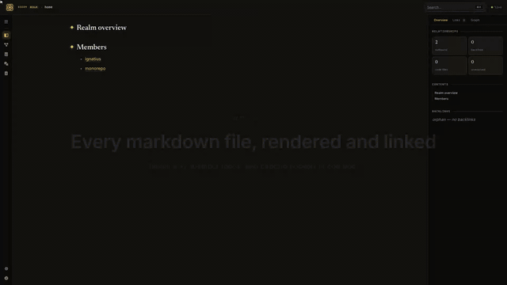

<h1 align="center">Atomic Claude</h1>

<p align="center">
 
</p>

<p align="center">
 <strong>Code graphs, wikis, and research-backed agentic coding. Deterministic tools for nondeterministic workflows, in one opinionated Claude Code config.</strong>
</p>

<p align="center">
 <em>Stop re-explaining your repo to Claude every session.</em>
</p>

<p align="center">
 <a href="docs/guides/install.md">Install</a> &bull;
 <a href="docs/guides/upgrade-7.md">Upgrade from 6.10</a> &bull;
 <a href="docs/reference/concepts.md">Concepts</a> &bull;
 <a href="docs/reference/workflow.md">Workflow</a> &bull;
 <a href="docs/reference/commands.md">Commands</a> &bull;
 <a href="docs/reference/skills.md">Skills</a> &bull;
 <a href="docs/reference/agents.md">Agents</a> &bull;
 <a href="docs/credits.md">Credits</a>
</p>

<p align="center">
 
 <a href="https://github.com/damusix/atomic-claude/releases/latest"></a>
 <a href="./LICENSE"></a>
 <a href="https://deepwiki.com/damusix/atomic-claude"></a>
</p>

<p align="center">
 
</p>

<p align="center">
 <em><code>atomic serve</code>, the whole tour: wiki docs, search, SQL schema, two agents on the bus, plans, and the code graph.</em>
</p>


## 🌟 Features

| Feature | What it does |
|---|---|
| **Repo-aware sessions** | One scan builds a standing map of your codebase that Claude reads before your code, so it stops inventing `npm` scripts. |
| **Multi-harness install** | One authored corpus projects into Claude Code, Oh My Pi (OMP), and Codex CLI through native adapters. `atomic install` detects the harnesses you have; `atomic update` reconverges the ones already enrolled. |
| **Code graph** | A tree-sitter symbol graph across 31 languages and 23 web frameworks answers callers, call sites, and blast radius, no compiler required. |
| **SQL in the graph** | Procedures, views, foreign keys, and lineage across Postgres, MySQL, T-SQL, and Snowflake, plus dbt models and macros, read from `.sql` files with no database connection. |
| **Autopilot** | `/autopilot` plans, implements, and ships a task or issue without routine questions. It opens a PR by default. |
| **Session retrospective** | `/retro` uses your corrections to propose improvements. It changes rules only with your approval. |
| **Inter-session bus** | Concurrent agent sessions message each other over named rooms: delegate work to a peer session, watch or halt a room as the operator. `atomic bus gateway` hosts rooms across machines behind sealed keys. |
| **Persistent REPLs** | Named Python and Node interpreter sessions hold state across separate Bash calls, so agents stop re-running setup code to get back to where they were. |
| **Structured replies** | Tables, trees, and ASCII flows replace walls of prose when they explain faster. |
| **Incremental adoption** | One install; every layer is optional, from clearer replies up to full autopilot. |


## 🚀 Usage

Everything below is opt-in and composes into one lifecycle. Lost? `/atomic-help` reads your git state and names one next command; `/atomic-help tour` walks the whole system.

### Install and harnesses

```bash
curl -fsSL https://raw.githubusercontent.com/damusix/atomic-claude/main/install.sh | bash
atomic install                       # every installed harness: Claude Code, OMP, Codex when CODEX_HOME names an existing directory
atomic install --harness omp         # narrow to one harness
```

Atomic ships one authored corpus — `context/AGENTS.md` plus commands, agents, skills, and rules — and projects it into a harness through a native adapter. Claude Code receives a direct global `CLAUDE.md`, repository and realm `AGENTS.md` loader pairs, native artifacts, and path-scoped rules. OMP receives a profile `AGENTS.md` that keeps its `@` imports, plus the generated extension module, commands, skills, and agent files under the profile's agent root; commands, skills, and rule bodies also ship in `~/.atomic/packages/omp/atomic` as Atomic's corpus store, and agent delivery, output-style selection, package installation, and registration are reported `unsupported` rather than assumed. A bare `atomic install` detects the installed harnesses and prints what it found; `--harness` narrows it to one. `atomic harness list` marks each instance discovered or enrolled, `atomic harness status` reports one target and the shared resources it consumes, `atomic harness repair` reconverges it, and `atomic update` never enrolls a new harness on its own. The one exception is a Claude install an older version wrote: the first `atomic update` adopts it once and, when it meets user content it will not overwrite, stops and names the file. Codex resolves its root from `CODEX_HOME` and receives a managed block in `$CODEX_HOME/AGENTS.md`, its agents, and one generated plugin package that install registers with the `codex` CLI so Codex lists its skills. Codex also receives a `SessionStart` member in `$CODEX_HOME/hooks.json` that adds the session context, and a `PreToolUse` member that delivers wiki cards for edited paths, once you trust each in Codex's `/hooks`; `atomic doctor` reports that trust. Commands, `@` imports, and rule bodies read `WARN unsupported`, and `atomic doctor`'s `codex` category gives each unsupported surface its evidence and a fix. → [install guide](docs/guides/install.md)

### The workflow

```
onboard your repo

  /setup-wiki .......................... audit conventions, scaffold what's missing
  /refresh-wiki ........................ scan + infer: teach Claude the repo's shape

then get to work

  /atomic-plan <desc> .................. design doc + checkpoint spec
    /gather-evidence <hypothesis> ...... chase the hunch through primary sources
    /pressure-test ..................... defend the design in dialogue before it's built
    /challenge-swarm @spec.md .......... parallel expert lenses attack the written spec
  /implement [task or @spec] ........... implement, review, and verify
  Ask to commit, push, open a PR, squash, or merge.
  /autopilot <task|issue#> ............. plan, implement, and ship unattended

clean up what's already there

  /deslop [scope] ..................... audit a change, PR, or standing code
  /cleanup ............................ remove selected session files or worktrees
```

Fresh-context subagents drive the loop as a maker/checker split (Anthropic's evaluator-optimizer pattern): the implementer writes a failing test before any code, the reviewer re-runs tests and gates the diff against the spec, and work commits per green checkpoint. → [workflow](docs/reference/workflow.md)

Shipping, `/report-issue`, and follow-ups use the resolved provider, issue tracker, and worktree location. `atomic workflow resolve` shows the result; `atomic workflow set` overrides one key per profile, realm, or repo. See [workflow preferences](docs/reference/concepts.md#workflow-preferences).

Each phase's working state lives in one `atomic scratchpad` bundle per task — later phases join the same bundle rather than scattering new directories. Bundles sit in the repository's state root, `.atomic/` by default ([resolution order](docs/reference/concepts.md#state-root-resolution-order)); `atomic state migrate` moves Atomic's state out of legacy `.claude` (into `.atomic` by default), and new worktrees go in `.claude/worktrees/` under Claude Code and `.atomic/worktrees/` elsewhere. `atomic serve`'s Plans view lists every bundle and its docs across your worktrees, so you can check what's in flight without `cd`-ing anywhere. → [conventions](docs/reference/conventions.md) · [serve](docs/reference/serve.md)

### Wikis

Wikis are how Claude learns a codebase once instead of every session. Two scopes:

- **Repo wiki**: `docs/wiki/` inside one repository. Build and framework facts, a domain map, cross-cutting notes. Plus one pointer card per domain under `<state-root>/rules/wiki/` (default `.atomic/rules/wiki/`), injected whenever Claude touches a file in that domain.
- **Realm wiki and capture**: a folder holds repos and the material around them. Capture buckets carry indexes; existing realm wiki summaries and concerns remain readable and are maintained by their owners.

```text
~/work/acme/       the realm: repos + the material around them
├─ AGENTS.md       realm rules (plus a thin CLAUDE.md loader) — loaded from any session inside
├─ billing-api/    repo · has its own wiki → linked
├─ gateway/        repo · has its own wiki → linked
├─ vendor-sdk/     repo · no wiki
├─ research/       capture bucket: one folder per item, raw material in 01_raw/
└─ wiki/           realm registry and existing pages
   ├─ index.md     member registry + bucket listing
   ├─ repos/       existing summaries
   └─ concerns/    existing cross-repo notes
```

Use `/setup-wiki` for missing repo setup and `/refresh-wiki` for an on-demand repo wiki refresh. Implementation uses the scan and task diff to update affected documentation before accepting a new baseline.

For a linked realm wiki, exchange edits explicitly with `atomic realm sync`. See the [realm sharing guide](docs/guides/realm-sharing.md), [knowledge base](docs/guides/knowledge-base.md), and [repo wiki](docs/reference/repo-wiki.md).


## 💭 Contributing & feedback

Atomic Claude dogfoods itself: [`context/`](context/) is both the shipped artifact source and the live config this repo runs on. Bugs and ideas are welcome via [Issues](https://github.com/damusix/atomic-claude/issues). To work on the config, see [docs/guides/contributing.md](docs/guides/contributing.md).


## 📖 Further reading

| Topic | Link |
|-------|------|
| Workflow lifecycle | [docs/reference/workflow.md](docs/reference/workflow.md) |
| Commands | [docs/reference/commands.md](docs/reference/commands.md) |
| Skills | [docs/reference/skills.md](docs/reference/skills.md) |
| Agents | [docs/reference/agents.md](docs/reference/agents.md) |
| Output style | [docs/reference/output-style.md](docs/reference/output-style.md) |
| Repo wiki | [docs/reference/repo-wiki.md](docs/reference/repo-wiki.md) |
| Realm wiki | [docs/reference/realm-wiki.md](docs/reference/realm-wiki.md) |
| Bus (inter-session messaging) | [docs/reference/bus.md](docs/reference/bus.md) |
| Bus hosting (rooms across machines) | [docs/guides/bus-hosting.md](docs/guides/bus-hosting.md) |
| REPL (persistent interpreter sessions) | [docs/reference/repl.md](docs/reference/repl.md) |
| Retro (`atomic retro extract`, session history for retrospectives) | [docs/reference/retro.md](docs/reference/retro.md) |
| Docs index (`atomic docs index`, `<bucket-docs>` region for any directory) | [docs/reference/docs-index.md](docs/reference/docs-index.md) |
| Code intelligence | [docs/reference/code-intel.md](docs/reference/code-intel.md) |
| Code-intel MCP setup | [docs/guides/code-intel-mcp.md](docs/guides/code-intel-mcp.md) |
| Concepts (how it flows) | [docs/reference/concepts.md](docs/reference/concepts.md) |
| Conventions | [docs/reference/conventions.md](docs/reference/conventions.md) |
| Install / update / uninstall | [docs/guides/install.md](docs/guides/install.md) |
| Docker evaluation | [docs/guides/evaluations.md](docs/guides/evaluations.md) |
| Contributing | [docs/guides/contributing.md](docs/guides/contributing.md) |
| Credits | [docs/credits.md](docs/credits.md) |
| Specs | [docs/spec/](docs/spec/) |
| Anthropic patterns behind it | [Building Effective Agents](https://www.anthropic.com/engineering/building-effective-agents), [Effective context engineering](https://www.anthropic.com/engineering/effective-context-engineering-for-ai-agents) |


## License

[MIT](LICENSE)
