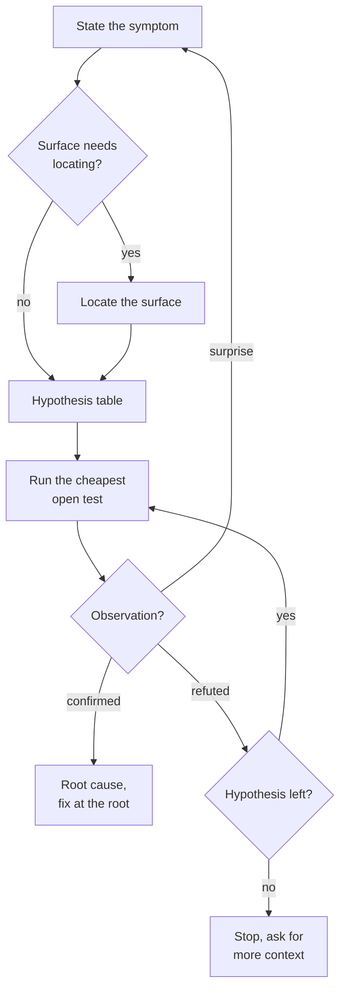

Debug by hypothesis, not by guessing. Cheapest test first. Root cause, not symptom.

<trigger>

Auto-trigger on:

- Error message or stack trace pasted
- "broken", "doesn't work", "failing", "crash", "regression", "flaky"
- Test failure output

Explicit: `/atomic-debug` or "let's debug X".

</trigger>

<workflow>

## Flow

A fix is written only after a test confirms a hypothesis; a refuted one moves to the next open test, and a surprise sends you back to the symptom.



- **State the symptom**: one sentence. Quote the exact error. Note what changed recently (commit, dep, env) if known.

    ```
    Symptom: `POST /users` returns 500 since commit abc1234. Stack: `TypeError: Cannot read 'id' of undefined at users.ts:42`.
    ```

- **Surface needs locating?**: yes when the suspect code is not mapped in the conversation (no `file:line` references, no recent reads of the relevant module). No when the symptom names the exact file:line (e.g. the stack trace pinpoints it), the bug is in code already in context, or the symptom is too abstract to map (e.g. "the build is slow" — there's no surface yet, hypotheses come first).
- **Locate the surface**: code-intel first when an index is present. Try `atomic code explore "<symptom as a natural-language query>"` for a one-shot digest of the failure neighborhood, or `atomic code callers <suspect-fn>` when the symptom names a symbol. One shell command is cheaper than spawning an investigator, and it returns caller-graph context grep would have to reconstruct. When the index is absent or the query returns nothing useful, dispatch `atomic-investigator` before forming the hypothesis table. It is read-only, so it is cheap. Give it a focused brief:

    ```
    Locate <symptom-relevant surface>. Report file:line table.

    Example: "Locate the request pipeline for POST /users — middleware order, body parsing, auth check. Report file:line table."
    ```

    Use its `file:line — what` table as the evidence base for the hypothesis table. The investigator runs in its own context, so the session running this skill keeps its context for the hypothesis work instead of spending it on grep.

- **Hypothesis table**: 3-5 candidates ranked by likelihood × cheapness to test, highest (likelihood / cost) first. Don't list more than 5 — if you have more, you're guessing.

    ```
    | # | Hypothesis | Likelihood | Test cost | Test |
    |---|-----------|-----------|-----------|------|
    | 1 | req.body missing `user` after middleware reorder | high | 1m | log req.body at line 40 |
    | 2 | DB returns null for new user before commit | med | 5m | run failing test in isolation |
    | 3 | Type widening hides null in TS 5.5 upgrade | low | 10m | revert tsconfig strict change |
    ```

- **Run the cheapest open test**: execute the test for the top hypothesis not yet crossed off. Report the observation, exact and unedited. A refuted hypothesis is crossed off and the table updated.
- **Observation?**: a surprise means the mental model is wrong: stop and re-state the symptom.
- **Root cause, fix at the root**: write the root cause as a causal chain:

    ```
    Root cause: middleware order change (commit abc1234) moved `parseBody` after `requireAuth`,
    so `requireAuth` accesses `req.body.user` before it's populated → `undefined` →
    `.id` throws TypeError.
    ```

    ASCII flow diagram if the chain has ≥3 hops:

    ```
    parseBody (moved after) → requireAuth runs → req.body = {} → req.body.user undefined → .id throws
    ```

    If the root cause is a shared symbol, run `atomic code callers <fn>` (when an index is present) to check for other callers that assume the old behavior. A fix that ignores the blast radius leaves related callers broken — list any non-trivial callers in the root-cause statement.

    Propose the minimal fix at the root, not a guard at the symptom. State what regression test will lock the fix in.

    Bad fix: `if (req.body?.user)` guard at line 42.
    Good fix: restore middleware order so `parseBody` runs before `requireAuth`. Add ordering test in middleware-pipeline.test.ts.

    If the user wants the symptom guard anyway (e.g., defense-in-depth), add it ON TOP of the root fix, not instead of.

</workflow>

## Debugging discipline

Stay hypothesis-driven throughout:

- Form a hypothesis before changing anything — "try this and see" is guessing, not debugging
- Fix the root cause, not the symptom — try/catch to silence an error hides the bug
- When reverting commits, identify which specific line caused the regression first
- Verify the fix with evidence before claiming it works (defer to `atomic-verify`)
- Read the surrounding code before proposing a fix — context prevents repeat bugs

<constraints>

## Rules

- One symptom per debug session. If the user reports two unrelated bugs, debug separately. **Why:** mixing symptoms conflates evidence trails — a clue that explains bug A can appear to confirm a hypothesis about bug B, producing a false root cause for both.
- If hypothesis #1 is confirmed, stop. Fix and verify. Exploring remaining hypotheses "for completeness" wastes time on a solved problem. **Why:** continuing past a confirmed root cause risks introducing unrelated changes and inflates the diff without a corresponding bug to fix.
- If every listed hypothesis is refuted (at most 5), the mental model is wrong. Stop and ask for more context (logs, env, recent changes). **Why:** diminishing returns past five refutations signal that the framing is wrong, not the tests — more hypotheses from the same mental model just burn time; fresh context or fresh eyes reset the frame.
- Report cheap signals first: `git log --oneline -20`, `git diff HEAD~5`, exact env, exact reproduction command. **Why:** expensive tests (isolated DB run, full rebuild, bisect) are only worth running once cheap signals have narrowed the search space — running them first wastes time and may dirty the environment before the cheap tests run.

</constraints>
