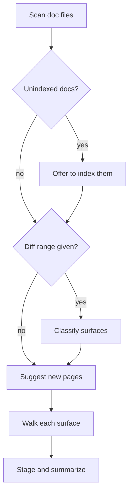
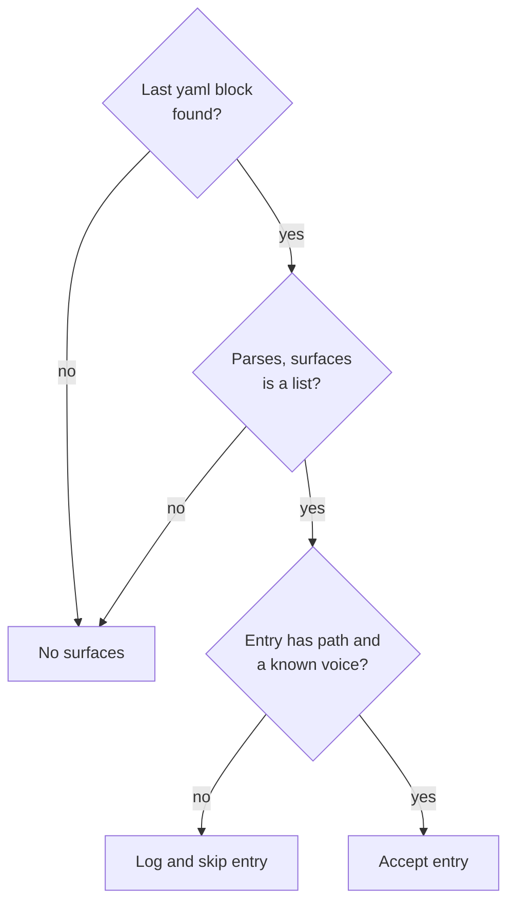

<trigger>

Auto-fires on: "doc this change", "what surfaces does this touch", "doc impact for this diff", "what needs documenting".

Also invoked by `/documentation` (authoring mode) and by ship verbs (maintenance mode, between stage and signals).

</trigger>

This skill reads the project's indexed documentation surfaces, matches a diff against them, and either flags stale/incomplete docs (maintenance mode) or runs the full discovery + generation pipeline (authoring mode). It emits a structured YAML block listing affected surfaces. When the user picks "Yes", it opens the file and makes the edit.

## Two surfaces, one file voice

| Surface | Where | Style |
|---------|-------|-------|
| **How the assistant talks** | TUI replies | Atomic output style: terse, fragments OK, drop articles. Governed by `output-styles/atomic.md`. |
| **How files are written** | All file content | The `atomic-writing` skill, everywhere: README, guides, reference, specs, designs, wiki pages, `AGENTS.md`, and the prompt artifacts under `commands/`, `agents/`, `skills/`, `rules/`. One voice; length is set by what the surface carries. |

There is no separate terse-technical voice. A spec and a README differ in length and structure, not in voice, and either one prefers a diagram over a paragraph when the content has a shape.

## How surface routing works

The skill reads the `## Documentation surfaces` table from the project's instruction files. Search order: a local override file → the shared project steering `AGENTS.md` → any adjacent native loader. First file containing the heading wins.

Expected table format:

```markdown
## Documentation surfaces

| Path | Covers | Voice |
|------|--------|-------|
| `docs/architecture/payments.md` | billing, webhooks, Stripe | atomic-writing |
| `docs/models/README.md` | data model, ERD, migrations | atomic-writing |
| `docs/api/endpoints.md` | REST API, auth, rate limits | atomic-writing |
```

The `Covers` column is the matching key. The skill compares diff file paths and changed symbols against these terms to classify each surface as `stale`, `incomplete`, or `missing`. If no `## Documentation surfaces` section exists in any of the searched files, the skill returns empty surfaces — clean degradation with no false positives.

An optional `**Ownership:**` list may follow the table, each line naming a page and the facts it owns (`- docs/guides/install.md owns the update flags`). When present, it routes duplication: a proposed edit that would restate an owned fact on a sibling page becomes a pointer to the owning page, not a copy. Absent the list, ownership defaults to the page whose `Covers` terms name the fact.

## Two modes

<maintenance_mode>

### Maintenance mode (commit flow — invoked by ship verbs)

Fires automatically during ship verbs after staging, between stage and signals refresh. Reads the indexed surfaces table, matches the staged diff against it, flags affected surfaces. **Never emits `impact_type: missing`** — suggesting new pages during a commit is outside the user's mental context.

Per stale or incomplete surface, prompt the user:

```
docs/models/README.md may be stale.
reason: migration adds refund_status column to orders table
action: update orders entity in ERD, add field to orders table

  [y] Yes — update now
  [l] Later — create a follow-up (atomic followups add)
  [r] Remind me — schedule a reminder (/remind-me flow)
  [s] Skip — no action, no record
```

**Yes** → skill opens the file, reads current content, reads the diff, makes the targeted edit (see Content generation below), stages the file.

**Later** → runs `atomic followups add` with `severity: nit`, `origin: /commit-only doc-impact`, title derived from surface path and diff summary.

**Remind me** → natural-language time inference same as `/remind-me`. Creates a reminder.

**Skip** → no action, no record.

</maintenance_mode>

<authoring_mode>

### Authoring mode (invoked by `/documentation`)

Full pipeline. User opted in to spending time on docs. Diff classification runs only when a range is given; the scan, the new-page suggestions, and the per-surface walk always run.



- **Scan doc files**: `atomic docs scan` (deterministic heading extraction). Lists discovered doc files with H1 + first 3 H2s. On a non-zero exit, print its stderr and stop.
- **Unindexed docs?**: compare the scan against the indexed surfaces table.
- **Offer to index them**: `Found N doc files not in your surfaces table. Add them?`
- **Classify surfaces**: match the range against indexed surfaces as stale, incomplete, or missing.
- **Suggest new pages**: for domains identified by signals with no doc surface and 5+ files (heuristic gate — small utility modules don't need a page).
- **Walk each surface**: with the user, per surface:
    - **Stale/incomplete** → same Yes/Later/Remind/Skip as maintenance mode. "Yes" generates the full content immediately.
    - **Missing** → `[n] New` generates a full page draft (ERDs, flowcharts, prose, tables as appropriate), writes the file, offers to add it to the surfaces table in the project instructions, notes where to link it (index, sidebar, README).
- **Stage and summarize**: stage edited/created files, then emit the summary: edited / deferred / skipped / created.

</authoring_mode>

## Content generation

When the user picks "Yes" (maintenance) or "New" (authoring), the skill opens the file and makes the edit. The user approves — they do not write.

### For stale/incomplete surfaces

Read the current doc file, read the diff, generate a targeted edit:

- **Stale ERD** (migration added a column): find the Mermaid ERD block, add the new field to the entity, find the field table, add the row with type + description.
- **Stale flow diagram** (new step added to a process): find the Mermaid flowchart, insert the new step at the correct position, update any prose description of the flow.
- **Incomplete API reference** (new endpoint added): find the section for the relevant resource, add a row to the endpoint table with method, path, auth, request/response shapes, add an example matching the existing format.

Stage the file after editing.

### For new pages (authoring mode only)

Generate a full draft using the doc type that fits the content:

- **New module with data models** → domain guide: intro sentence, Mermaid ERD, field tables per entity, business rules, edge cases.
- **New API routes** → API reference: endpoint table (method, path, auth, request, response), one example per endpoint.
- **New multi-step process** → flow doc: Mermaid flowchart (happy path → error/edge paths), step descriptions.
- **Architectural decision** → ADR: context, decision, consequences. Short. Point-in-time.

After generating: write the file, offer to add it to the `## Documentation surfaces` table in the project instructions, note where to link it.

### Mermaid generation

Generate full Mermaid syntax — not descriptions. Pick the diagram type:

| Content | Diagram type | When |
|---------|-------------|------|
| Entities and relationships | `erDiagram` | Data model pages, domain guides |
| Multi-step process | `flowchart` | Architecture pages, flow docs |
| Actor interactions | `sequenceDiagram` | Integration docs, API flows |
| State transitions | `stateDiagram-v2` | Lifecycle docs (order states, auth flows) |

Every Mermaid block gets a one-sentence caption above it. When updating an existing diagram, preserve the existing style (orientation, naming, colors) and modify only the changed elements.

### Output quality standards

Generated docs are for humans navigating a codebase. Apply these standards:

- **Short intro sentence** before any detail — tells the reader what the page is about.
- **Tables for structured comparisons** — multiple items with shared attributes always use a table, not a prose list.
- **Categorized sections** — a reader scanning headings should know what each section covers without reading it.
- **Plain language** — "this handles saving and loading user data from the database," not "provides an abstraction layer over the persistence subsystem."
- **Code blocks only for things the user types or sees** — CLI commands, config snippets, API calls. Not for describing behavior.

Quality checks:
- Document *why*, not *what* — restating the code adds no value.
- Break prose with a heading, table, diagram, or code block every ~15 lines.
- Write direct and specific — "This comprehensive guide provides an in-depth overview of..." is AI phrasing. So are "load-bearing", "here's the thing", "it's worth noting", "at its core", "the real question is", and the contrastive reveal ("not X, it's Y"), which stages an insight instead of stating one. Cut the phrase, keep the fact. This check applies to every file surface, prompt artifacts included.
- Note where generated pages should be linked so they're discoverable.
- When updating a doc because the API changed, update all examples too.

<output_format>

## Output contract

After completing analysis, emit as the **final block** of the response a fenced `yaml` block in the shape below. Callers (ship verbs and `/documentation`) parse the **last** `yaml` or `yml` fenced block in the model output. If no yaml block is present, callers treat the response as "no surfaces affected."

```yaml
surfaces:
  - path: docs/models/README.md
    voice: atomic-writing
    impact_type: stale
    reason: migration adds refund_status to orders table
    suggested_change: |
      Add refund_status field to Order entity in ERD.
      Add row to orders field table: refund_status | string | pending/approved/rejected
  - path: docs/api/endpoints.md
    voice: atomic-writing
    impact_type: incomplete
    reason: new POST /payments/refund endpoint added
    suggested_change: |
      Add row to payments endpoint table with method, path, auth, request/response.
```

`voice` is always `atomic-writing`. The field stays in the schema as an explicit pointer to the skill that governs the edit, not as a choice between alternatives.

`impact_type` values: `stale | incomplete | missing`. Maintenance mode never emits `missing`.

Parser contract (caller side): a malformed or absent block reads as "no surfaces", and a bad entry is skipped without aborting the rest.



- **Last yaml block found?**: the last fenced code block tagged `yaml` or `yml` (alias; both accepted) in the model output.
- **Parses, surfaces is a list?**: a parse error, a missing `surfaces` key, or a non-list `surfaces` all mean "no surfaces." Empty `surfaces: []` is valid and means "explicitly nothing to update."
- **Entry has path and a known voice?**: checked per entry; `path` and `voice` are the only required fields.
- **Accept entry**: unknown fields (e.g. `impact_type`, `reason`, `suggested_change`) are accepted.

</output_format>

<constraints>

## Why structured handoff here

This is the only skill in the atomic system that emits a fenced YAML block for callers to parse. Other skills (`atomic-git-discipline`) emit free text that callers act on conversationally. The structured handoff here is justified by one concrete need: per-surface accept/reject prompts in ship verbs require a clear item list — the caller cannot reliably extract a structured list from free-text output. The YAML block provides that list without ambiguity.

Do not apply this pattern to other skills without a similarly concrete need for machine-readable per-item output. When in doubt, emit free text and let the caller act conversationally.

</constraints>
