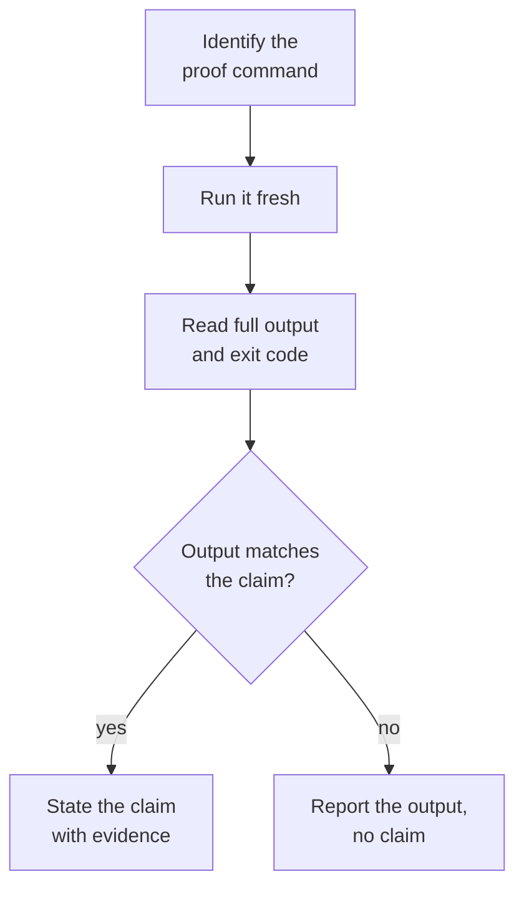

Verify before claim. No claim without fresh evidence in this turn.

<trigger>

- "done", "fixed", "passing", "complete", "ready to merge", "looks good"
- "should work", "should pass", "this works"
- "tests pass", "build green", "lint clean", "typecheck green"
- "bug fixed", "regression resolved"
- Any phrase implying success not preceded by verification output IN THIS TURN.

</trigger>

<workflow>

## The gate

A claim is stated only after a command run fresh in this turn produced output that matches it.

- **Identify the proof command**: the table below names the check for each claim.

Skip any step = lying, not verifying.

## Claim → required check

| Claim | Required verification |
|-------|----------------------|
| tests pass | run test command, see 0 failures |
| build green | run build, exit 0 |
| lint clean | run lint, 0 errors |
| typecheck green | run typecheck (tsc/mypy/etc), 0 errors |
| bug fixed | run repro that failed before, see it pass now |
| agent task complete | check VCS diff for actual changes |
| code I wrote myself is ready | dispatch `atomic-reviewer` (code mode, `diff: working`, one-line `intent:`), 0 unaddressed 🔴 findings, state the `review:` line in the claim |
| regression test works | red → fix → green sequence verified |
| spec/artifact changed | run `atomic validate spec` + `atomic validate config` + `atomic validate artifacts`, 0 FAIL |

`diff: working` tells `atomic-reviewer` to also read untracked files — a new file is the most common shape of an ad-hoc change and never appears in `git diff HEAD`. Resolution is the reviewer's job; see `atomic-reviewer.md`'s code-mode step 2.

## Verification discipline

Every completion claim needs a fresh command run in this turn. Watch for these moments:

- Before saying "done" or "fixed" — run the proof command first
- Before committing or pushing — verify all signals are green
- After a subagent reports success — check the artifacts yourself
- Partial checks (one test out of N) are not verification — run the full suite
- When the change touched `docs/spec/**`, `docs/design/**`, or bundled artifacts (`agents/`, `commands/`, `skills/`, `output-styles/`, `rules/`, `AGENTS.md`), run `atomic validate spec` (when a spec changed), `atomic validate config`, and `atomic validate artifacts`. A FAIL is a gate failure with the same standing as a failing test.

## When tempted to skip

| Temptation | What to do instead |
|-----------|-------------------|
| "Should work" | Run the command. Evidence over confidence. |
| "Linter passed" | Linter ≠ build ≠ tests. Run all applicable checks. |
| "Subagent said success" | Verify the diff yourself. |
| "Partial check is enough" | Run the full suite. Partial proves nothing about the rest. |

</workflow>

<constraints>

## Boundaries

- Fires only when the assistant transitions from "doing" to "asserting done."
- Intent statements ("I'll fix it") are future — no gate needed yet.
- Progress reports ("ran tests, 2 failures") are evidence without a completion claim — no gate needed.

</constraints>
