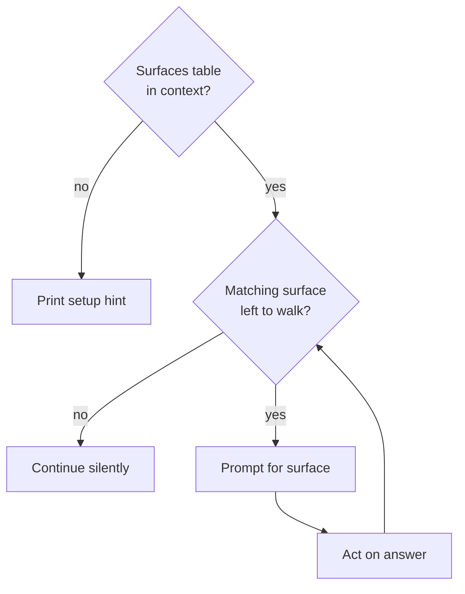

{{define "doc-impact"}}<doc-impact>
Check whether the staged changes affect any indexed documentation surfaces.

Each documentation surface the staged diff makes stale gets its own prompt and the user's answer before the next one, and a repo with no surfaces table or no match passes through without blocking.



- **Surfaces table in context?**: a `## Documentation surfaces` section in the CLAUDE instructions already loaded in context (`CLAUDE.md`, `claude.local.md`, or any `@`-included file).
- **Print setup hint**: print exactly the line below, then skip the rest of this step. No error, no blocking.

    ```
    no documentation surfaces indexed. run /documentation to set up.
    ```

- **Matching surface left to walk?**: run `git diff --cached` and read the output. For each row in the `## Documentation surfaces` table, use LLM judgment to decide whether the staged diff touches the domain described in that row's `Covers` column, making the surface stale or incomplete. Path overlap, changed symbols, and changed domain terms all count. This is a judgment call within the current context window — no separate dispatch. Ignore any surface entry where `impact_type` is `missing`; maintenance mode never suggests new pages.
- **Continue silently**: no output, no prompt.
- **Prompt for surface**: print, then wait for the user's response:

    ```
    doc surface: <path> — <reason the diff makes this stale>
    proposed: <one sentence describing the targeted edit>

      [y] Yes    — update now
      [l] Later  — create a follow-up
      [r] Remind — schedule a reminder
      [s] Skip   — no action
    ```

- **Act on answer**:
    - **Yes** — invoke the `atomic-documentation` skill scoped to this surface. Pass the path, the diff context, and the proposed change as the prompt. The skill opens the file, makes the edit, and stages it with `git add <path>`. Do not move to the next surface until the skill completes.
    - **Later** — run:

        ```
        atomic followups add \
          --id "doc-<slugified-path>-<short-hash>" \
          --title "update <path> — <reason>" \
          --severity nit \
          --origin "ship-verb doc-impact"
        ```

        Use the first 6 characters of the HEAD commit SHA as `<short-hash>`.
    - **Remind** — prompt: `When should I remind you? (e.g. "after the PR", "tomorrow", "end of week")`. Accept natural-language input and invoke `/remind-me <timing> update <path> — <reason>`. Continue without blocking if `CronCreate` is unavailable.
    - **Skip** — no action, no record.

Run doc-impact before signals refresh. **Why:** new or updated doc files appear in the signals scan only if they're staged before the scan runs.
</doc-impact>{{- end}}
