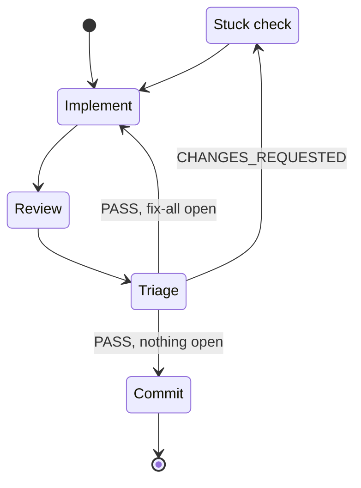

{{- define "implement-loop" -}}
<implement-loop>

## Index

`test -f .claude/.atomic-index/atomic.db` → present: `atomic code sync`; absent: `atomic code index` after a one-line notice. The loop never blocks on the index.

## Scratchpad

Derive a kebab-case `<topic>` from the spec filename or the task.

    atomic repo init >/dev/null
    SCRATCH=$(atomic scratchpad new "<topic>" --purpose <implement|fix>)

Paths come from `atomic scratchpad` / `atomic where --json`; if what is on disk does not match, run `atomic migrate --show-log`. Seed three files from `atomic template brief|state|followups`; fill every `<placeholder>`, delete the guidance comment. Never improvise a skeleton.

| File | Rule |
|------|------|
| `BRIEF.md` | This iteration's scope, success criteria, and reviewer feedback. Overwrite each iteration. Without a spec the `**Spec:**` line reads `no spec — inline brief in BRIEF.md`. |
| `STATE.md` | `Loop base SHA: $(git rev-parse HEAD)` before the first entry. One `## Iteration N` per cycle; never rewrite a prior entry. |
| `FOLLOWUPS.md` | Non-blocking findings (🟡 that did not drive the verdict, 🔵, ❓) as `F-N`, numbered across severities. Append after every reviewer pass, PASS included. Readability 🟡 is never recorded here; it blocks the iteration. |

## Iterate

One iteration per checkpoint. Checkpoints come from the spec's table when one exists, else from the brief. Repeat until the reviewer passes the last one.

A checkpoint commits only on a PASS with nothing left to fix, and every `CHANGES_REQUESTED` goes through the stuck check before the next attempt.

- **Implement**: by the policy's Writer.
    - `atomic-implementer` → dispatch it (`subagent_type: "atomic-implementer"`), fresh context. Mode `surgical` when the iteration touches at most 2 non-test files and is mechanically obvious, else `feature`. Prompt from `atomic prompt implementer`, substituting `{SCRATCH_PATH}`, `{SPEC_PATH}`, `{MODE}`, `{ITERATION_SCOPE}`, `{REVIEWER_FEEDBACK}` (`N/A — first iteration` on the first), `{BASE_SHA}` = HEAD now.
    - `main agent` → write the checkpoint yourself under the `atomic-tdd` skill, run the project's signals, record the commands and results in `STATE.md`. Stay inside the checkpoint.
- **Review**: dispatch `atomic-reviewer` (`subagent_type: "atomic-reviewer"`), fresh context, code mode. Prompt from `atomic prompt reviewer`, substituting `{SCRATCH_PATH}`, `{SPEC_PATH}`, `{BASE_SHA}`. The iteration is uncommitted at this point; the reviewer diffs the working tree against `{BASE_SHA}`. Attach the implementer's report, or say `main agent wrote this`. Never inline the implementer or reviewer prompt.
- **Triage**: read the `VERDICT:` line and append the iteration to `STATE.md`: built, findings, next focus. Non-blockers `ledger` → harvest non-blocking findings into `FOLLOWUPS.md`. Non-blockers `fix-all` → nothing goes to the ledger: on `CHANGES_REQUESTED` every finding is the next focus, and on `PASS` the open 🟡 and 🔵 findings get one more implement→review round. Otherwise, on `CHANGES_REQUESTED` the next focus is every 🔴 and every readability 🟡; readability findings are fixed, never deferred.
- **Stuck check**: stuck means two consecutive `CHANGES_REQUESTED` on the same underlying blocking signal (same root failure, however the reviewer phrases it). Not stuck → the next attempt. Stuck, by the policy's Stuck setting:
    - `ask` → `AskUserQuestion`: continue / `/pressure-test @docs/spec/<topic>.md` (`/pressure-test <task>` without a spec) / dispatch `atomic-strategist` (read-only RCA). Record the choice in `STATE.md`. A strategist run feeds the next `BRIEF.md` and is not an iteration.
    - `auto` → dispatch `atomic-strategist` without asking; fold its findings into the next `BRIEF.md`.

    The check resets when the blocking signal changes.
- **Commit**: when the iteration produced no diff, skip it and say so in `STATE.md`. Otherwise:
    1. Message: the implementer's `## Commit` proposal (the reviewer already checked it), else the `atomic-git-discipline` skill.
    2. Stage the touched files by explicit path. No `-A`.
    3. Commit via HEREDOC. Record the SHA in `STATE.md`.
    4. `atomic code sync` when the index exists.

</implement-loop>
{{- end -}}
