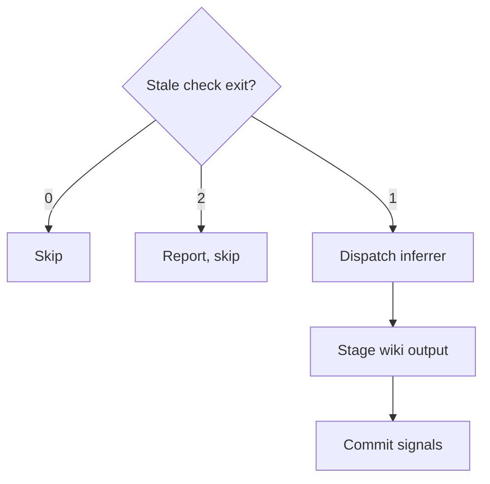

{{- define "loop-finalize" -}}
<loop-finalize>

## Finalize

Once, after the last checkpoint passes. Run the steps the policy's Finalize row names, in this order; skip the rest.

1. **Verify.** Invoke `atomic-verify` and run the full suite yourself. When `docs/spec/**`, `docs/design/**`, or a bundled artifact changed, also run `atomic validate spec` and `atomic validate config`.
2. **Docs.** Invoke `/documentation` in authoring mode, scoped to `<loop-base>..HEAD`, so a capability this change introduced gets its own page rather than a patch to an existing one. A hands-off run answers every surface prompt `Yes` and records what it touched in `STATE.md`. Commit as `docs: <topic>`.
3. **Audit.** Dispatch `atomic-auditor` once with `spec:` (or `brief: $SCRATCH/BRIEF.md`), `range: <loop-base>..HEAD`, `state: $SCRATCH/STATE.md`, `scratch: $SCRATCH`, and the `## Documentation surfaces` table when the project has one. `CHANGES_REQUESTED` → one implement→review→commit iteration against its findings, then continue. Never a second audit.
4. **Follow-ups.** For every open `F-N` in `FOLLOWUPS.md`, ask the user: `fix-now` (one more iteration), `defer`, `issue` (`/report-issue`), or `drop` (state why). `defer` runs `printf '%s' "<body>" | atomic followups add --id <topic>-F-<N> --title "<title>" --severity <risk|nit|question> --origin "<spec or brief>, iter <N> reviewer" --file "<path:line>" --body -` and commits `docs(followups): defer <id>`. Skipped when the ledger is empty.
5. **Log.** When a spec exists, append `## Implementation log` to it from `atomic template implementation-log`: SHAs from `STATE.md`, deferrals from step 4.
6. **Signals.** The flow under **Signals** below.
7. **Report.** What shipped, iterations with SHAs, what was verified and how, the audit verdict, follow-up dispositions, what is left. When the policy omitted the docs step and a touched file matches a row of the project's `## Documentation surfaces` table, end with one line: `/documentation — N doc surfaces may be stale`.

**Signals.** Only exit 1 from the stale check refreshes the wiki, and the refresh lands as its own commit.

- **Stale check exit?**: `atomic signals stale`.
- **Dispatch inferrer**: `atomic-wiki-inferrer` with `mode: silent`, `first_run: false`, `changed_range: <loop-base>..HEAD`.
- **Stage wiki output**: `docs/wiki/*.md`, `[ ! -d .claude/rules/wiki ] || git add -A .claude/rules/wiki/`, and any modified `.gitignore` or `.claude/.gitignore`.
- **Commit signals**: `chore(signals): refresh after <topic>`; record the SHA.

`$SCRATCH` stays; `/git-cleanup` archives it. Do not push, merge, or open a PR unless the policy's Ship row says so.

</loop-finalize>
{{- end -}}
