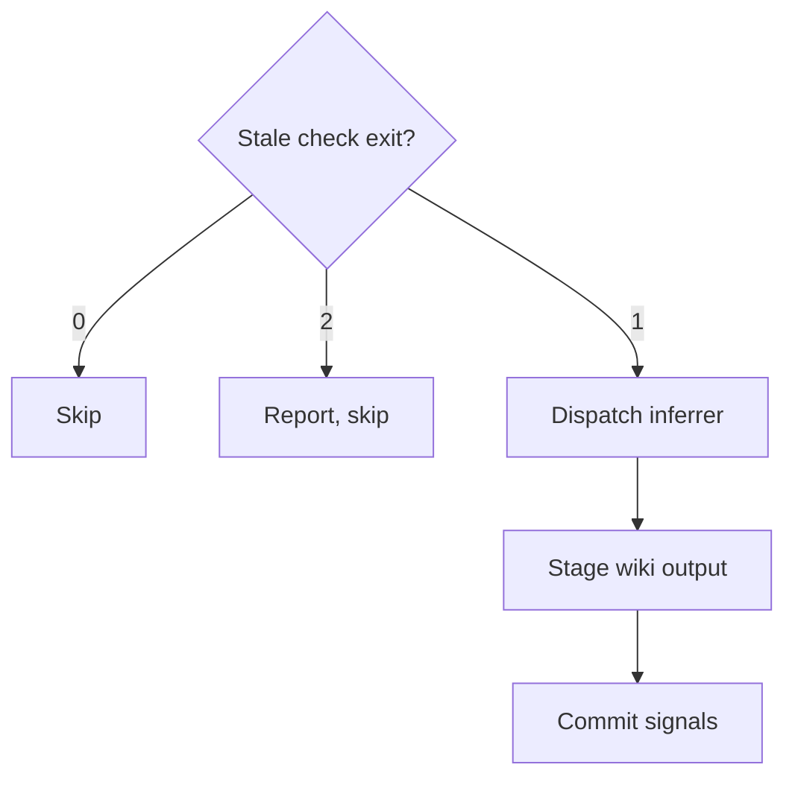

{{- define "loop-finalize" -}}
<loop-finalize>

## Finalize

After the last checkpoint passes, run only the steps in the policy's Finalize row, in the order listed there.

- **Cleanup.** Compare `FOLLOWUPS.md` with the finished checkpoints. Mark duplicate, obsolete, and unsupported findings closed with a reason. Set aside worthwhile out-of-scope findings for the final follow-up offer. Give the Writer one cleanup pass for the remaining in-scope findings, with their `F-N` IDs and the approved scope. Use the normal implementer brief and dispatch; for inline work, retain the original goal and success criteria in the brief for the audit. Commit the cleanup and record the outcome of each item and the verification in `STATE.md` and `FOLLOWUPS.md`. Skip the dispatch if no in-scope findings remain. Do not reopen passed checkpoints or offer their nits to the user.
- **Docs.** Invoke `/documentation` in authoring mode, scoped to `<loop-base>..HEAD`, so a capability this change introduced gets its own page rather than a patch to an existing one. A hands-off or `batch` run accepts in-scope documentation updates without prompting and records what it touched in `STATE.md`. Commit as `docs: <topic>`.
- **Verify.** With `batch`, verify the cleanup and documentation together after the Docs step. For other policies, verify before Docs. Invoke `atomic-verify` and run the full suite yourself. When `docs/spec/**`, `docs/design/**`, or a bundled artifact changed, also run `atomic validate spec`, `atomic validate config`, and `atomic validate artifacts`.
- **Audit.** Dispatch `atomic-auditor` once with `spec:` (or `brief: $SCRATCH/BRIEF.md`), `range: <loop-base>..HEAD`, `state: $SCRATCH/STATE.md`, `scratch: $SCRATCH`, and the `## Documentation surfaces` table when the project has one. `CHANGES_REQUESTED` → one implement→review→commit iteration against its findings, then verify any corrections before continuing. Never a second audit.
- **Follow-ups.** With `batch`, offer only worthwhile out-of-scope items together once, as separate follow-up work. Skip the offer when there are none. Record only the items the user selects for `defer`; do not expand the current implementation. Otherwise, for every open `F-N` in `FOLLOWUPS.md`, ask the user: `fix-now` (one more iteration), `defer`, or `drop` (state why). Include the sink preview in any offer to defer. `defer` records through the **Follow-up sink** below, with id `<topic>-F-<N>`, the entry's title and severity, kind `finding`, origin `<spec or brief>, iter <N> reviewer`, and file `<path:line>`. When the sink wrote a ledger file that Git does not ignore (`git check-ignore -q <path>` exits 1, with `<path>` from the filesystem `issue-create` output), stage `<path>` and the folder's `INDEX.md`, then commit `docs(followups): defer <id>`.
- **Log.** When a spec exists, append `## Implementation log` to it from `atomic template implementation-log`: SHAs from `STATE.md`, and each deferral with its issue URL or key, or its ledger entry id.
- **Signals.** The flow under **Signals** below.
- **Report.** What shipped, iterations with SHAs, what was verified and how, the audit verdict, follow-up dispositions, what is left. When the policy omitted the docs step and a touched file matches a row of the project's `## Documentation surfaces` table, end with one line: `/documentation — N doc surfaces may be stale`.

**Signals.** Only exit 1 from the stale check refreshes the wiki, and the refresh lands as its own commit.

- **Stale check exit?**: `atomic signals stale`.
- **Dispatch inferrer**: `atomic-wiki-inferrer` with `mode: silent`, `first_run: false`, `changed_range: <loop-base>..HEAD`.
- **Stage wiki output**: `docs/wiki/*.md`, `[ ! -d <state-root>/rules/wiki ] || git add -A <state-root>/rules/wiki/` (`<state-root>` is the `state_root` field of `atomic where --json`, `.atomic` by default), and any modified or untracked `.gitignore`, `<state-root>/.gitignore`, `.claude/.gitignore`, `.omp/.gitignore`, `.claude/rules/atomic` (the card link), `AGENTS.md`, or `CLAUDE.md` (the `@-ref` append and its loader). Stage the OMP card links: the symlinks from `find .omp/rules -maxdepth 1 -name 'atomic-wiki-*.md' -type l` (skip when the directory is absent) plus the pruned ones from `git ls-files --deleted -- '.omp/rules/atomic-wiki-*.md'`, each through `git add --`, leaving out any path `git check-ignore -q` reports so `git add` never exits 1. Never stage a regular file there: that is the generated copy kept when the state root lies outside the repository.
- **Commit signals**: `chore(signals): refresh after <topic>`; record the SHA.

{{ template "followup-sink" . }}

`$SCRATCH` stays; `/git-cleanup` archives it. Do not push, merge, or open a PR unless the policy's Ship row says so.

</loop-finalize>
{{- end -}}
