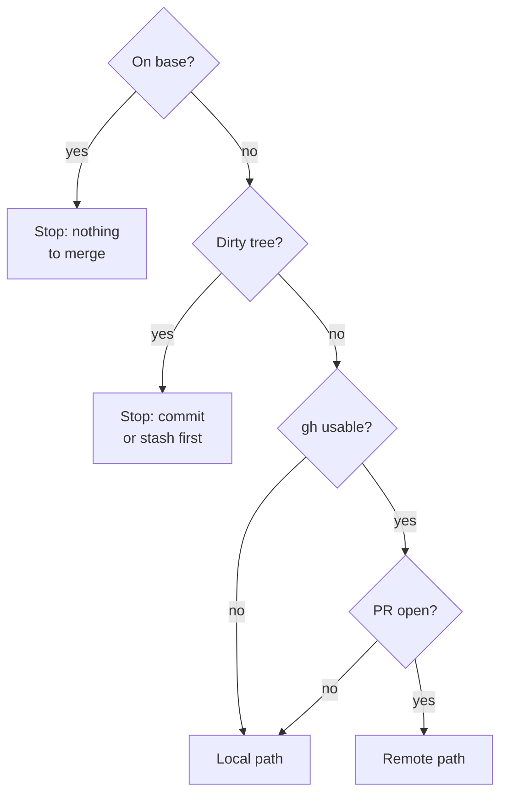
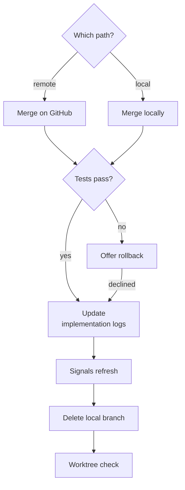

{{define "merge-flow-preflight"}}
<merge-preflight>

Invoke `atomic-verify` to confirm the branch is ready before merging.

A clean feature branch merges through GitHub when it has an open PR, and locally otherwise.



- **On base?**: compare `git branch --show-current` with the base from:
   {{ template "base-resolution" . }}
- **Dirty tree?**: `git status --porcelain`.
- **gh usable?**: `gh` is installed and authed. When it is not, take the local path and say so in a note.
- **PR open?**: `gh pr view --json number,state -q '.state' 2>/dev/null` prints `OPEN`.
- **Remote path**: preferred, because a local merge + push does not auto-close the PR on GitHub — it stays open as "Not merged" indefinitely. `gh pr merge` is the only way to close it cleanly.

</merge-preflight>{{- end}}

{{define "merge-flow-steps"}}
<merge-steps>

Both paths end on a fast-forwarded base with the merge SHA recorded, and a failing test run after the merge offers a rollback that fits the path.



- **Which path?**: the one the preflight chose. Record the feature branch name and PR number (if any) first.
- **Merge on GitHub**: `gh pr merge <PR#> --merge --delete-branch` — server-side merge, auto-closes the PR, removes the remote branch. Then `git checkout <base>`, `git pull`, and `MERGE_SHA=$(git rev-parse HEAD)`.

    `--merge` keeps every commit on the branch, so a changelog generator reads their subjects and the PR title never matters. **`--squash` inverts that**: the title becomes the sole commit subject on the base branch and the branch's own conventional subjects survive only as body bullets, which release-please does not parse for a type. Before any `--squash`, check the title — `gh pr view <PR#> --json title -q .title` — and if it lacks the prefix the base branch's history uses, fix it first with `gh pr edit <PR#> --title '<type>(<scope>): <subject>'`. After the squash it takes a force-push of the base branch to correct, which is the one repair the flow otherwise refuses.
- **Merge locally**: `git checkout <base>`, `git pull`, `git merge <feature>`, then `MERGE_SHA=$(git rev-parse HEAD)`.
- **Offer rollback**: local path → ask about rolling back with `git reset --hard ORIG_HEAD`. Remote path → the merge SHA is already published, so offer `git revert` instead; never force-push the base branch. An accepted rollback ends the flow.
- **Update implementation logs**: find spec files with an `## Implementation log` section in the merged diff:

    ```bash
    git diff --name-only ORIG_HEAD..HEAD | grep '^docs/spec/.*\.md$' | while read f; do
      grep -q '^## Implementation log' "$f" && echo "$f"
    done
    ```

    For each match, append `**Merged into <base> as <MERGE_SHA> — <date>.**`, then stage and commit as a follow-up.
- **Signals refresh**: if signals regenerate, commit as a follow-up: `chore(signals): refresh after merge of <feature>`. Push on the remote path.
    {{ template "signals-gate" . }}
- **Delete local branch**: `git branch -d <feature>`.
- **Worktree check**: {{ template "worktree-cleanup-prompt" . }}

</merge-steps>{{- end}}

{{define "merge-flow"}}
{{ template "merge-flow-preflight" . }}

{{ template "merge-flow-steps" . }}{{- end}}
