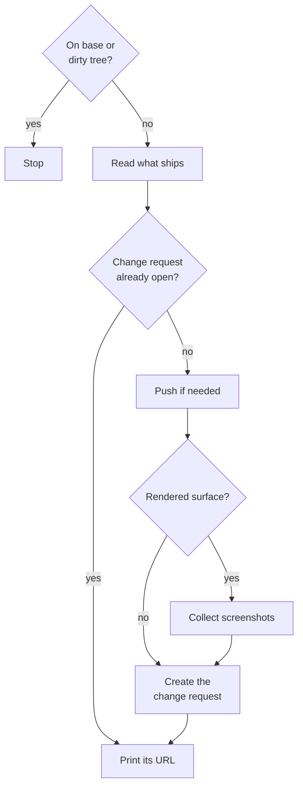

{{define "pr-flow"}}
<pr-flow>

Invoke the `atomic-git-discipline` skill; its PR section owns title and body.

A change request opens only from a clean feature branch with none already open, and screenshots ride along only when the change has a rendered surface.

- **On base or dirty tree?**: branch from `git branch --show-current`, dirty when `git status --porcelain` prints anything, base from:
   {{ template "base-resolution" . }}
- **Stop**: on base, stop. Dirty, tell the user to commit first.
- **Read what ships**: `git log <base>..HEAD --oneline` and `git diff <base>...HEAD --stat`, in parallel.
- **Change request already open?**: the `change-request-view` operation for the current branch returns one.
- **Push if needed**: `git push -u <remote> <branch>` when `<ref>` is missing or HEAD is ahead of it, with `<ref>` and `<remote>` resolved as in push-flow.
- **Rendered surface?**: a UI, a docs-site page, or terminal output.
- **Collect screenshots**: the PNGs the session produced (the task scratchpad, `tmp/`, files the user supplied), or capture them now against the built result. The skill's body carries one `` line per image. Upload them with the `change-request-attach-images` operation, gated by the `push-permission-check` operation: on create when the row allows it, otherwise right after create against the new change request. Ship the body without the image lines, and print why, only when the row gives neither a CLI nor a REST call or a precondition it names fails.
- **Create the change request**: the `change-request-create` operation, with the title and body below and the base from above, then any images the create step could not carry.

    The title is `<type>(<scope>): <imperative, ≤70 chars>` whenever the project uses Conventional Commits, because a squash merge turns it into the commit subject on the base branch and a changelog generator reads nothing else. Confirm with `git log <base> --oneline -20`: conventional subjects there mean the prefix is required here. Type by user-visible impact across the whole change request: `feat:` for new behavior, `fix!:` for anything removed or renamed.
    Body sections: `## Summary` (1-3 bullets), `## What this solves` (1-2 sentences; skip if obvious), then the screenshot lines. No test plan section. Never enumerate changed files or restate the diff; reviewers read the diff. No AI bylines or attribution anywhere in title or body: no "Generated with Claude Code" footer, no `Co-Authored-By: Claude` trailer, no session links. When the create step exits non-zero after printing a URL, the change request exists and an upload failed: retry each failed file with `change-request-attach-images` against that URL, never a second create.

</pr-flow>{{- end}}
