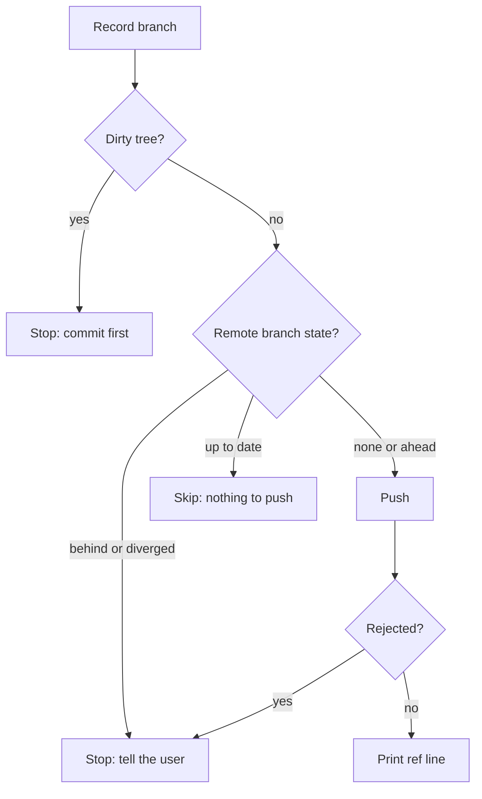

{{define "push-flow"}}
<push-flow>

A clean branch pushes when its remote branch is missing or HEAD is ahead of it, skips when they match, and otherwise stops for the user instead of resolving it here.

- **Record branch**: `git branch --show-current`, then `git log <ref>..HEAD --oneline 2>/dev/null` to show what ships; it prints nothing when `<ref>` does not exist yet.
- **Dirty tree?**: `git status --porcelain`.
- **Remote branch state?**: `<ref>` is `@{u}` when `git rev-parse --abbrev-ref @{u}` prints `<remote>/<branch>`, else `origin/<branch>` with `<remote>` = `origin`, because a branch created from `origin/<base>` tracks the base. `git rev-list --left-right --count <ref>...HEAD` prints `<behind> <ahead>`. An unknown revision is none, `0 <n>` is ahead, `0 0` is up to date, and a nonzero behind count is behind or diverged.
- **Push**: `git push -u <remote> <branch>`.
- **Skip: nothing to push**: on the PR path, pr-flow still runs.
- **Stop: tell the user**: print the behind/ahead count or the rejection; the user decides how to resolve it.
- **Print ref line**: the resulting `<old>..<new> <branch> -> <branch>` line.

</push-flow>{{- end}}
