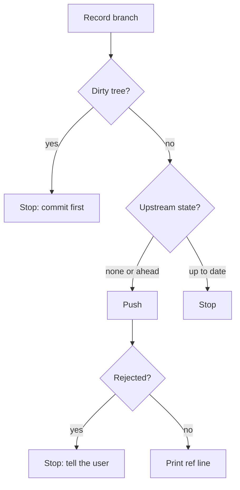

{{define "push-flow"}}
<push-flow>

A push runs only from a clean tree with something to send, and a rejected push stops for the user instead of being resolved here.

- **Record branch**: `git branch --show-current`, then `git log @{u}..HEAD --oneline 2>/dev/null` to show what is about to ship. A branch with no upstream is expected; the push sets it.
- **Dirty tree?**: `git status --porcelain`.
- **Push**: no upstream → `git push -u origin <branch>`; upstream and ahead → `git push`.
- **Stop: tell the user**: a non-fast-forward rejection. The user decides how to resolve it.
- **Print ref line**: the resulting `<old>..<new> <branch> -> <branch>` line.

</push-flow>{{- end}}
