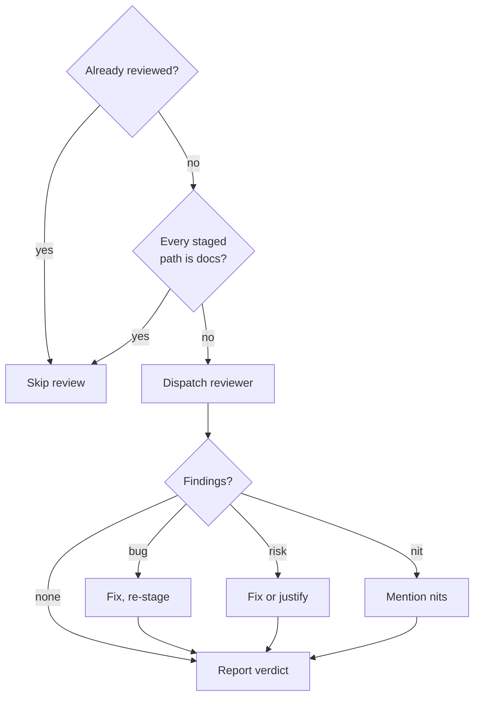

{{define "review-gate"}}<review-gate>
Give code the main agent wrote itself an independent review before it lands.

A change gets one review, skipped when a reviewer already read it or when it is all documentation, and every finding is settled before the commit message is written.

- **Already reviewed?**: yes when any of these holds:
    - The staged work came from `/implement`, `/subagent-implementation`, `/quick-fix`, `/autopilot`, or `/subagent-diagnose` in this session. Each dispatches `atomic-reviewer` per iteration or per checkpoint, so the diff has been read by a fresh context already.
    - This gate already ran on the same change earlier in the flow — a squash of commits the commit-time gate reviewed, or a ship verb escalating after its own commit step. Review once per change, not once per step.
    - The claim gate already reviewed this same tree in this session (`atomic-verify`'s dispatch) and nothing has changed since.
- **Every staged path is docs?**: `git diff --cached --name-only`, judged by the documentation-path test from the signals refresh step of this same flow — same paths, same treatment of bundled artifact `.md` files as source rather than docs. Prose belongs to the doc-impact step, not to a code reviewer.
- **Dispatch reviewer**: `atomic-reviewer` (`subagent_type: "atomic-reviewer"`) in code mode on the staged diff (`diff: staged`), with an explicit model override to the session's model and a one-line `intent:` describing what the change was meant to do. There is no spec for ad-hoc work — say so rather than inventing one; the `intent:` stands in for it.
- **Findings?**: `VERDICT: PASS` with no findings is `none`; otherwise act on each 🔴 bug, 🟡 risk, and 🔵 nit.
- **Fix, re-stage**: fix the 🔴 bug. Do not commit around a red finding.
- **Fix or justify**: fix the 🟡 risk, or state in one line why it stands. Never carry one silently.
- **Mention nits**: 🔵 nits are the user's call; mention them, do not block.
- **Report verdict**: the totals line and `review: <verdict> (atomic-reviewer on <model>)`, to the user, before writing the commit message.

The main agent editing code directly is the third implementation path, alongside the subagent loop and `/quick-fix`. `/implement` is that path run deliberately, and it carries its own per-checkpoint gate; this step covers the same editing done ad-hoc, outside any command. **Why:** the agent that wrote the code is the worst judge of it — it reviews its own reasoning rather than the diff, and every rationalization that produced the bug is still in its context.
</review-gate>{{- end}}
