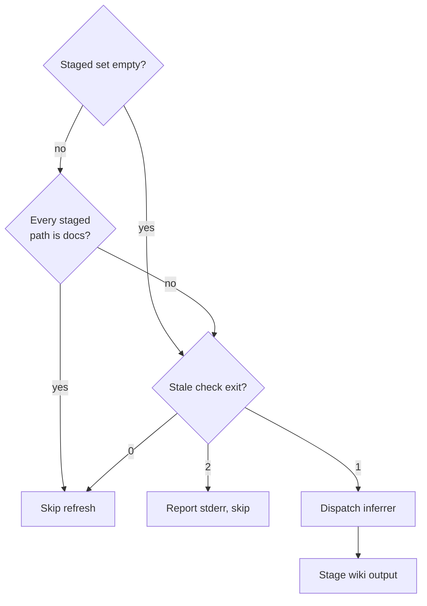

{{define "signals-gate"}}<signals-refresh>
Refresh project signals so the project map stays current for the next session.

A docs-only commit skips the refresh, and otherwise the exit code of `atomic signals stale` alone decides whether the inferrer runs.



- **Staged set empty?**: `git diff --cached --name-only`. The set is empty after a merge or squash, where the commit already landed; an empty set does not mean every path is documentation.
- **Every staged path is docs?**: a path is documentation when it is under a `docs/` directory at any depth, or is a top-level `README*` / `CHANGELOG*` / `CONTRIBUTING*` / `CODE_OF_CONDUCT*` / `SECURITY*` / `LICENSE*`. Any other path — source, config, build files, the steering file (`AGENTS.md`, or the `CLAUDE.md` loader beside it), or any bundled-artifact `.md` under `agents/`, `commands/`, `skills/`, `rules/`, or `output-styles/` — is not documentation. **Why:** the deterministic substrate counts per-language LOC, so a docs-only commit trips `stale` exit 1 and dispatches the inferrer for no real map change. In a config repo the artifact `.md` files are the product, so they must count as source, not docs.
- **Stale check exit?**: `atomic signals stale`. It is content-based: it assembles the deterministic snapshot exactly as a scan would and compares it to `docs/wiki/scan.md`, so a no-op regeneration that only bumps file mtimes stays fresh, and a stored file the implementation phase already refreshed returns 0. Exit 1 makes the refresh mandatory: do not second-guess it with `atomic signals diff`, file counts, or a judgment that "the change was small". The command prints how much would change and the directive; follow it.
- **Report stderr, skip**: exit 2 is an error such as a missing signals file; a refresh cannot run against a missing baseline.
- **Dispatch inferrer**: the `atomic-wiki-inferrer` agent in silent mode, passing the scope's steering so the silent refresh honors the user's corrections instead of falling back to pure inference:

    ```
    mode: silent
    first_run: false

    <steering>
    <contents of docs/wiki/AGENTS.md, or the docs/wiki/CLAUDE.md loader beside it when the shared file is absent, if it exists and is not all comments>
    </steering>
    ```

- **Stage wiki output**: `git add docs/wiki/*.md` for the router, domain files, and `docs/wiki/scan.md`. `scan.md` is committed deliberately — it is the drift-scope diff baseline (`git diff HEAD -- docs/wiki/scan.md`) that `atomic signals stale` and the `<scan-sha>` tiebreaker depend on, and it is not `@-ref`'d, so committing it costs nothing in context. Stage the per-domain pointer cards the agent wrote or deleted with `[ ! -d <state-root>/rules/wiki ] || git add -A <state-root>/rules/wiki/` (the state root is the selected repository-state directory, `.claude` by default); the guard exists because a repo whose wiki has no domain files never creates the directory, and an unguarded `git add -A` on a missing path exits 128. Then run `git status --short -- .gitignore <state-root>/.gitignore` (the state root's own ignore file is `.claude/.gitignore` by default) and `git add` whichever path it reports modified, since the agent reports no paths in silent mode.
</signals-refresh>{{- end}}
