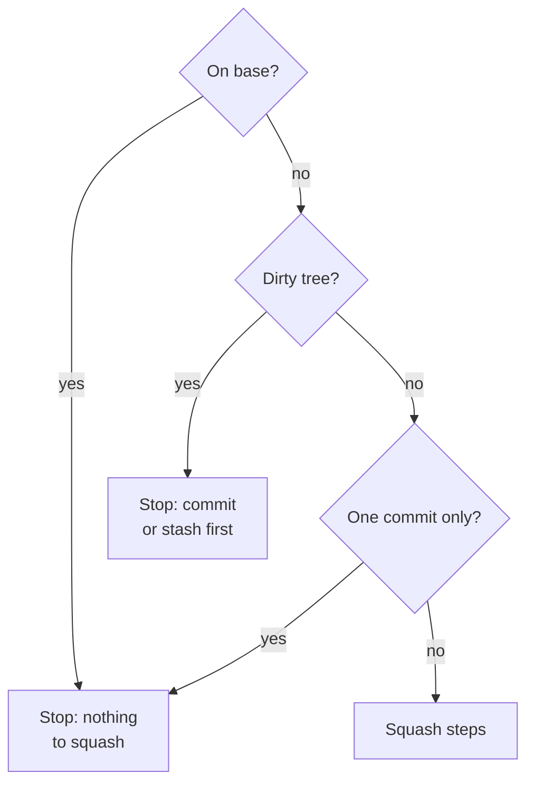

{{define "squash-flow-preflight"}}
<squash-preflight>

A squash runs only on a clean feature branch carrying two or more commits.



- **On base?**: compare `git branch --show-current` with the base from:
   {{ template "base-resolution" . }}
- **Dirty tree?**: `git status --porcelain`.
- **One commit only?**: `git rev-list --count <base>..HEAD` prints `1`.

</squash-preflight>{{- end}}

{{define "squash-flow-steps"}}
<squash-steps>

1. Gather subjects (oldest-first): `SUBJECTS=$(git log <base>..HEAD --format='%s' --reverse)`.
2. **Session reports** — resolve the report dir via `atomic where --json`'s `reports` field (never construct it). If it has `*.md` files, read them chronologically and pass as supplemental why-context alongside `SUBJECTS`. Paths come from `atomic where --json`; if what you find on disk does not match, run `atomic migrate --show-log` for the change history.
3. `git reset --soft $(git merge-base HEAD <base>)` — collapse all branch commits into the index.
4. {{ template "review-gate" . }}
5. {{ template "doc-impact" . }}
6. Invoke `atomic-git-discipline` skill. Pre-fill a Conventional Commits message synthesized from `SUBJECTS` (plus session reports if present). Present for review, then commit via HEREDOC.
7. **Clean up session reports** — on successful commit, delete the `reports`-resolved dir from step 2. If the commit failed, leave them.
8. **Update implementation logs.** Find spec files with an `## Implementation log` section in the squashed diff:
    ```bash
    git show --name-only --pretty=format: HEAD | grep '^docs/spec/.*\.md$' | while read f; do
      grep -q '^## Implementation log' "$f" && echo "$f"
    done
    ```
    For each match, append: `**Squashed to <new-sha> — <date>.** Per-iteration SHAs above are historical (unreachable from any branch).` Stage and commit as a follow-up. If none match, skip.
9. **Post-squash signals refresh:**
    {{ template "signals-gate" . }}
    If signals regenerate, commit as a follow-up: `chore(signals): refresh after squash`.
10. `git status` to confirm.

</squash-steps>{{- end}}

{{define "squash-flow"}}
{{ template "squash-flow-preflight" . }}

{{ template "squash-flow-steps" . }}{{- end}}
