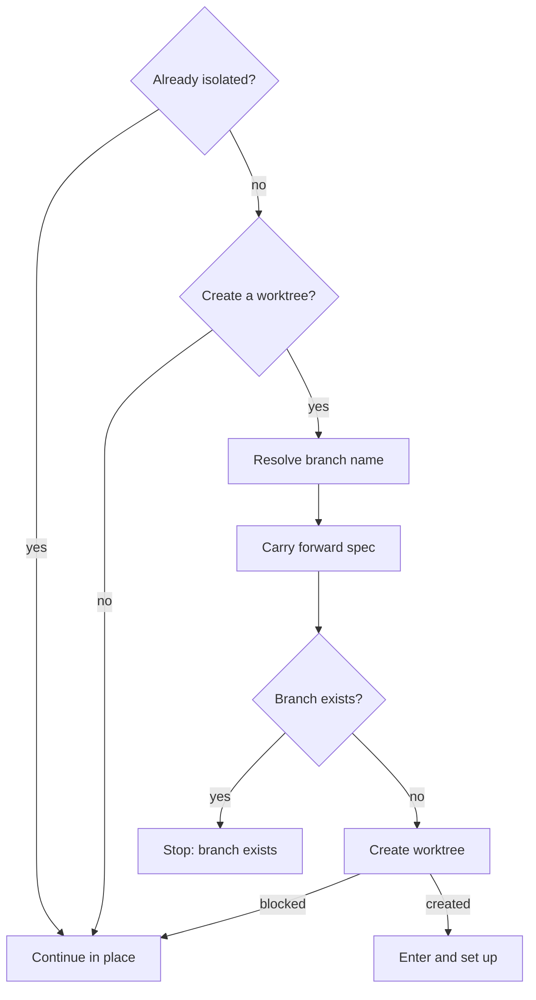
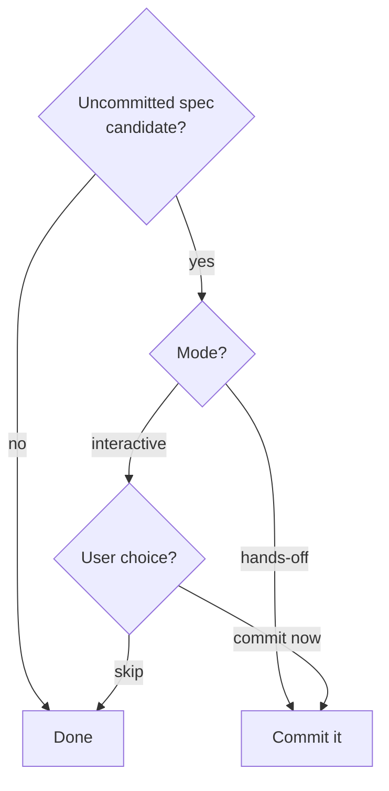
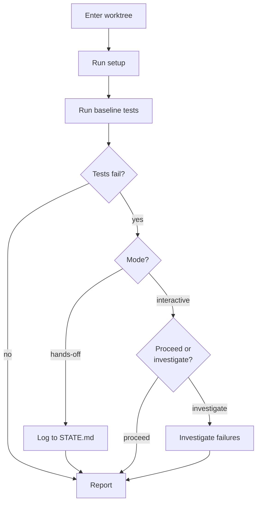

{{- define "worktree-setup" -}}
<worktree-setup>

## Worktree

A new worktree is created only outside existing isolation and on a branch name that is not taken; a taken name stops the flow, and a sandbox or permission block falls back to working in place.



- **Already isolated?**: run in parallel:

    ```bash
    GIT_DIR=$(cd "$(git rev-parse --git-dir)" 2>/dev/null && pwd -P)
    GIT_COMMON=$(cd "$(git rev-parse --git-common-dir)" 2>/dev/null && pwd -P)
    SUPERPROJECT=$(git rev-parse --show-superproject-working-tree 2>/dev/null)
    CURRENT_BRANCH=$(git branch --show-current 2>/dev/null)
    ```

    Isolated when `$GIT_DIR != $GIT_COMMON` and `$SUPERPROJECT` is empty; a non-empty superproject path is a submodule, which counts as a normal repo. When isolated, print:

    ```
    already isolated at <pwd> on branch <branch>. Skipping creation.
    ```

- **Continue in place**: keep the current working tree and skip the rest of this section.
- **Create a worktree?**: hands-off mode (auto-create) answers yes without asking. Interactive mode (ask-if-unspecified) asks the user unless the caller already decided:

    ```
    Significant work ahead. Use an isolated worktree?
    - Yes, new branch → create and enter .claude/worktrees/<derived-name>/
    - No, work in place
    ```

- **Resolve branch name**: the caller passes it (e.g. a topic slug derived from the spec or task). It must match `^[a-z0-9][a-z0-9/-]*$`. With no name available, derive one: kebab-case slug of the first ~6 words of the task description.
- **Carry forward spec**: the flow under **Carry forward spec** below.
- **Branch exists?**: `git rev-parse --verify <branch>` exits 0.
- **Stop: branch exists**: print `branch <name> already exists. pick a different name or checkout existing.` and stop.
- **Create worktree**: run `atomic repo init` first (idempotent; guarantees the `.claude/` layout and its ignore rules), then:

    ```bash
    git worktree add .claude/worktrees/<branch> -b <branch>
    ```

    The explicit `git worktree add` pins the branch name and bases it on the current HEAD, so a just-committed spec is carried forward, which a harness's own worktree command does not guarantee (it may name the branch itself and base it on a configured ref). A permission or sandbox error is `blocked`: print `sandbox blocked worktree creation. working in place.` and run no setup or tests.
- **Enter and set up**: the flow under **Enter and set up** below.

**Carry forward spec.** A worktree branches from `HEAD`, so an uncommitted spec or design is committed first or the implementer cannot read it from the worktree and the loop fails before iteration 1.



- **Uncommitted spec candidate?**: only `docs/spec/` and `docs/design/` files qualify. A candidate is a spec path the caller passed that `git status --porcelain -- <path>` reports untracked or modified, or a `docs/spec/*.md` or `docs/design/*.md` this conversation produced that is untracked or modified and whose basename matches or is closely related to the branch name. Run the flow once per candidate.
- **User choice?**: ask the user, with options `commit now (recommended)` / `skip`:

    ```
    Spec `<path>` is uncommitted. Commit it before creating the worktree so
    the branch carries it forward?
    ```

- **Commit it**: invoke the `atomic-git-discipline` skill for the message, stage the file by explicit path (no `git add -A`), and commit on the current branch (typically `main`).

**Enter and set up.** Setup and baseline tests run inside the worktree, and failing baseline tests are recorded rather than fixed here.



- **Enter worktree**: when the harness exposes a worktree-entry capability, invoke it with the path `.claude/worktrees/<branch>`. The session's working directory is now the worktree, so file edits and shell commands land in it with no `cd`. If no such capability is available, run all subsequent commands from inside the worktree directory.
- **Run setup**: the first match wins.
    - `pnpm-lock.yaml` exists alongside `package.json` → `pnpm install`
    - `yarn.lock` exists alongside `package.json` → `yarn install`
    - `package.json` exists → `npm install`
    - `Cargo.toml` exists → `cargo build`
    - `requirements.txt` exists → `pip install -r requirements.txt`
    - `poetry.lock` exists alongside `pyproject.toml` → `poetry install`
    - `pyproject.toml` exists → `pip install -e .`
    - `go.mod` exists → `go mod download`
    - None matched → skip setup, note as skipped

    A network or permission error notes `setup skipped (sandboxed or no network)` and continues.
- **Run baseline tests**: the first match wins.
    - `pnpm-lock.yaml` + `package.json` with `test` script → `pnpm test`
    - `yarn.lock` + `package.json` with `test` script → `yarn test`
    - `package.json` with `test` script → `npm test`
    - `Cargo.toml` → `cargo test`
    - `pytest.ini` present, or `pyproject.toml` contains `[tool.pytest` → `pytest`
    - `go.mod` → `go test ./...`
    - None matched → skip, note as skipped
- **Log to STATE.md**: list the failures in `STATE.md` and proceed; the reviewer catches regressions.
- **Proceed or investigate?**: list each failure, then ask.
- **Investigate failures**: look into them before continuing to the loop.
- **Report**:

    ```
    Worktree: .claude/worktrees/<branch>/
    Branch:   <branch>
    Setup:    <command run> | skipped (no manifest) | skipped (sandboxed)
    Baseline: <N> tests pass | <N> failures | skipped
    Ready.
    ```

</worktree-setup>
{{- end -}}
