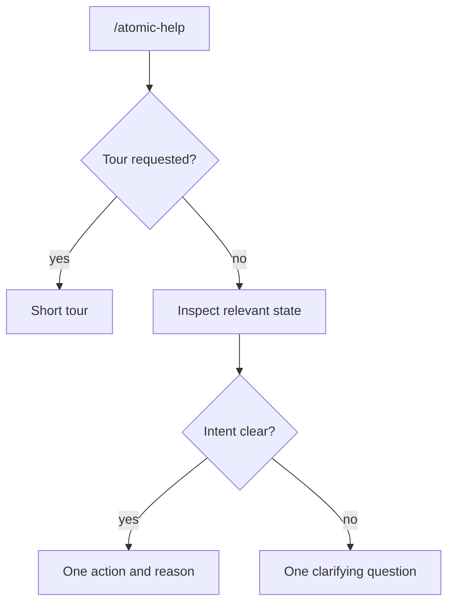

Route `/atomic-help` to one next action and one reason. Accept an empty argument, a topic, or freeform intent. Do not execute the recommended action.

The user's intent takes precedence; repository state supplies evidence, not a substitute for their goal.



## Inspect and route

- Check only state relevant to the request. For repository work, use read-only Git probes for the worktree, branch, status, and, when needed, commits ahead of the base. Inspect a scratchpad or spec only when it could identify the work to resume. A failed probe is unknown, not evidence that a repo, spec, or work is absent.
- An active scratchpad or spec supports resuming `/implement` only when it matches the user's work. A dirty tree or an existing spec does not by itself establish what the user wants, whether work is ready, or whether it should be committed.
- For an explicit goal, recommend one existing command, skill, or plain-language action. Use `atomic-debug` for an unknown failure and `/implement` for a known fix. Use `/review-branch` for correctness and `/deslop` for avoidable complexity in a change or standing code. Recommend only the Git action the user requested.
- With no stated goal, use relevant active work as a signal. If no single action follows from the evidence, ask one concise clarifying question instead of inventing a task. Outside a repository, do not recommend `git init` unless the user intends to create one.
- If a topic names a command, direct the user to that command or its reference. If the topic is ambiguous, ask one question. Do not print a catalog or offer a tour automatically.

For exact slash-command syntax, consult `docs/reference/commands.md` or the installed command in `~/.claude/commands/`. For skills and agents, use `docs/reference/skills.md` and `docs/reference/agents.md`. For CLI syntax, use `atomic --help` or `atomic <verb> --help`; consult the relevant page under `docs/reference/` for details. These references are the source of truth, not a copied command list.

## Tour

Only when the user explicitly requests a tour, including `tour`, `--tour`, or `walkthrough`, give a short overview: Atomic uses commands for workflows, skills for disciplines, agents for delegated work, and the `atomic` CLI for tools and context. Mention `/atomic-plan` and `/implement` as examples, and point to `docs/reference/workflow.md` and `docs/reference/commands.md` for details. Do not start an automatic multi-stage walkthrough.

## Response

For routing, give one action and one reason, with no alternatives or preamble:

```text
recommend: <one action>
why: <one reason grounded in intent or observed state>
```

If the action cannot be chosen without more information, ask one clarifying question instead. State a relevant failed probe without treating it as a result.
