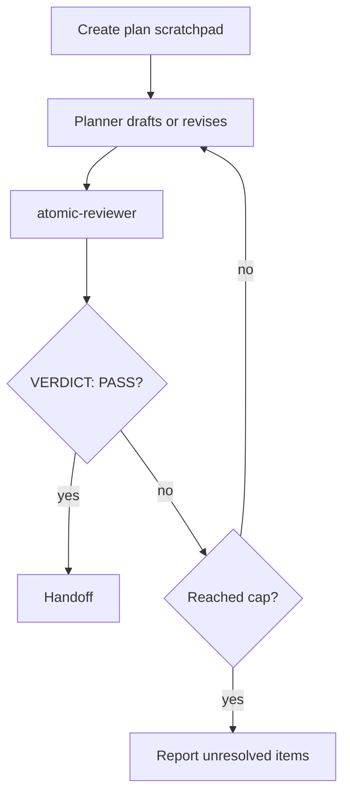

Plan only. Keep decisions in `docs/design/<topic>.md`. For a full plan, create the task scratchpad before drafting and use its `SPEC.md` for the implementation contract. Never commit that file. Use a short kebab-case topic without a date.

## Choose the route

| Tier | Signals | Action |
|---|---|---|
| Trivial | One cohesive change in at most 3 files, one obvious approach, no new module or change to architecture, business rules, or a public contract | State why it is trivial and write the spec yourself. You may offer to implement directly instead. |
| Borderline | 4–8 files, unfamiliar subsystem, a small design choice, or unresolved scope | Recommend full, inline, or abort. Ask the user unless Autopilot can decide within the agreed scope. |
| Non-trivial | Cross-system work, a new module, multiple viable approaches, contract changes, non-obvious business rules, or more than 8 files | Default to the full route: research, design, then spec review. |

Use the trivial route only when all its signals are clear. Ask only about unresolved choices the user owns. Autopilot selects the route and methods itself; stop if progress requires a decision outside the authority the user granted.

## Research and design the full plan

1. Identify the main uncertainty. Load `atomic-planning` and recommend one method when it would improve the plan. Run a challenge only if the user chooses it or `/autopilot` invokes the automated route. Keep decisions that require human authority with the user.
2. For unfamiliar code, dispatch a read-only scout on an inexpensive model. Ask for a `file:line` map. Skip scouting when the current session already maps the area.
3. Ask whether any new code is needed. Check existing code, the standard library, native features, and installed dependencies. Compare 3–5 approaches by cost and risk. Recommend one and cite the evidence. You may consult `atomic-strategist` for a hard tradeoff or impact across two or more subsystems.
4. Write the design with `atomic template design-doc`. Show the observable end result, business rules, and design shapes. Use real syntax only for consumer examples; use diagrams, tables, or short language-neutral pseudocode for logic. For a visual decision, show 2–4 labeled variants per dimension in a standalone HTML file and record the user's choices.

## Write the spec

Use `atomic template spec` and follow `atomic-writing` and `rules/specs/spec-currency.md`. Fill the placeholders and remove the guidance comments. If a template fails, stop and name the failed command.

Name the chosen approach and link to the design. In `## Flows`, link to the relevant design sections instead of copying them. Write only uncovered flows. Use links that resolve from the spec file. For an inline spec without a design, include Approaches and Recommendation.

State the end-result contract separately from checkpoints: the observable outcome, explicit non-goals, and end-to-end proof that demonstrates the complete user or system journey. Name the proof's setup, action, expected observation, and any external dependency or access needed. If proof cannot run in this environment, name the limitation and who can perform it; do not substitute checkpoint checks.

Use a checkpoint table with one cohesive, verifiable slice per row. Each slice must fit one builder dispatch and end in a green check named under `Verifies`. Use feature mode by default; use surgical mode for a 1–2 file edit. Mark scope under Non-goals. Keep the change tree and outline adaptable: success criteria bind; signatures, algorithms, and implementation code do not belong in the spec.

Keep only the current contract in the disposable spec. Record lasting decisions and `## Open decisions` in the durable design, and link to them from the spec. Remove TODOs and placeholders before handoff.

## Review the full spec

Keep the review loop in the scratchpad and report when it ends without approval.

- **Create plan scratchpad:** Reuse the bundle returned by `atomic scratchpad new <topic> --purpose plan`. If `SPEC.md` is inside the Git worktree, verify Git ignores it before filling it. Use `atomic repo init` if needed; stop if it remains visible to Git. A spec outside the worktree needs no ignore rule.
- **Planner drafts or revises:** Fill `SPEC.md`, address reviewer findings, and run `atomic validate spec <spec-path>` on the filled file before handoff.
- **`atomic-reviewer`:** Use spec mode. Pass both paths and ask for alignment with the design, template, and repo evidence. Check the observable outcome, non-goals, end-to-end proof, falsifiable criteria, cohesive checkpoints, spec currency, and risks paired with likelihood and mitigation.
- **Reached cap?:** Stop after five iterations unless memory sets another cap.

## Hand off

Summarize the plan and name both the design and spec paths when present. For an inline spec, hand off the conversation. For a reviewed full spec, offer `/implement @<actual-scratchpad-path>/SPEC.md`. If a blocking uncertainty remains, explain it and recommend one method rather than handing off.

For an interactive handoff with a reviewed `SPEC.md`, open it in the user's configured editor. Prefer the harness editor action, then `$VISUAL` or `$EDITOR`, then the OS default. Pass the resolved file path as one argument. Do not launch an editor in Autopilot or other unattended runs. If opening fails, report the path and continue the handoff.
