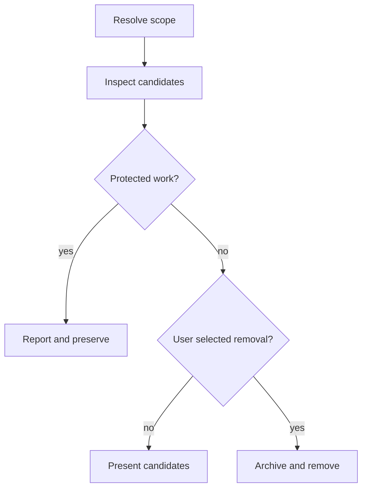

Use the user's intent to select cleanup targets. Do not require flags.

The default scope is files and git state attributable to this session or its current worktree. Inspect other local worktrees or branches only when the user requests a broader local scan; inspect remote state only when requested. A request to clean up is not permission to discard uncommitted or unpushed work.

Cleanup follows the requested scope and protects work that cannot be safely removed:

1. Verify the repository and identify the current worktree, main worktree, base branch, and candidate ownership. Use session evidence and worktree metadata, not a filename guess. If attribution is uncertain, report the candidate and leave it alone.
2. Inspect each candidate without mutation. For worktrees, check registration, tracked changes, untracked and ignored files, merge status, and commits missing from the configured upstream. If ownership, publication, or contents cannot be established, preserve the worktree. Age is not permission to delete.
3. Present paths, branches, evidence, and proposed actions. Obtain explicit selection before removing anything; a specific request naming the targets and action counts. Never remove the main worktree or base branch. To remove this session's linked worktree, first leave it and run removal from a different worktree. Preserve dirty worktrees, uncommitted files, and unpushed or unknown-status commits. Never force deletion to bypass these protections.
4. Before `git worktree remove <path>`, run `atomic --repo <path> scratchpad list --json` and archive each bundle with `atomic --repo <path> scratchpad archive <slug>`. Treat listing warnings and archive failures as blockers. Preserve the worktree if ignored content remains that the user has not selected for removal. Use `git branch -d` only for a separately selected, safe branch.
5. Print each command before running it. Stop on the first failure and report the partial result. Report removed, preserved, and skipped candidates with reasons. Do not commit or open a PR.

Inspect remote branches only on request. Before deleting one, get explicit authorization naming the remote and branch, refresh that remote, and verify that the exact tip is merged into its target and that the branch is neither protected nor a base. Preserve it if any check is unknown. Guard deletion with a lease for the verified SHA so a concurrent push prevents removal.

Avoid global `git worktree prune` or report reaping in a scoped cleanup. When a branch no longer has a worktree, do not infer scratchpad ownership from its name; archive only a known bundle.
