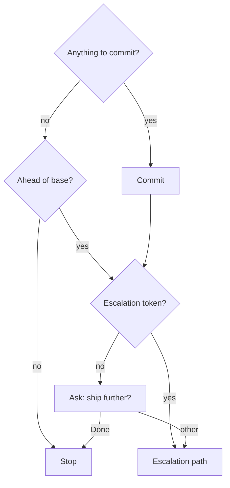

## Parse arguments

Read `$ARGUMENTS`. Scan for escalation tokens: `push`, `pr`, `merge`, `squash`, `squash merge`.

Token → escalation mapping:

| Token(s) in args | Path |
|---|---|
| _(none)_ | commit only, then ask |
| `push` | commit + push |
| `pr` | commit + push + PR |
| `merge` | commit + merge to base |
| `squash` (without `merge`) | commit + squash branch |
| `squash merge` (both tokens) | commit + squash + merge to base |

## Route

The commit always runs first when there is something to commit, and a token decides how far to ship without asking.

- **Commit**: the `## Commit` section.
- **Ask: ship further?**: the `## Interactive path` prompt. Drop its "Committed." line when no commit ran.
- **Escalation path**: the `###` section under `## Escalation` that matches the token or the answer.

## Commit

{{ template "commit-flow" . }}

## Escalation

A `Stop` node ends the verb. A `Skip` inside a gate (review, doc impact, signals refresh) stays inside that gate. Any other `Skip` ends its whole ship step (all of push, or all of squash including its steps); the path's next ship step runs, and when none follows, the verb ends.

<constraints>
If there is an open PR and the escalation requires a merge, the new commit must be pushed before `gh pr merge` so the server-side merge includes it. Push to the PR's existing branch — do not create a new PR.
</constraints>

### Push path (`push` token or user picks Push)

{{ template "push-flow" . }}

### PR path (`pr` token or user picks Open PR)

{{ template "push-flow" . }}

{{ template "pr-flow" . }}

### Merge path (`merge` token or user picks Merge to base)

{{ template "merge-flow" . }}

### Squash path (`squash` token, no `merge`, or user picks Squash branch)

{{ template "squash-flow" . }}

### Squash + merge path (`squash merge` tokens or user picks Squash + merge)

{{ template "squash-flow" . }}

{{ template "merge-flow" . }}

## Interactive path

Ask the user:

> Committed. Ship further?
> - Done — just the commit
> - Push to remote
> - Open PR
> - Merge to base
> - Squash + merge

{{ template "git-safety" . }}
