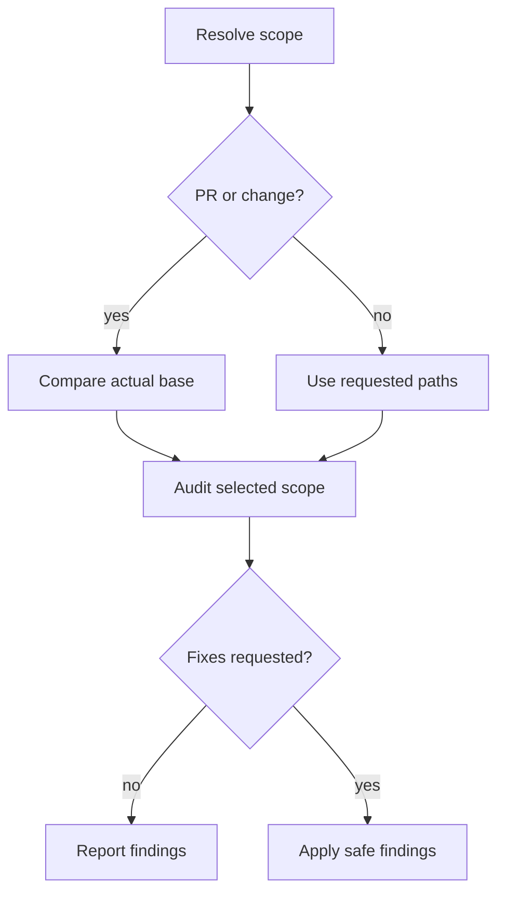

Use the user's intent to choose scope and whether to audit or fix. No flag or second invocation is required. By default, audit the current change; for a PR, resolve its actual target branch and compare from the merge base to the PR head. Include current worktree changes when the user asks about current work. If the base cannot be established, report the blocker rather than guessing.

The selected scope controls findings and edits:

- **Resolve scope**: A repository or path audit requires a request for that scope. Exclude generated, vendored, machine-owned, and ignored files.
- **Compare actual base**: Use the PR's target branch, not an assumed default. Restrict findings and edits to changed lines, including relevant deletion hunks. Read surrounding code and cross-references for context only; do not report or edit unrelated lines. If a proposed edit requires changes outside the diff, report it instead.
- **Audit selected scope**: Use `atomic-deslopper` for substantive independent shards when delegation is appropriate. Give each auditor the exact paths, changed ranges when diff-scoped, and an output path in a scratchpad. Deduplicate findings and retain the more conservative tier. Small scopes may be audited directly under the same rules.
- **Report findings**: Give actionable `path:line`, category, evidence, safety tier, and a specific remedy. Report a clean result without padding it. Do not recommend Atomic code tools.
- **Apply safe findings**: Require an explicit request to fix. For a PR, verify the target worktree is at the reviewed head and that its edits do not overlap unrelated work; otherwise report only. Apply behavior-preserving `safe` findings within scope and report the rest. Run relevant checks and report their results. Do not commit unless asked.

## Safety

Findings must follow a named project convention or the categories and evidence rules in `atomic-deslopper`. Correctness, security, performance, coverage, generated files, and linter or formatter findings are outside this audit. Never auto-fix public or dynamically reachable symbols, unknown blast radii, or failed caller lookups. A textual search alone cannot prove dead code safe. Read-only audit writes no source files; scratchpad reports are allowed.
