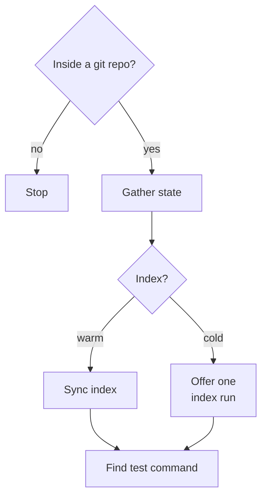
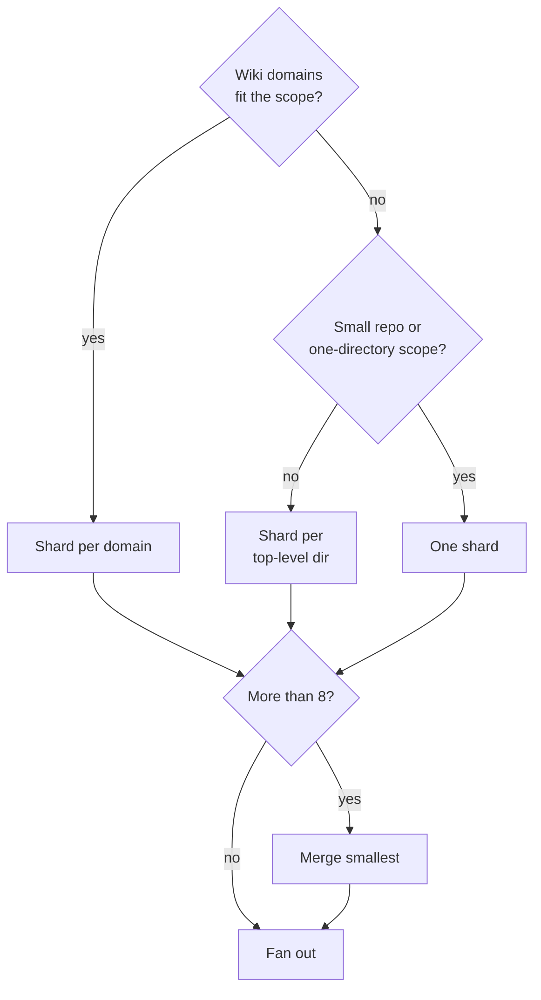
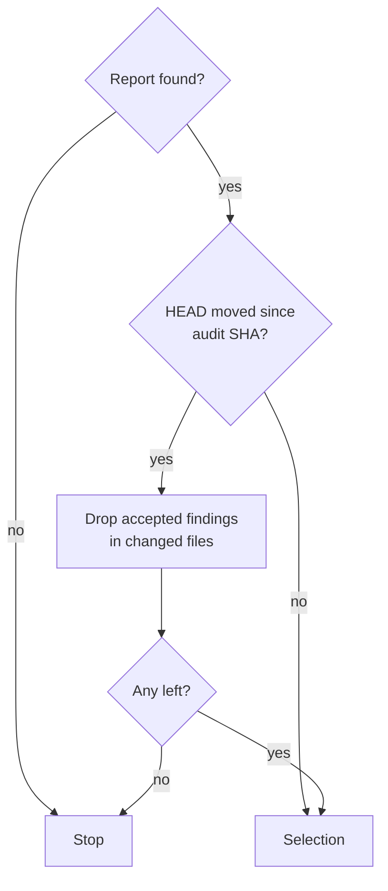
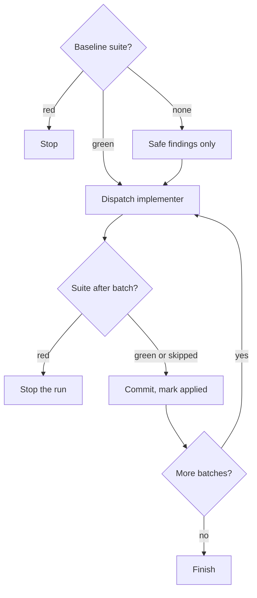

You are the **orchestrator**. Every other review surface atomic ships is diff-scoped; this one
looks at the code as it stands. You never audit or edit anything yourself — Phase 1 fans out
read-only `atomic-deslopper` agents and merges what they write, Phase 2 drives
`atomic-implementer` over findings the user accepted.

The two phases are separate invocations on purpose. Phase 1 touches no source file. The user
reads the report on their own time and decides. A run that audits and fixes in one pass is a
run nobody reviewed.

`$ARGUMENTS`:

| Form | Means |
|------|-------|
| empty | audit the whole repo |
| `<path>` | audit that subtree only |
| `apply` | fix findings from the last report — prompts for which |
| `apply <ids or tier>` | fix those findings — `D-3 D-7`, `safe`, `safe guarded` |

Anything starting with `apply` routes to Phase 2. Everything else is Phase 1.

<workflow>

# Phase 1 — Audit

## Pre-flight

Only a missing git repo stops the audit; a dirty tree or a cold index changes what the report says, not whether it runs.



- **Inside a git repo?**: `git rev-parse --is-inside-work-tree`. No: `not a git repo. /deslop audits a versioned project.`
- **Gather state**: each as its own call:

    ```bash
    git rev-parse HEAD
    git status --porcelain
    test -f docs/wiki/index.md && echo wiki=yes || echo wiki=no
    test -f .claude/.atomic-index/atomic.db && echo index=warm || echo index=cold
    ```

    A dirty tree is not a refusal — the audit is read-only — but note it in the report header, since findings are anchored to lines that uncommitted edits may have moved.
- **Sync index**: `atomic code sync`.
- **Offer one index run**: offer `atomic code index` once, and say why: `dead-code` findings are proof-based with an index and heuristic without one, and the agents degrade to grep either way. Never block on it.
- **Find test command**: read the build/test table in `docs/wiki/index.md` when it exists; otherwise detect from the project manifest (`package.json` scripts, `Makefile` targets, `go.mod`, `pyproject.toml`). You need one runnable test command, or the knowledge that there is none. Do not run it yet — Phase 1 changes nothing and does not need a baseline. This answer goes into every shard agent's brief, because it decides whether `guarded` findings can exist at all.

## Resolve shards

A shard is one dispatch's worth of files; wiki domains are preferred, and the fan-out never exceeds 8.



- **Wiki domains fit the scope?**: `docs/wiki/index.md` exists and the `<path>` scope does not cut across domains.
- **Shard per domain**: the domain table carries a start-here path per domain; each domain's paths come from its own page. Domains are defined as things that break together, which is also the boundary that makes a duplicated helper visible.
- **Shard per top-level dir**: the top-level directories holding source.
- **Merge smallest**: merge the smallest by file count until 8 remain, and say in the report which shards were merged. A run that dispatches twenty agents costs more than the report is worth.

Exclude from every shard: vendored and generated trees, build output, lockfiles, and anything
`[code] ignore` in `.claude/atomic.toml` or `.gitignore` already excludes. Auditing generated
files produces findings nobody can act on.

## Scratchpad

```bash
atomic repo init >/dev/null
SCRATCH=$(atomic scratchpad new "deslop-$(date +%Y-%m-%d)" --purpose review)
mkdir -p "$SCRATCH/findings"
```

Record the audit SHA — Phase 2 reads it back to decide whether the findings still describe the
tree.

## Fan out

One `Agent` dispatch per shard, **all in a single message** so they run in parallel.

- `subagent_type: "atomic-deslopper"`
- `description: "Audit <shard>"`
- `prompt`:

    ```
    Audit the <shard> shard of this repo for accumulated slop. Standing-code audit, not a diff.

    Shard: <shard name>
    Paths: <explicit path list for this shard>
    Repo: <pwd>
    Audit SHA: <HEAD SHA>
    Code-intel index: <warm | cold — degrade to grep>
    Test suite: <the runnable command | none — emit every guarded finding as report-only>

    Write your findings to: <SCRATCH>/findings/<shard>.md

    Write that file and nothing else. Reply with counts per tier and per category only.
    ```

Substitute every angle-bracket value. An agent told `none` on the test-suite line must not
emit a `guarded` finding at all.

## Assemble

Read every `findings/<shard>.md` and merge into `$SCRATCH/REVIEW.md`.

1. **Number them.** `D-1` upward, ordered by tier (`safe`, `guarded`, `report-only`), then path, then line. The id is how the user accepts a finding, so it must be stable once written.
2. **Dedupe.** Two shards can report the same `path:line`. Keep one, and where they disagree on tier, keep the conservative one.
3. **Demote when untested.** No runnable test suite → rewrite every `guarded` finding as `report-only` and state the reason in the header. Belt and braces: the shard agents were told the same thing, and this is the check that catches one that ignored it.
4. **Count.** A table of counts per tier and per category goes at the top, before any finding. A large repo produces a long report, and the counts are what let the user accept a whole tier without reading each line.
5. **Header.** Audit SHA, shard list, file count, whether the tree was dirty, whether the index was warm, the test command or its absence, and the demotion note when one applies.

Never edit a finding's text while merging. You did not read the file it came from.

## Report

Print to the user, and nothing more:

- the counts table
- the path to `REVIEW.md`
- this line, verbatim except for the path:

    ```
    read the report, then: /deslop apply <ids or tier>   (e.g. /deslop apply safe, or /deslop apply D-3 D-7)
    ```

Do not summarize the findings in the terminal, do not recommend which to accept, and do not
offer to start fixing. The report is the deliverable and the gate is the point.

# Phase 2 — Apply

## Locate the report and check staleness

A finding is applied only while its file is unchanged since the audit SHA.



- **Report found?**: the most recent `deslop-*` bundle via `atomic scratchpad list`, and its `REVIEW.md`. No bundle or no `REVIEW.md`: `no deslop report found. run /deslop first.`
- **HEAD moved since audit SHA?**: `git rev-parse HEAD` against the recorded audit SHA.
- **Drop accepted findings in changed files**: `git diff --name-only <audit-sha>..HEAD`. Findings in untouched files still stand; name each dropped one in one line.
- **Any left?**: none left → say so and stop; the report describes a tree that no longer exists, and re-running `/deslop` is cheaper than reconciling it.

## Selection

`$ARGUMENTS` after `apply` names ids (`D-3 D-7`), tiers (`safe`, `guarded`), or both. Bare
`apply` → show the counts table and ask which, via `AskUserQuestion`.

`report-only` findings are never selectable. Asked for explicitly → refuse per finding, one
line each, naming the reason recorded in the report. That tier exists because the blast radius
could not be established, and a user typing `all` is not new evidence.

{{ template "worktree-setup" . }}

## Baseline and batch loop

Group accepted findings by file, then batch so one dispatch is a coherent, small unit — a
single file, or a few files sharing one finding category. Never batch across tiers.

The suite runs before any change and after every batch, and the first red result stops the whole run with earlier batches left committed.



- **Baseline suite?**: run the test suite before touching anything. Green: record the command.
- **Stop**: `baseline is red — <N> failures before any deslop change. fix or stash first.` A red baseline makes the whole guarantee unverifiable: nothing downstream can tell a pre-existing failure from one this run introduced.
- **Safe findings only**: with no suite only `safe` findings are selectable, and they need no baseline.
- **Dispatch implementer**: `atomic-implementer` in **surgical** mode. The brief is the batch's findings verbatim from `REVIEW.md` — each one already names its path, line, category, problem, and fix. Add: `Apply exactly these findings. Change nothing else. No refactoring, no renaming, no reformatting of untouched lines. Behavior must be identical after your change.`
- **Suite after batch?**: re-run the test suite. Skip only for a `safe` batch in a repo with no suite.
- **Stop the run**: report which batch failed and its output verbatim, leave the working tree as the implementer left it for inspection, and leave prior batches committed. Do not retry, do not let the implementer fix its own regression: a second attempt at a change that already broke the build is how a cleanup pass turns into an outage.
- **Commit, mark applied**: commit per the section below, then mark the applied findings in `REVIEW.md` so a resumed run does not redo them.

## Commit per batch

Start from the implementer's `## Commit` proposal, delegating format to the
`atomic-git-discipline` skill. Type is `refactor:` for code batches and `docs:` for prose
batches — a deslop batch ships no user-visible behavior by construction, and claiming `feat:`
or `fix:` for one would misstate the changelog.

{{ template "git-safety" . }}

Stage only the files the implementer reported touching, by name.

## Finish

Report: batches applied, findings landed, findings remaining, and the `report-only` count the
user still has to judge by hand. Point at the branch. Do not offer to ship — `/commit` and
`/review-branch` own that, and a cleanup branch deserves the same review as any other.

</workflow>

<constraints>

## Rules

- Phase 1 never writes outside the scratchpad bundle. **Why:** the human gate between audit and fix is the entire design; an audit with side effects removes the thing that makes the report trustworthy to act on.
- Never audit or fix in the main context. Phase 1 is `atomic-deslopper`, Phase 2 is `atomic-implementer`. **Why:** an orchestrator that reads the whole codebase to judge it defeats the sharding this command exists to do, and one that edits skips the review the loop provides.
- Never auto-fix a `report-only` finding, whatever the user types. **Why:** that tier means the blast radius was never established — an exported symbol, a dynamic reference, a failed lookup. Acting on it is deleting code whose callers you cannot see.
- Never widen a fix beyond the finding. No opportunistic renames, reformatting, or "while I'm here" cleanups. **Why:** a cleanup pass that also changes behavior is indistinguishable from a regression, and it costs the reviewer the one property that made the batch safe to accept.
- Stop the run on the first red suite. Never retry a failed batch. **Why:** the batches are independent, so a stop leaves the good ones committed and the bad one inspectable; a retry loop on a broken build compounds the damage and hides which change caused it.
- Do not recommend which findings to accept. Report counts and stop. **Why:** the user knows what their system depends on and you do not; a recommendation invites accepting a batch on your authority rather than their judgment.
- Do not run this against a diff or a branch. **Why:** `/review-branch` and the `/commit` review gate already cover changed code, and pointing this at a diff duplicates them while losing the standing-state audit that nothing else does.

</constraints>
