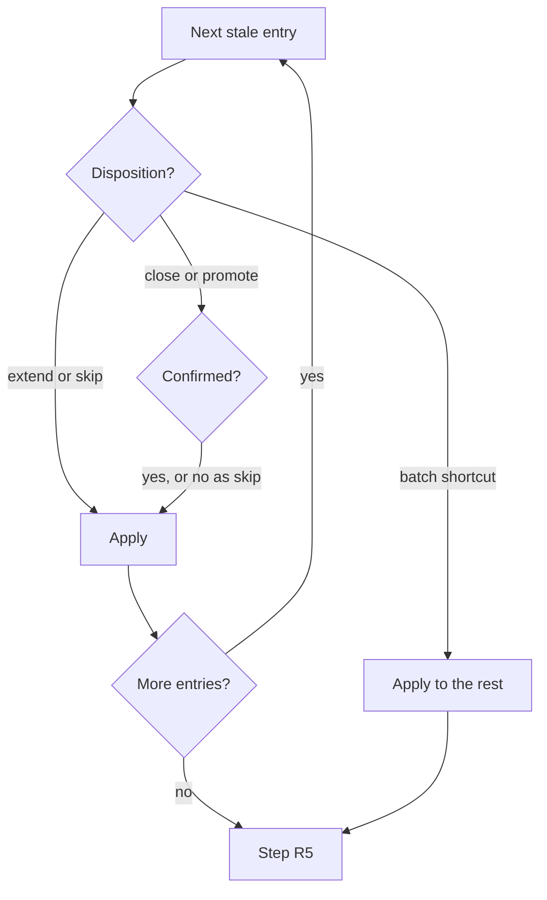

Record a follow-up, or handle stale project follow-up entries.

Spec: `docs/spec/workflow-preferences.md`

`<followups-dir>` below is the follow-ups directory under the selected repository state root. The `atomic followups` CLI owns the exact path — prefer its verbs over hand-constructing entry paths.

## Mode detection

Inspect `$ARGUMENTS`:

- `review` → **review flow** (steps R1–R6 below).
- Any other text → **record flow**.
- Empty → print the two forms and exit:

    ```
    usage: /follow-up <text>    record one follow-up
           /follow-up review    triage stale ledger entries
    ```

---

<workflow>

## Record flow (`/follow-up <text>`)

Record one follow-up through the **Follow-up sink** below. From `<text>`, derive an imperative title of at most 70 characters and a body carrying the text, the origin `/follow-up`, and any file it names. Severity is `risk`, `nit`, or `question` as the text reads, `nit` when it says nothing; kind is `plan` for work the text proposes, else `finding`. The command has no earlier choice to carry the preview, so print the sink preview and ask one question, "Record this follow-up? Yes / No". That Yes is the sink's choice and the only prompt; No records nothing.

{{ template "followup-sink" . }}


## Review flow (`/follow-up review`)

Reviews stale project follow-up entries (past `review_by`) with per-item disposition. `kind: plan` entries are excluded from staleness review — plans are a backlog, not findings going cold; they surface via INDEX, not via the stale nag.

### Step R1 — Fetch stale entries

```bash
atomic followups list --stale --json
```

Parse the JSON array. If empty: print `no stale follow-ups; <N> open, all within TTL` (get N from `atomic followups list --json` | count) and exit.

### Step R2 — Print numbered list (axiom 4)

```
Stale follow-ups (N)
  [1] <id> — <title> (<age>d old, severity: <severity>)
  [2] <id> — <title> (<age>d old, severity: <severity>)
  ...
```

Print one line per stale entry. Include id, title, severity, and age in days.

### Step R3 — Per-item disposition

Entries are reviewed one at a time in order; `close` and `promote` act only after their own confirm (axiom 3), and only the non-destructive verbs take a batch shortcut.



- **Disposition?**: ask the user in a batched question block with choices `["extend", "close", "promote", "skip"]` — a small-choice decision per axiom 4 guidance:

    ```
    [<N>] <id> — <title>
    Disposition: extend | close | promote | skip
    ```

- **Confirmed?**:
    - `close`: ask the user in a batched question block — "Close <id>? This writes to CLOSED.md and deletes the entry file. Yes / No". On Yes, optionally ask for a reason — a batched question block: "Reason (optional — leave blank to skip):"
    - `promote`: resolve the tracker per the sink's **Tracker** step. With `issue-tracker: filesystem`, print `[<N>] <id> — promote needs a hosted tracker; issue-tracker is filesystem.` and apply `skip`. Otherwise ask the user in a batched question block, with the rendered issue redacted per the **Privacy** rules — "Promote <id> to <tracker>? This creates an issue there and then closes the entry. Yes / No"
- **Apply to the rest**: typed text instead of an option, to avoid fatigue when many entries are stale. `extend all` / `extend rest` extends this and all remaining entries; `skip all` / `skip rest` skips this and all remaining; `done` / `stop` stops reviewing and skips the rest.
- **Apply**: per Step R4. A declined confirm applies as `skip`.

### Step R4 — Apply dispositions

**`extend`**: rewrite `review_by` in the entry frontmatter to `today + ttl_days`.

- Read TTL from user memory key `feedback_followups_ttl` (format `Nd`). Default: `60d`.
- Compute new date: today + N days, formatted `YYYY-MM-DD`.
- Edit the frontmatter line `review_by: <old>` to `review_by: <new>` via shell `sed`:

    ```bash
    sed -i '' "s/^review_by: .*/review_by: $(date -v+60d +%Y-%m-%d)/" <followups-dir>/<id>.md
    ```

    Substitute the correct N in the `+Nd` expression from the TTL value.

- Print: `[<N>] <id> — review_by extended to <new-date>.`

**`close`**: run:

```bash
atomic followups close <id>          # no reason
atomic followups close <id> --reason "<r>"   # if user provided one
```

Print: `[<N>] <id> — closed.`

**`promote`**: create the issue in the resolved tracker, then close the entry on success.

1. Run the sink's **Hosted tracker** step for the entry: its title, a body of `Origin: <origin>` and the entry body, its severity and kind. The sink's **Filesystem** step does not apply here.
2. On success, with the URL or key `issue-create` returned:

    ```bash
    atomic followups close <id> --reason "promoted to <tracker> <issue-id>"
    ```

    Print: `[<N>] <id> — promoted to <tracker> <issue URL or key> and closed.`

3. When `auth-check` or `issue-create` fails, or the project does not resolve to exactly one: print `WARN: <tracker> issue-create failed for <id>; entry left open. Error: <stderr>.` Do NOT close the entry.

**`skip`**: no-op. Print: `[<N>] <id> — skipped.`

### Step R5 — Regenerate INDEX

INDEX regeneration is automatic after each `atomic followups close` call (the CLI runs render internally). If only `extend` or `skip` dispositions were applied, run:

```bash
atomic followups render
```

### Step R6 — Summary

After all dispositions:

```
Review complete.
  Extended: <id-list or "none">
  Closed:   <id-list or "none">
  Promoted: <id-list or "none">
  Skipped:  <id-list or "none">
```

</workflow>
