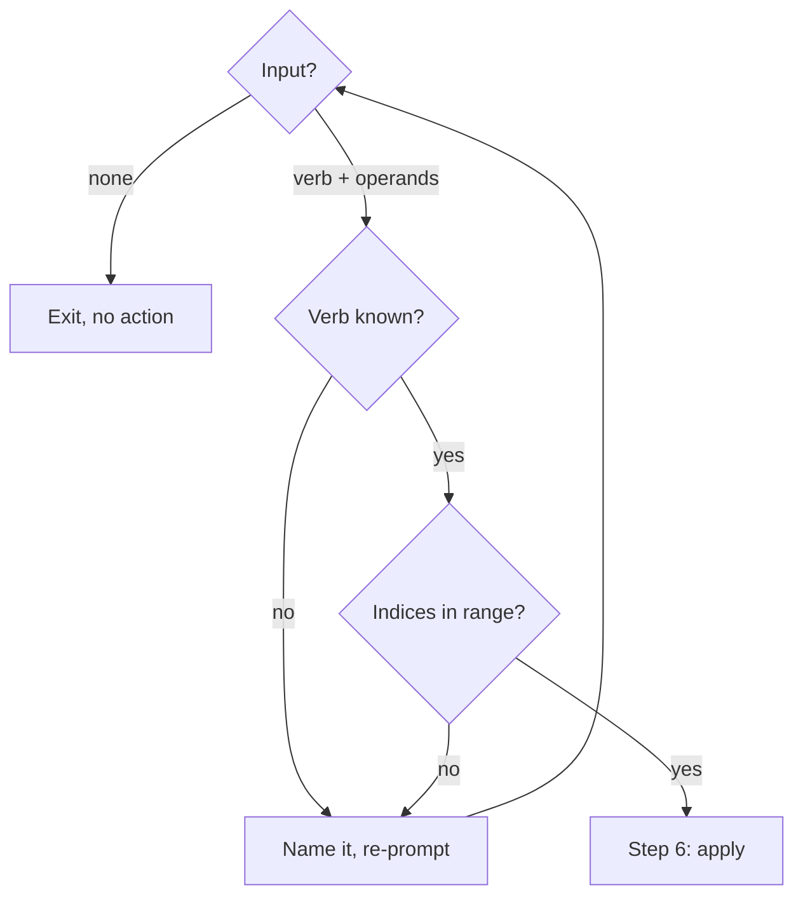
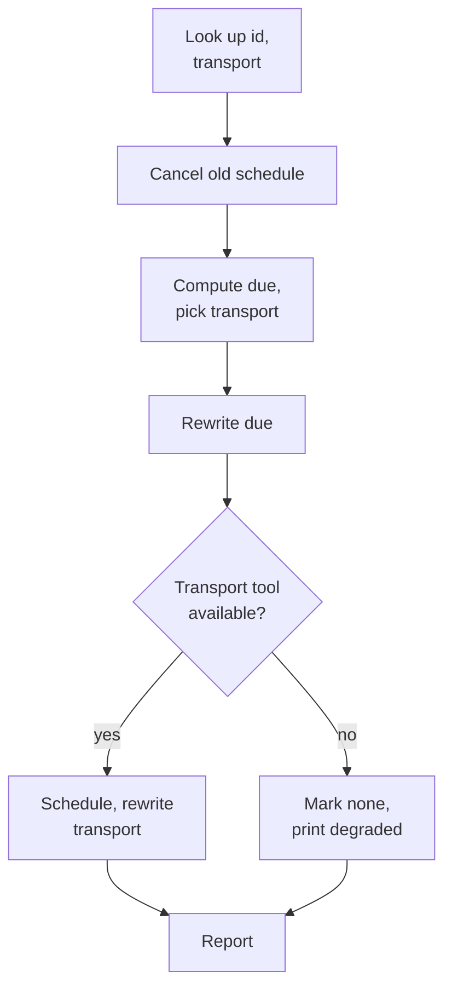
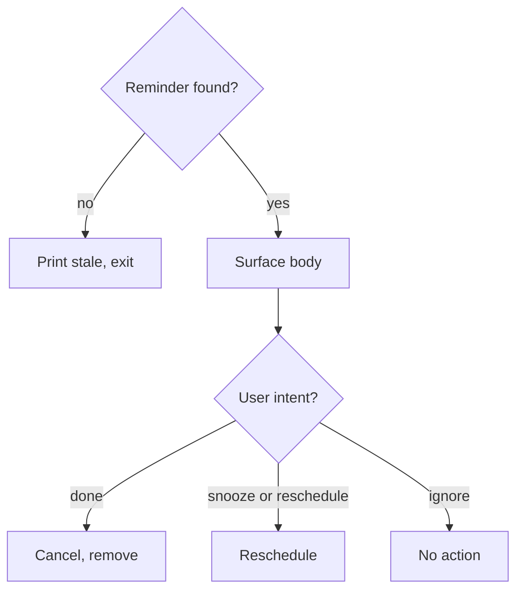
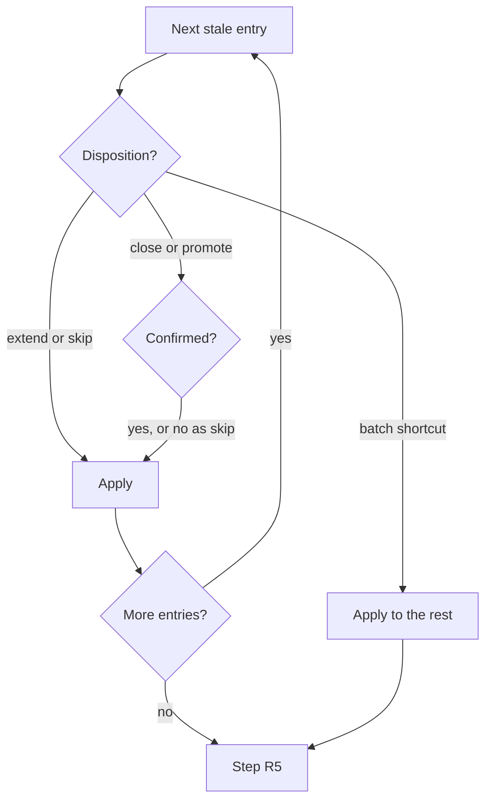

Handle pending reminders and project follow-up entries. Three modes: bare (`/follow-up`), cron-fired (`/follow-up due <id>`), and review (`/follow-up review`).

Spec: `docs/spec/cron-workflow.md § /follow-up`

`<reminders-dir>` below is `atomic where --json`'s `reminders` field. Paths come from `atomic scratchpad` / `atomic where --json`; if what you find on disk does not match, run `atomic migrate --show-log` for the change history.

## Mode detection

Inspect `$ARGUMENTS`:

- Empty → **bare flow** (interactive list, steps 1–6 below).
- `due <id>` → **cron-fired flow** (below).
- `review` → **review flow** (steps R1–R6 below).

---

<workflow>

## Bare flow

### Step 1 — Build the indexed reminder list

```bash
atomic reminder list
```

Output is indexed and includes the `transport` column. Capture it. No reminders listed: print `no reminders.` and exit.

### Step 2 — Optionally enrich with schedule info

For each reminder, attempt to find its live schedule entry:

- **`cron` transport**: call `CronList` and search for an entry whose prompt contains `/follow-up due <id>`. If found, note the next-fire time as "fires in X" or "fires at <time>".
- **`routine` transport**: if a routine listing is accessible, search for an entry with the matching prompt. Note fire time if found.
- **`none` transport**: no schedule lookup needed. The reminder will surface via the session-start hook only.

Skip enrichment silently if the listing tool is unavailable or returns no match — both are expected.

### Step 3 — Print the indexed list

<example>
```
Reminders (3)
  [1] r-7b21 — benchmark the new query plan (created 2 days ago) [routine]
  [2] r-3f9a — fix auth race in middleware (created 5 days ago, fires in 2 days) [cron]
  [3] r-1c7e — revisit error handling in ingest (created 1 week ago) [none]
```
</example>

Include the `[transport]` tag so the user knows how each reminder is scheduled.

### Step 4 — Prompt for action

<example>
```
Type one of:
  done <indices>             — mark done (delete file + cancel schedule)
  snooze <index> <duration>  — reschedule; may change transport
  reschedule <index> <when>  — same as snooze, explicit semantic
  show <index>               — print body
  none                       — exit

Examples: done 1 3 | snooze 2 3d | reschedule 2 next friday | none
```
</example>

The `<duration>` and `<when>` accept natural language — same inference rules as `/remind-me` Step 1. "next friday", "end of week", "3 days" all work.

### Step 5 — Parse and validate selection

The user is re-prompted until the verb is known and every index is in range, or exits with `none`.



- **Input?**: `done 1 3` marks indices 1 and 3 done; `snooze 2 3d` snoozes index 2 by 3 days; `reschedule 4 2026-06-01` reschedules index 4 to that date; `show 2` prints the body of index 2.
- **Indices in range?**: validate every index against the printed list.
- **Name it, re-prompt**: unknown verb: `unrecognized verb. retry your selection.` Out-of-range index: `invalid index <N>. retry your selection.`

### Step 6 — Apply actions

#### `done <indices>`

For each index in the selection:

1. Look up the reminder id and its `transport` from the indexed list.
2. **Cancel the schedule** based on transport:
    - **`cron`**: call `CronList`. Find the entry whose prompt contains `/follow-up due <id>`. If found, call `CronDelete` on that cron id.
    - **`routine`**: invoke the `schedule` skill with a delete intent for the entry whose prompt contains `/follow-up due <id>`. If the skill does not expose a deletion interface at this level, list routines, identify the matching one by prompt content, and ask the user to confirm which routine to cancel before deleting. Note: the routine cancellation contract may differ from `CronDelete` — see `docs/spec/cron-workflow.md § Open follow-ups`.
    - **`none`**: no schedule to cancel; skip to deletion.
3. Delete the reminder: `atomic reminder rm <id>`
4. Report: `[<index>] r-<id> — done.`

#### `snooze <index> <duration>` and `reschedule <index> <when>`

Both verbs accept natural-language time expressions — same inference rules as `/remind-me` Step 1 ("next friday", "end of week", "3 days", "2026-06-01" all work). Snooze implies relative and reschedule absolute, but they run the same steps, and a missing scheduling tool degrades to `transport: none` without an error.



- **Look up id, transport**: from the indexed list.
- **Cancel old schedule**: by current transport, same logic as `done` step 2 above.
- **Compute due, pick transport**: same time-component rules as `/remind-me` (09:00 local for day-granularity, absolute for hour-granularity). `< 1h` → `cron`, `>= 1h` → `routine`. This may differ from the original transport (e.g. snoozing a routine reminder by `30m` switches to cron).
- **Rewrite due**: `atomic reminder set-due <id> <iso>`.
- **Schedule, rewrite transport**: `cron`: `CronCreate` with a one-shot trigger at the new `due`, prompt `/follow-up due <id>`. `routine`: the `schedule` skill with the new trigger time and the same prompt. Then rewrite `transport:` even when it did not change, so the file matches the actual scheduling outcome:

    ```bash
    sed -i '' 's/^transport: .*/transport: <new-transport>/' <reminders-dir>/<file>
    ```

- **Mark none, print degraded**: the same `sed` with `transport: none`, then the message from `## Degraded mode`. The session-start hook surfaces the reminder once past due.
- **Report**: `[<index>] r-<id> — rescheduled. fires: <human-readable when>. transport: <new-transport>.`

#### `show <index>`

Print the reminder body from `atomic reminder show <id>`. Then re-display the prompt from step 4 so the user can take further action.

#### Final report

After all actions are applied:

```
Done:
  [1] r-7b21 — benchmark the new query plan — deleted.
  [3] r-1c7e — revisit error handling in ingest — deleted.

Rescheduled:
  [2] r-3f9a — fix auth race in middleware — fires: Mon 26 May 09:00 local. transport: routine.
```

---

## Cron-fired flow (`/follow-up due <id>`)

Claude wakes with this prompt when a reminder's cron or Routine fires. A fired reminder changes only on an explicit user action; ignoring it leaves it stored and unscheduled.



- **Reminder found?**: `atomic reminder show <id>`; also read the `transport:` frontmatter field, needed for cancel operations. Missing or empty: `reminder <id> not found; schedule entry may be stale`.
- **Surface body**: print, then wait and detect intent from what the user types or does next:

    ```
    reminder fires: <id>

    <body text>
    ```

- **Cancel, remove**: cancel on the matching transport — `cron`: `CronList` → the entry matching `/follow-up due <id>` → `CronDelete`; `routine`: the `schedule` skill's delete intent for the matching entry (bare flow `done` step 2 covers the case where deletion is not directly available); `none`: nothing to cancel. Then `atomic reminder rm <id>` and print `r-<id> — marked done.`
- **Reschedule**: snooze takes `now + N`, reschedule a specific absolute time. Run the bare-flow snooze steps from **Compute due, pick transport** through **Mark none, print degraded**; the fired one-shot needs no cancel. Print `r-<id> — rescheduled. fires: <human-readable when>. transport: <new-transport>.`
- **No action**: the user addresses something else, or the session ends. The reminder persists in storage and keeps appearing in bare `/follow-up` and the session-start hook, but it will not re-fire on its own — the one-shot cron/routine already fired. The user must snooze it back into the registry or mark it done. This is intentional; no silent auto-reschedule.

---

## Review flow (`/follow-up review`)

Reviews stale project follow-up entries (past `review_by`) with per-item disposition. `kind: plan` entries are excluded from staleness review — plans are a backlog, not findings going cold; they surface via INDEX, not via the stale nag.

### Step R1 — Fetch stale entries

```bash
atomic followups list --stale --json
```

Parse the JSON array. If empty: print `no stale follow-ups; <N> open, all within TTL` (get N from `atomic followups list --json` | count) and exit.

### Step R2 — Print numbered list (axiom 4)

```
Stale follow-ups (N)
  [1] <id> — <title> (<age>d old, severity: <severity>)
  [2] <id> — <title> (<age>d old, severity: <severity>)
  ...
```

Print one line per stale entry. Include id, title, severity, and age in days.

### Step R3 — Per-item disposition

Entries are reviewed one at a time in order; `close` and `promote` act only after their own confirm (axiom 3), and only the non-destructive verbs take a batch shortcut.



- **Disposition?**: ask via `AskUserQuestion` with choices `["extend", "close", "promote", "skip"]` — a small-choice decision per axiom 4 guidance:

    ```
    [<N>] <id> — <title>
    Disposition: extend | close | promote | skip
    ```

- **Confirmed?**:
    - `close`: `AskUserQuestion` — "Close <id>? This writes to CLOSED.md and deletes the entry file. Yes / No". On Yes, optionally ask for a reason — `AskUserQuestion`: "Reason (optional — leave blank to skip):"
    - `promote`: `AskUserQuestion` — "Promote <id> to a GitHub issue? This creates a gh issue and then closes the entry. Yes / No"
- **Apply to the rest**: typed text instead of an option, to avoid fatigue when many entries are stale. `extend all` / `extend rest` extends this and all remaining entries; `skip all` / `skip rest` skips this and all remaining; `done` / `stop` stops reviewing and skips the rest.
- **Apply**: per Step R4. A declined confirm applies as `skip`.

### Step R4 — Apply dispositions

**`extend`**: rewrite `review_by` in the entry frontmatter to `today + ttl_days`.

- Read TTL from user memory key `feedback_followups_ttl` (format `Nd`). Default: `60d`.
- Compute new date: today + N days, formatted `YYYY-MM-DD`.
- Edit the frontmatter line `review_by: <old>` to `review_by: <new>` via Bash `sed`:

    ```bash
    sed -i '' "s/^review_by: .*/review_by: $(date -v+60d +%Y-%m-%d)/" .claude/project/followups/<id>.md
    ```

    Substitute the correct N in the `+Nd` expression from the TTL value.

- Print: `[<N>] <id> — review_by extended to <new-date>.`

**`close`**: run:

```bash
atomic followups close <id>          # no reason
atomic followups close <id> --reason "<r>"   # if user provided one
```

Print: `[<N>] <id> — closed.`

**`promote`**: create a GitHub issue, then close on success.

1. Run:

    ```bash
    gh issue create --title "<title>" --body "Origin: <origin>\n\nSee .claude/project/followups/<id>.md"
    ```

2. Capture the issue URL from stdout. On success:

    ```bash
    atomic followups close <id> --reason "promoted to gh issue #<N>"
    ```

    Print: `[<N>] <id> — promoted to <issue-url> and closed.`

3. On `gh issue create` failure: print `WARN: gh issue create failed for <id>; entry left open. Error: <stderr>.` Do NOT close the entry.

**`skip`**: no-op. Print: `[<N>] <id> — skipped.`

### Step R5 — Regenerate INDEX

INDEX regeneration is automatic after each `atomic followups close` call (the CLI runs render internally). If only `extend` or `skip` dispositions were applied, run:

```bash
atomic followups render
```

### Step R6 — Summary

After all dispositions:

```
Review complete.
  Extended: <id-list or "none">
  Closed:   <id-list or "none">
  Promoted: <id-list or "none">
  Skipped:  <id-list or "none">
```

---

</workflow>

## Degraded mode

If scheduling tools (`CronList`, `CronDelete`, `CronCreate`, or the `schedule` skill) are unavailable for a given step:

- File operations still proceed (delete or `set-due` rewrite).
- Skip the schedule cancel/create call (do not raise an error on the missing tool).
- After completing the action, print:

    ```
    scheduling tools unavailable — file updated; reminder won't auto-fire; review via /follow-up.
    ```

---

<constraints>

## Rules

- Never delete a reminder file without the user explicitly selecting `done` or acknowledging in the cron-fired flow.
- Never auto-reschedule. The user drives all scheduling decisions.
- The cron/routine lookup key is the prompt content containing the reminder id (`/follow-up due <id>`). Match this string when searching `CronList` results or routine listings.
- Transport changes on snooze/reschedule are intentional: a reminder originally set for `1w` snoozed by `30m` correctly moves from routine to cron.
- `atomic reminder set-due <id> <iso>` is the canonical way to rewrite `due:`.
- Reminder storage is project-scoped, at the `reminders` path `atomic where --json` reports. Persists across sessions and worktrees of the same clone. Paths come from `atomic scratchpad` / `atomic where --json`; if what you find on disk does not match, run `atomic migrate --show-log` for the change history.
- The `id` frontmatter field is the canonical key. Filenames are cosmetic.

</constraints>
