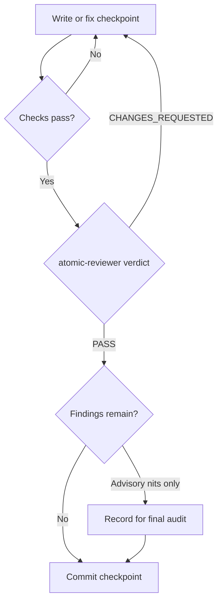
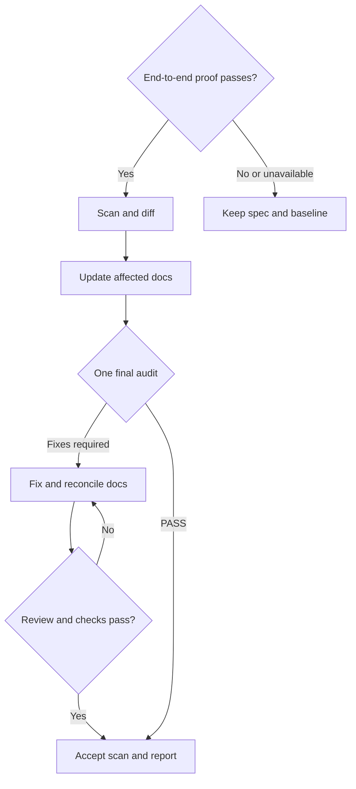

Use the request and current conversation.

| Starting point | First action |
|---|---|
| Bug or CI failure with an unknown cause | Stop and direct the user to `atomic-debug`. |
| Approved spec | Read the supplied spec and linked design. Resolve any decisions that supersede the spec before dispatch. Use its checkpoints. |
| Task without a spec | If the goal and approach are clear, set observable success criteria and proceed without a spec. A straightforward known-cause fix is one checkpoint in the current tree. Use `/atomic-plan` if scope, public behavior, or approach is undecided. |

## Implement and review

State the checkpoints and end-result check. Record the starting tree, including existing edits. Work in place for a small fix or if the task is already isolated. Offer isolation for significant work on a clean tree. Reuse the plan bundle or open one with `atomic scratchpad new <topic> --purpose implement` before delegated or multi-checkpoint work. If you move worktrees, keep the spec and its design links accessible to reviewers and builders.

Before each checkpoint, match its paths against wiki pointer cards or the wiki index. Read the relevant pages and pass their paths as `wiki:` to the builder and reviewer, even when the harness injects rules.

A checkpoint can commit only after `atomic-reviewer` returns `PASS`.

- **Write or fix checkpoint:** Work directly when the context fits. Otherwise give `atomic-implementer` the resolved spec path and design links (or the inline contract), checkpoint paths and criteria, evidence, and prior findings. Use an inexpensive read-only scout when needed. Follow `atomic-tdd`; for a fix, establish the original failure before changing code.
- **`atomic-reviewer` verdict:** Capture the task-only checkpoint patch, including new files. Send it as `diff: patch <path>` with the spec and design links (or inline contract), criteria, and check results. Avoidable duplication and departures from established library use block the checkpoint. Set `allow-advisory: true` only to defer harmless polish to final cleanup outside Autopilot. If the same blocker persists twice, stop and show the evidence; Autopilot consults `atomic-strategist`.
- **Commit checkpoint:** Commit only the patch that passed review. If it changes, review it again. Stop if you cannot isolate the patch or stage it without disturbing other work. Record the scope, evidence, verdict, SHA, and deferred nits in the task bundle when present; otherwise keep the nit list in the session.

## Finish

Keep the accepted scan unchanged until the documentation is reviewed. Run the final auditor once.

- **End-to-end proof:** Run the spec's proof or the agreed inline check. If it fails, fix it and rerun. If it cannot run here, record the limitation and who can run it. Do not accept or discard the spec without evidence of a pass.
- **Scan and diff:** Pin the accepted `docs/wiki/scan.md` from the task's starting revision. Run `atomic signals scan --out <scratch-dir>` and compare `<scratch-dir>/docs/wiki/scan.md` with that baseline. Use the task's Git diff as well, including new and removed files and behavior changes in existing files. With no baseline, use the task diff and current scan for the first review. If the starting wiki's `<scan-sha>` disagrees with its scan, reconcile the existing wiki against source before advancing the baseline.
- **Update affected docs:** Apply `atomic-documentation` maintenance to the scratch scan comparison and task diff. Keep lasting decisions in the linked design and include task-owned planning edits in review. Record updates and explain why any relevant surface needed no change.
- **One final audit:** Send `atomic-auditor` the spec and design links (or inline contract), `proof:`, cumulative task patch with docs, scan comparison, commit range, and deferred nits. Pass `scratch:` with the resolved bundle path when present. Assign or apply every remaining finding, including final polish. Reconcile docs and rescan against the original baseline if fixes change scope. Review the fixes without advisory deferrals and rerun affected checks. Do not rerun the audit.
- **Accept scan and report:** After docs, wiring, ignore rules, and card projection are final, refresh the candidate if any scan inputs changed and check the new impact. Include the candidate at `docs/wiki/scan.md` in the final task-only patch with docs and audit fixes. If `docs/wiki/index.md` exists, update its `<scan-sha>` with the candidate's `git hash-object` value. Review the exact patch without advisory deferrals; commit it only on `PASS` and record the SHA when a bundle exists. Preserve the accepted baseline if required proof, scan, docs, or review is blocked. Do not ship without a request.

After acceptance, record the end-to-end evidence and discard only the untracked `SPEC.md` generated for this task and any worktree copy the task made. Leave the design and other bundle files. If the run is incomplete, keep the spec for resumption. Never delete a tracked or externally supplied spec.
