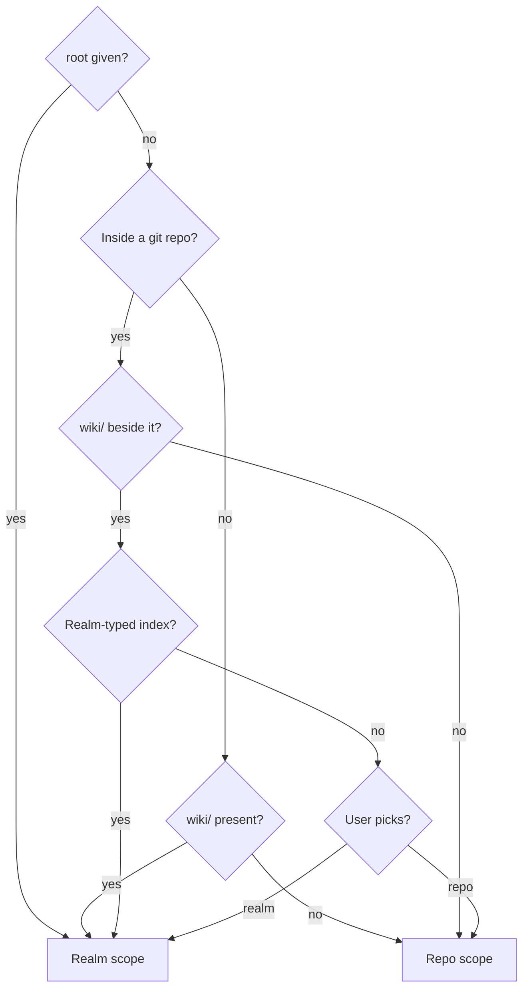
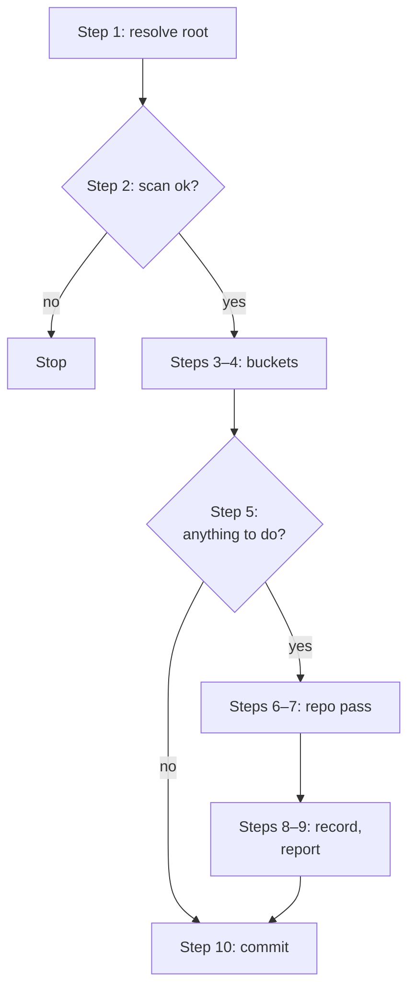
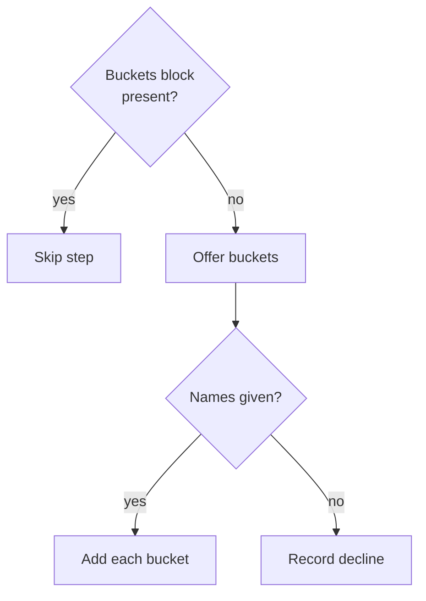

`/refresh-wiki [root]` — refresh the wiki. With no argument, auto-detects scope: if `docs/wiki/index.md` exists in the current repo the scope is **repo**; if a `wiki/` directory exists at the cwd or a supplied `[root]` the scope is **realm**. Pass `[root]` to target a specific realm root.

<workflow>

## Step 0 — Detect scope

A supplied `[root]`, a `wiki/` outside a git repo, or a realm-typed `wiki/` means realm scope, a plain git repo means repo scope, and a git repo with an untyped `wiki/` beside it is the user's call.



- **Repo scope**: covers a first run too, where `docs/wiki/` is empty or has no index yet. Outside a git repo the R1 pre-flight stops it.
- **Realm-typed index?**: `wiki/index.md` contains `<wiki-type>realm</wiki-type>`.
- **User picks?**: ask the user in one batched question block; cancel or ambiguous input means repo scope:

    ```
    This directory is a git repo and has a wiki/ sibling. Which scope?
    - Repo scope (refresh docs/wiki/ inside this repo)
    - Realm scope (refresh wiki/ as a cross-repo wiki)
    ```

---

## Repo scope

### R1 — Pre-flight

```bash
git rev-parse --is-inside-work-tree
```

If not inside a git repo, stop:

```
not a git repo. /refresh-wiki (repo scope) requires a git repository.
```

### R2 — Bootstrap check

```bash
test -f docs/wiki/scan.md
```

If the file does not exist, this is a first-time initialization. Print:

```
no existing signals found. initializing from scratch.
```

Set `first_run=true`. Continue to R3.

### R3 — Steering file check

```bash
atomic wiki init --scope repo
```

This is idempotent: it writes the wiki steering scaffold if it does not exist, and no-ops silently if it already does. On creation the command prints `created <path>` on stdout — relay that line, followed by `(edit to steer the inferrer).`

The scaffold's canonical home is the wiki steering pair: the shared `docs/wiki/AGENTS.md`, with the `CLAUDE.md` loader beside it. Read whichever the command created — the shared file where present, otherwise the loader beside it — for the dispatch prompt.

### R4 — Code-intel index lifecycle

Bring the code-intel index current before dispatching the inferrer, so domain clustering can use real dependency edges rather than filename heuristics alone. A failed sync or index never blocks the refresh.

- If `.claude/.atomic-index/atomic.db` **exists** (warm index): run `atomic code sync` — incremental and cheap. On error, print a warning and proceed; a stale index is still useful.
- If it **does not exist** (cold): run `atomic code index` directly — do **not** prompt. Indexing is cheap, idempotent, and harmless, so assume the user wants it. Print a one-line "Building code index (first run may take seconds to minutes)…" notice first so a slow first index isn't a surprise. On error, print a warning and proceed; the inferrer falls back to filename/path heuristics and still produces valid signals.

### R5 — Dispatch agent

Dispatch `atomic-wiki-inferrer`, fresh context. Prompt:

```
mode: interactive
first_run: <true if R2 found no existing signals, false otherwise>

<steering>
<contents of the wiki steering file, if it exists and is not all comments>
</steering>
```

Wait for the agent to complete. The agent reads the `atomic-wiki` skill's `references/repo.md` and executes the full repo-scope pipeline (scan → infer → write `docs/wiki/` files → linkify → wire the steering reference).

### R6 — Surface concerns

If the agent returned a `## Concerns` table (judgment observations found during inference), present them to the user as a numbered list and ask, in one batched question block: "The signals scan found N potential issues. Create follow-ups for any?" with options:

- "All" — create follow-ups for every concern via `atomic followups add`
- "Pick" — print the indexed list, accept space/comma-separated indices, create only those
- "Skip" — discard, no follow-ups created

### R7 — No project steering file at all

If no project steering file exists after the agent runs (the agent could not wire the `@-ref`), ask the user:

```
No project steering file found. Create a starter with the signals reference?
- Yes (writes a minimal shared steering file with the @-ref)
- No, skip
```

On "Yes": write a minimal shared steering file (`AGENTS.md`) at repo root containing only:

```markdown
<atomic-signals>

## Project signals (auto-loaded)

@docs/wiki/index.md

</atomic-signals>
```

On "No, skip": continue without creating.

### R8 — Report

Print final state, folding the agent's Step 9 one-line summary (card counts, any ignore-file edit) onto the `cards:` line:

```
signals <refreshed | initialized>.

  scan (raw):    docs/wiki/scan.md
  index:         docs/wiki/index.md
  steering:      <updated with the @-ref | unchanged (already wired) | not created (skipped)>
  cards:         <P> emitted, <Q> deleted<ignore-edit>

suggested next step:
  git add -A docs/wiki/*.md
  [ ! -d <state-root>/rules/wiki ] || git add -A <state-root>/rules/wiki/
  (and the steering file and any amended ignore file if modified)
  then: /commit
```

`<ignore-edit>` is empty when Step 9 reported no ignore-file change, or `, <path> amended for rules/wiki` when it did, appended to the same line, matching the `atomic-wiki` skill's `references/repo.md` Step 9.

Use "initialized" if R2 found no existing signals; "refreshed" otherwise.

---

## Realm scope

A failed scan stops the run, and a run with nothing to refresh goes straight to the commit step.



### Step 1 — Resolve root

If `[root]` was supplied, use it as the realm root. Otherwise default to the current working directory. `[root]` is the realm root (the parent of `wiki/`), never the `wiki/` directory itself — `atomic wiki scan --root <resolved-root>` creates `wiki/` underneath it, and the rest of this workflow appends `wiki/` to `<resolved-root>` (e.g. `<resolved-root>/wiki/index.md`).

### Step 2 — Scan (deterministic)

Run the scan step to scaffold any missing structure, classify repos, and register the wiki:

```bash
atomic wiki scan --root <resolved-root>
```

Parse the stdout handoff:

- **Summary line** — `<N> repos · <M> indexed · <K> pending`
- **Per-repo list** — one line per member: `<status> <path> [→ signals path]`
- **NEXT STEPS** block — names each `pending` repo

Record the member list (path, status) for use in Step 7.

`atomic wiki scan` also rebuilds the `<bucket-docs>` region in every folder of each registered bucket, plus the `<wiki-bucket-list>` region in `wiki/index.md`. No separate call is needed here.

If `atomic wiki scan` exits non-zero, stop and surface the error verbatim. The most common cause is a `wiki/` directory with a missing or malformed `index.md` — the error message names the path.

### Step 3 — One-time bucket offer (judgment)

The offer fires only while `wiki/index.md` has no `<wiki-buckets` block, and either answer writes one, so it never fires twice.



- **Buckets block present?**: `grep -q '<wiki-buckets' <resolved-root>/wiki/index.md && echo "present" || echo "absent"`. Present means populated or declined.
- **Offer buckets**:

    ```
    This wiki has no capture buckets registered yet.

    Buckets are named capture folders at the realm root (e.g. research/, notes/, tickets/).
    The wiki indexes their docs: every folder's index.md lists what it holds.

    Would you like to create any capture buckets now?
    Enter bucket names (space-separated, e.g. "research notes tickets"), or press Enter to skip:
    ```

- **Add each bucket**: `atomic wiki bucket add --root <resolved-root> <name>` per name. It creates the bucket folder and its `index.md` stub, registers a `<bucket name="<name>" path="<abs-path>"/>` entry in the `<wiki-buckets>` block in `wiki/index.md`, and writes the `## Capture surfaces` section (with `<!-- describe what this bucket is for -->` placeholder) to the realm's shared steering file (`AGENTS.md`, with the `CLAUDE.md` loader beside it). It then rebuilds the bucket's indexes, so every folder the walk reaches in an existing bucket folder gains an `index.md`.
- **Record decline**: blank input. Write a `<wiki-buckets declined="true"></wiki-buckets>` block into `wiki/index.md` with an Edit after the last line of content (or append if the file ends without a trailing newline).

### Step 4 — Placeholder fill (judgment)

If new buckets were just created in Step 3, ask the user what each bucket is for (or infer from their Step 3 answers if they described purpose while naming). Then:

1. Replace the `<!-- describe what this bucket is for -->` placeholder in the realm's shared steering file (`AGENTS.md`) `## Capture surfaces` section for each bucket.
2. Write the bucket's `index.md` purpose line and update the `## Conventions` block to describe naming and content conventions for that bucket.

Code writes structure; the model writes meaning. A bucket whose placeholder survives this step (user declined to describe it) is flagged in the Step 9 disposition output as `PLACEHOLDER (unfilled)` — it is not a blocker for the rest of the run.

### Step 5 — Anything to do? (deterministic)

If there are no `pending` members from Step 2, no buckets created in Step 3, and no files under `wiki/repos/` or `wiki/concerns/` to offer in Step 7b: print `nothing to refresh.` and skip to Step 10.

### Step 6 — Pending repos: offer repo wiki refresh (judgment)

If there are `pending` repos from the Step 2 scan:

Present them as a numbered list and ask the user which ones to handle via `/refresh-wiki` (which will produce signals files and promote them to `indexed`). Repos not selected here go to the `atomic-wiki-inferrer` wiki-output pass in Step 7.

```
Pending repos (no docs/wiki/index.md found):

  1. /path/to/repo-a
  2. /path/to/repo-b
  3. /path/to/repo-c

Which repos do you want to refresh via /refresh-wiki first?
(This runs the full signals pipeline for those repos and promotes them to `indexed`.)

Type indices (e.g. 1 3), a range (1-3), `all`, or `none` to skip:
```

Accepted input: space-separated indices, comma-separated, ranges (`1-3`), `all`, `none`, or `all except N`.

Ask the user to run `/refresh-wiki` in each selected repo, then confirm once done before continuing. An executing agent cannot run slash commands programmatically — the user must do this step. Once signals are written, those repos become `indexed`; update your internal member list accordingly.

Unselected `pending` repos continue to Step 7 as candidates for wiki-mode summarization.

### Step 7 — Repo pass (judgment)

Write summaries for pending repos, then re-author the existing summaries and concerns the user picks. Each artifact gets one disposition:

- **NEW** — a `pending` repo (not handled via `/refresh-wiki` in Step 6) that has no summary yet.
- **RE-AUTHORED** — an existing summary or concern the user selected in 7b.
- **SKIPPED (not selected)** — an existing summary or concern the user did not select in 7b.

#### 7a — Pending repo summaries (NEW)

For each `pending` repo not selected in Step 6:

**Code-intel index sync (best-effort).** Before dispatching the inferrer, check whether the member repo has an existing index:

```bash
test -f <member-repo-path>/.claude/.atomic-index/atomic.db
```

- **Warm** (DB exists) → run an incremental sync so the inferrer sees fresh call/import edges:

  ```bash
  atomic --repo <member-repo-path> code sync
  ```

  The `--repo` global flag goes BEFORE `code`. On any non-zero exit, skip silently and continue to the inferrer dispatch — the inferrer degrades to heuristic summarization.

- **Cold** (no DB) → do NOT auto-index and do NOT prompt. Indexing is opt-in: the user runs `atomic --repo <member-repo-path> code index` themselves when they want graph-grounded summaries. The inferrer will degrade to summary-without-graph for this repo.

Code-intel grounding is best-effort per repo. A repo without an index still gets summarized via heuristics — absence of an index is never a blocker for the wiki refresh.

Dispatch `atomic-wiki-inferrer`, fresh context, in wiki-output mode. Prompt:

```
target_repo: <abs-path-to-repo>
wiki_dir: <abs-path-to-wiki-root>
```

Wait for the agent to complete. The inferrer reads the `atomic-wiki` skill's `references/realm.md` and executes the wiki-output pipeline (W1-W7). It writes EITHER a single file `<wiki-root>/repos/<repo-name>.md` (small repo) OR multiple files under `<wiki-root>/repos/<repo-name>/<domain>.md` (large repo, domain-split). Check which shape was produced.

Print: `NEW  <summary-file-path>`

#### 7b — Re-author selected summaries and concerns (RE-AUTHORED)

Nothing records whether a summary or concern is current, so the user decides what to re-author. Present every existing artifact as one numbered list, leaving out the summaries 7a just wrote:

- one entry per repo summary: `repos/<repo-name>.md`, or the `repos/<repo-name>/` directory for a domain-split summary; leave out a summary whose repo is not in the Step 2 member list
- one entry per `concerns/*.md` file

If the list is empty, skip 7b.

```
Existing wiki artifacts:

  1. repos/repo-b/            (summary)
  2. repos/repo-c.md          (summary)
  3. concerns/cross-cutting-auth.md  (concern)

Which do you want to re-author?
Type indices (e.g. 1 3), a range (1-3), `all`, `none`, or `all except N`:
```

Accepted input: space-separated indices, comma-separated, ranges (`1-3`), `all`, `none`, or `all except N`.

**Selected summary.** The `<repo-name>` segment of the path identifies the member; look up its path in the Step 2 member list and use it as `target_repo`. Run the same code-intel sync as 7a, then dispatch `atomic-wiki-inferrer` in wiki-output mode with that `target_repo` and `wiki_dir`. Print `RE-AUTHORED  <summary-file-path>` for each file it writes.

**Selected concern.** Re-synthesize the concern in place. Read the concern, then the signals files and summaries of the repos it cites, and rewrite it to reflect their current state. Every concern document **must** begin with this frontmatter:

```yaml
---
type: Concern
description: <one-line summary of what this concern covers>
---
```

Print: `RE-AUTHORED  <concern-file-path>`

### Step 8 — Record and linkify (deterministic)

After every summary and concern is written (Step 7), re-run the scan so the `<wiki-scan>` block and `## Members` in `index.md` record the repos this run summarized and the ones Step 6 promoted to `indexed`, and `index.md` gains the `## Buckets` list for buckets created in Step 3:

```bash
atomic wiki scan --root <resolved-root>
```

Then render path citations in the summaries, the concerns, and `index.md` into navigable relative markdown links:

```bash
atomic wiki linkify --root <resolved-root>
```

Base resolution: `repos/**` summaries use each summary's `repo:` frontmatter dir; `concerns/*.md` and `index.md` use the realm root. It is idempotent — re-running produces byte-identical files; fenced code blocks are never touched. A `[text](path)` link is not an `@-ref`.

### Step 9 — Summary disposition report

After all artifacts are processed, print a per-artifact disposition table:

```
Wiki refresh — disposition:

  NEW                     <wiki-root>/repos/repo-a.md
  RE-AUTHORED             <wiki-root>/repos/repo-b/api.md
  SKIPPED (not selected)  <wiki-root>/repos/repo-c.md
  RE-AUTHORED             <wiki-root>/concerns/cross-cutting-auth.md
  PLACEHOLDER (unfilled)  tickets

<N> new, <M> re-authored, <K> skipped, <P> placeholder.
```

### Step 10 — Commit the wiki

Commit the wiki repository automatically — do not ask. The wiki is its own git repo under `<resolved-root>/wiki/`, and its git history *is* the wiki's changelog; prompting only adds friction to an additive operation that loses nothing.

Stage all changes under `<resolved-root>/wiki/`, invoke the `atomic-git-discipline` skill for the commit message format, and commit inside the wiki repo (not the parent repo). No AI byline. If there is nothing staged to commit, print `wiki already current — nothing to commit.` and stop.

</workflow>

<constraints>

## Rules

- Re-author only what the user selects in Step 7b. **Why:** unrequested rewrites thrash the wiki's git history.
- The bucket offer fires once per realm. The `<wiki-buckets>` block records both the populated state and the `declined="true"` state. Once the block exists, skip Step 3 entirely. **Why:** re-prompting on every run would be disruptive; the block is the durable opt-in/opt-out record.
- Commit the wiki automatically; never ask. The wiki repo's git history is its changelog, so an additive commit loses nothing. **Why:** axiom 3 governs *destructive* shared-state ops (delete, force-push, history rewrite); a plain additive commit to the wiki's own repo is not one, and the user has standing consent for it — the wiki is an audit trail, and prompting defeats its purpose.
- Pass both `target_repo` and `wiki_dir` to `atomic-wiki-inferrer` (wiki-output mode). If the inferrer reports a partial-args error, surface it verbatim and stop that repo's pass.
- Surface all `atomic wiki scan` errors verbatim. Do not paraphrase exit-code 2 output. **Why:** paraphrased errors drop the exact token needed to diagnose the root cause.

</constraints>

---

## How the pass works

Each run writes what is missing and re-authors what the user asks for:

- **Pending repos** that the user routes to `/refresh-wiki` (repo scope) graduate to `indexed` and never need a wiki summary (signals are richer than summaries).
- **Pending repos** routed to the inferrer get a new summary and become `summarized`.
- **Existing summaries and concerns** are re-authored only when the user selects them in Step 7b; only these incur inference cost beyond the new summaries.
- **Buckets** get no inference pass. `atomic wiki scan` rebuilds their doc indexes on every run.

