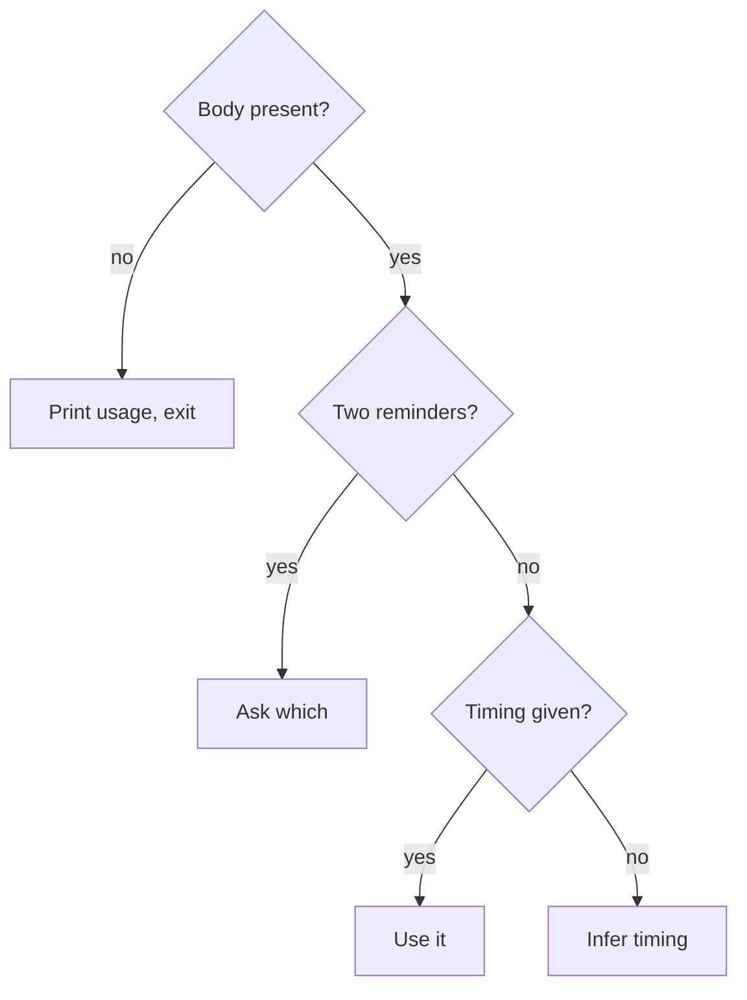
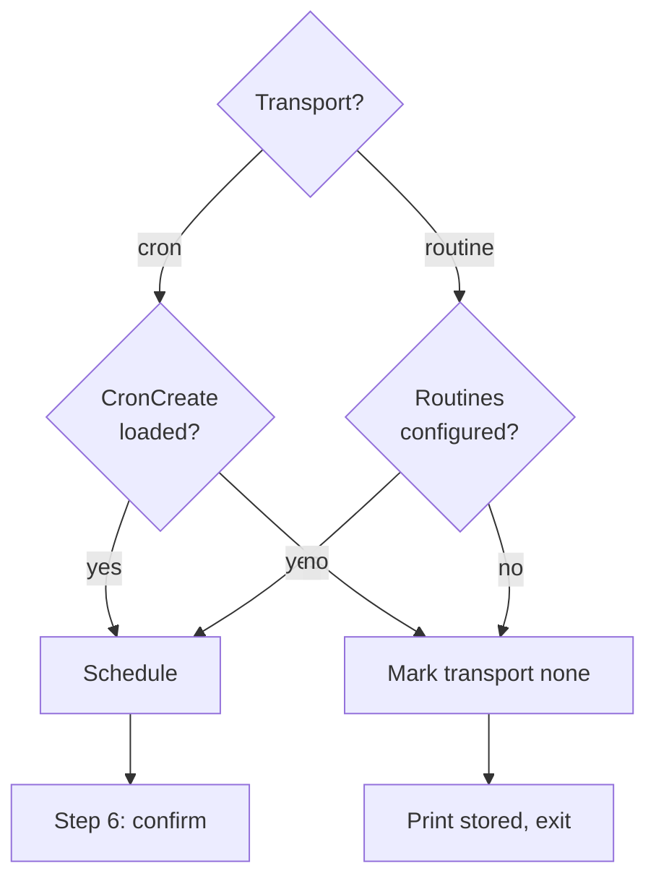

Schedule a reminder that fires at a future time. The user speaks naturally; you infer when it should fire.

Spec: `docs/spec/cron-workflow.md § /remind-me <prose>`

## Usage

```
/remind-me <anything the user wants to be reminded about>
```

`$ARGUMENTS` is free-form natural language. You are an LLM — infer timing from whatever the user wrote. All of these are valid:

<examples>
<example>
/remind-me 3d fix this issue
→ duration: 3d, body: "fix this issue"
</example>
<example>
/remind-me make paste for my mom on tuesday
→ duration: compute days until next Tuesday, body: "make paste for my mom"
</example>
<example>
/remind-me check if deploy finished in 30m
→ duration: 30m, body: "check if deploy finished"
</example>
<example>
/remind-me revisit error handling in ingest by June 1st
→ duration: 2026-06-01, body: "revisit error handling in ingest"
</example>
<example>
/remind-me follow up on the PR before end of week
→ duration: compute days until Friday, body: "follow up on the PR"
</example>
<example>
/remind-me refactor the user module by next friday
→ duration: compute days until next Friday, body: "refactor the user module"
</example>
</examples>

Canonical storage units: `<n>s`, `<n>m`, `<n>h`, `<n>d`, `<n>w`, `<n>months`, or ISO date `YYYY-MM-DD`. Convert all natural-language time references to one of these silently. Today's date is always available in context for computing relative dates.

<workflow>

## Steps

### Step 1 — Parse arguments

Read `$ARGUMENTS` as natural-language prose. Infer two things:

- **`<duration>`** — when the reminder should fire. May be explicit (`3d`, `2h`, `2026-06-01`) or implicit ("tuesday", "next week", "before the release", "end of sprint", "tomorrow morning"). You are an LLM — compute relative dates from today's date in context. Round fuzzy phrases to the nearest canonical unit silently.
- **`<body>`** — the user's intent, with any time-reference phrase removed. Strip glue prepositions (`in`, `after`, `within`, `by`, `before`, etc.) that only existed to connect the timing to the rest.

A reminder needs a body; missing timing is inferred, never asked for.



- **Body present?**: empty arguments and a duration with no body (e.g. `/remind-me 3d`) both count as no body.
- **Print usage, exit**:

    ```
    usage: /remind-me <anything>
    examples:
      /remind-me fix the deploy in 3 days
      /remind-me make paste for mom on tuesday
      /remind-me check CI before end of week
      /remind-me follow up on the PR
    ```

- **Ask which**: e.g. `"fix bug A by 3d, bug B by 1w"`. Surface both interpretations and ask which the user meant, or whether to create two separate reminders.
- **Infer timing**: e.g. `/remind-me follow up on the PR`. First match wins:
    1. The body references a known deadline (sprint end, release date, review_by from a follow-up) → align to it.
    2. The body implies urgency ("check if build passed", "see if deploy finished") → `1h`.
    3. Otherwise `3d` — a forgotten reminder is worse than a slightly-early one. State it: `inferred: 3 days (no timing specified). scheduling.`

### Step 1b — Verify inference

Before proceeding, state in one line what you inferred: `reminder: "<body>" — fires: <human-readable when>`. This gives the user a chance to correct before scheduling proceeds. Continue immediately (do not wait for confirmation) — the user can interrupt if the inference is wrong.

### Step 2 — Compute due time

`due = now + <duration>`.

- For `d`, `w`, `months` durations and ISO dates: time component defaults to **09:00 local**.
- For `h`, `m`, `s` durations: use absolute time from now.

Format `due` as ISO 8601 UTC (`YYYY-MM-DDTHH:MM:SSZ`) for storage and scheduling.

### Step 3 — Pick transport

| Duration | Transport | Scheduling tool |
|----------|-----------|-----------------|
| `< 1h` | `cron` | `CronCreate` (session-only) |
| `>= 1h` | `routine` | `schedule` skill / Routines (cloud-durable) |

The `1h` boundary is inclusive: `1h` → `routine`. ISO dates are always `routine`.

### Step 4 — Store the reminder

```bash
atomic reminder add --due "<iso>" --transport "<cron|routine>" "<body>"
```

Capture the id from stdout (e.g. `r-7b21ef`).

### Step 5 — Schedule via chosen transport

An unavailable scheduling tool degrades silently to a stored reminder that the session-start hook surfaces once past due.



- **Routines configured?**: the `schedule` skill is available and Routines auth is configured.
- **Schedule**: the prompt is `/follow-up due <id>` either way. `cron`: `CronCreate` with a one-shot trigger at `due`. `routine`: the `schedule` skill with the same trigger time and prompt; capture the routine id if returned.
- **Mark transport none**: rewrite the reminder file's frontmatter, where `<reminders-dir>` is `atomic where --json`'s `reminders` field:

    ```bash
    sed -i '' 's/^transport: .*/transport: none/' <reminders-dir>/<file>
    ```

- **Print stored, exit**: do **not** raise an error. Print:

    ```
    reminder stored. id: <id>. transport unavailable — will surface via session-start hook when past due (<human-readable due>).
    ```

### Step 6 — Confirm to the user

On success:

```
reminder scheduled. id: <id>. fires: <human-readable when>. transport: <cron|routine>.
```

Example:

```
reminder scheduled. id: r-7b21ef. fires: Thu 29 May 09:00 local. transport: routine.
```

</workflow>

<constraints>

## Rules

- The reminder file is always written before scheduling is attempted. A failed or unavailable transport never loses the reminder body.
- No state other than `due:` is ever rewritten after creation (snooze/reschedule rewrite `due:` via `atomic reminder set-due`; see `/follow-up`).
- The `transport:` field in frontmatter reflects the actual scheduling outcome (`cron`, `routine`, or `none` on degradation).
- The transport-specific schedule id (cron id, routine id) is **not** stored in the file. Claude finds it at action time by matching the prompt content (`/follow-up due <id>`) via `CronList` or routine listing.
- Reminder storage is project-scoped, at the `reminders` path `atomic where --json` reports. Persists across sessions and worktrees of the same clone. Paths come from `atomic scratchpad` / `atomic where --json`.
- The slug in the filename is cosmetic. The `id` field in frontmatter is the canonical key.

</constraints>
