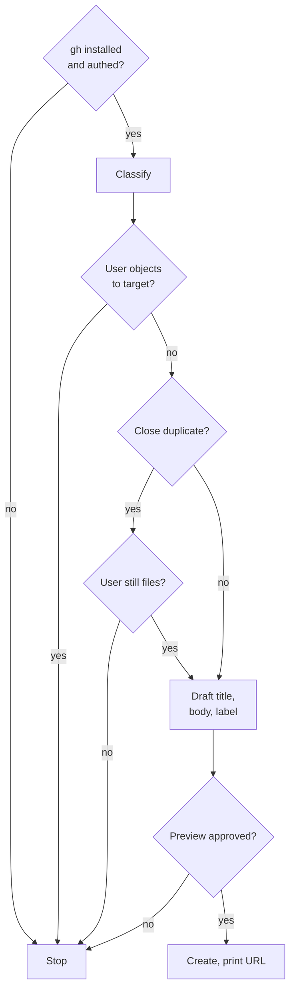

## Scope

This command files an issue against **atomic-claude** (`damusix/atomic-claude`) — the system that installs commands, skills, agents, and the output style into a harness's config directory. Use it when the problem is with atomic-claude's behavior, not the user's current repo. For issues in the user's current project, use `/report-issue` instead.

Hardcoded target: `damusix/atomic-claude`. Do **not** infer the target from `gh repo view` or cwd — the user is almost always inside a different repo when invoking this.

**Invoked from `/retrospective-learning`.** The retrospective audit routes its atomic-meta tier (finding tier 3 — frustration positionally co-located with an atomic artifact in the session) to this command. When the user opts "Open issue" on a meta finding, the audit prints the runnable `/report-issue-with-atomic <one-line summary>` and lets the user invoke it themselves with the surrounding context. Auto-invocation is forbidden — per axiom 3, issue creation is a public action and the user submits the body. See `commands/retrospective-learning.md` for the upstream contract.

## Steps

<workflow>

An issue is created only after `gh` is ready, the user accepts the target, no duplicate stops it, and the user approves the rendered preview.



- **gh installed and authed?**: `command -v gh` — if missing, tell the user to install (`brew install gh` / `winget install --id GitHub.cli` / https://cli.github.com/) then `gh auth login`. `gh auth status` — if unauthed, tell the user `gh auth login`.
- **Classify**: read the user's description: **bug** vs **feature/enhancement** vs **question**. If ambiguous, ask once.
- **User objects to target?**: say one sentence: "Filing against `damusix/atomic-claude` (not your current repo)." Proceed unless the user objects.
- **Close duplicate?**: `gh issue list --repo damusix/atomic-claude --search "<key terms>" --state all --limit 5`. On a close match, surface its URL and ask before opening a new one.
- **Draft title, body, label**:
    - Version: run `atomic --version` and include it in the body.
    - Templates: `gh api repos/damusix/atomic-claude/contents/.github/ISSUE_TEMPLATE 2>/dev/null` — when templates exist, prefer `--template <file>`; otherwise build the body inline.
    - Title: imperative for features (`Add X`), declarative for bugs (`/commit skips signals refresh on staged-only changes`). ≤70 chars. No "Bug:" / "Feature:" prefix.
    - Body: per the shape below (HEREDOC). Atomic tone — drop filler, exact symbols in backticks, no hedging, no AI bylines. Redact per the **Privacy** section as you draft — never write raw PII, secrets, or third-party identifiers into the body. This target repo is public, so redaction is not optional.
    - Label: `bug` → `bug`, `feature/enhancement` → `enhancement`, `question` → `question`. Verify it exists first with `gh label list --repo damusix/atomic-claude --search <name>`; skip it if it doesn't (don't auto-create). User-specified labels stack on top.
- **Preview approved?**: print the full rendered issue — title, body, target repo, labels — and get an explicit go-ahead before creating. See **Privacy**.
- **Create, print URL**: `gh issue create --repo damusix/atomic-claude --title "<title>" --body "$(cat <<'EOF' … EOF)" [--label <classified>] [--label <user-specified>]`, then print the issue URL.

</workflow>

{{ template "report-issue-privacy" . }}

## Body shapes

### Bug

```markdown
## Summary

<one-line statement of what's broken in atomic-claude>

## Repro

1. <step — exact command or skill trigger>
2. <step>
3. <step>

## Expected

<what atomic-claude should do per its spec / docs>

## Actual

<what happens, including exact error message or wrong output in a code block>

## Environment

- `atomic --version`: <x>
- Install method: <curl install.sh | brew | source | docker>
- OS: <x>
- Harness and version: <x if known>
- Affected artifact: <command/skill/agent/output-style name>
```

### Feature / enhancement

```markdown
## Problem

<the friction or gap in atomic-claude's current behavior>

## Proposal

<what to add or change — name the specific command/skill/agent if applicable>

## Why now

<context — skip if obvious>

## Out of scope

- <thing this issue is not>
```

### Question

```markdown
## Question

<the question, specific>

## Context

- `atomic --version`: <x>
- What was tried: <x>
- Where stuck: <x>
```

## Rules

<constraints>

- Hardcoded `--repo damusix/atomic-claude` on every `gh` call. Never omit.
- No AI bylines. No "I think" / "maybe" / "perhaps". State facts.
- Code blocks for exact errors and commands.
- One issue per invocation — if user describes multiple unrelated problems, ask which to file or split.
- If the user's description sounds like a problem with their *current project* (build error, test failure in their code, their PR not merging), redirect them to `/report-issue` instead.

</constraints>
