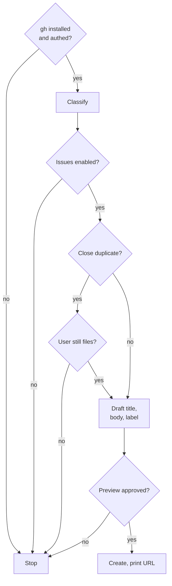

## Steps

<workflow>

An issue is created only after `gh` is ready, no duplicate stops it, and the user approves the rendered preview.



- **gh installed and authed?**: `command -v gh` — if missing, tell the user to install (`brew install gh` / `winget install --id GitHub.cli` / https://cli.github.com/) then `gh auth login`. `gh auth status` — if unauthed, tell the user `gh auth login`.
- **Classify**: read the user's description: **bug** vs **feature/enhancement** vs **question**. If ambiguous, ask once.
- **Issues enabled?**: `gh repo view --json nameWithOwner,hasIssuesEnabled`.
- **Close duplicate?**: `gh issue list --search "<key terms>" --state all --limit 5`. On a close match, surface its URL and ask before opening a new one.
- **Draft title, body, label**:
    - Templates: `gh issue create --help` notes `--template`. When `.github/ISSUE_TEMPLATE/` has templates, prefer `--template <file>` and let the user fill in via editor; otherwise build the body inline.
    - Title: imperative for features (`Add X`), declarative for bugs (`X crashes when Y`). ≤70 chars. No "Bug:" / "Feature:" prefix unless repo convention demands.
    - Body: per the shape below (HEREDOC). Atomic tone — drop filler, exact symbols in backticks, no hedging, no AI bylines. Redact per the **Privacy** section as you draft — never write raw PII, secrets, or third-party identifiers into the body.
    - Label: `bug` → `bug`, `feature/enhancement` → `enhancement`, `question` → `question`. Verify it exists first with `gh label list --search <name>`; skip it if it doesn't (don't auto-create). User-specified labels stack on top.
- **Preview approved?**: print the full rendered issue — title, body, target repo, labels — and get an explicit go-ahead before creating. See **Privacy**.
- **Create, print URL**: `gh issue create --title "<title>" --body "$(cat <<'EOF' … EOF)" [--label <classified>] [--label <user-specified>]`, then print the issue URL.

</workflow>

{{ template "report-issue-privacy" . }}

## Body shapes

### Bug

```markdown
## Summary

<one-line statement of what's broken>

## Repro

1. <step>
2. <step>
3. <step>

## Expected

<what should happen>

## Actual

<what happens, including exact error message in a code block>

## Environment

- Version / commit: <x>
- OS: <x>
- Runtime: <x>
```

### Feature / enhancement

```markdown
## Problem

<the user-facing pain, not the proposed solution>

## Proposal

<what to add or change>

## Why now

<context — skip if obvious>

## Out of scope

- <thing this issue is not>
```

### Question

```markdown
## Question

<the question, specific>

## Context

<what was tried, what was read, where stuck>
```

## Skill invocation

Atomic-review skill not invoked — issue bodies are not finding lists. Tone comes from the active output style.

## Rules

<constraints>

No AI bylines. No "I think" / "maybe" / "perhaps". State facts. Code blocks for exact errors and commands. One issue per invocation — if user describes multiple unrelated problems, ask which to file or split.

</constraints>
