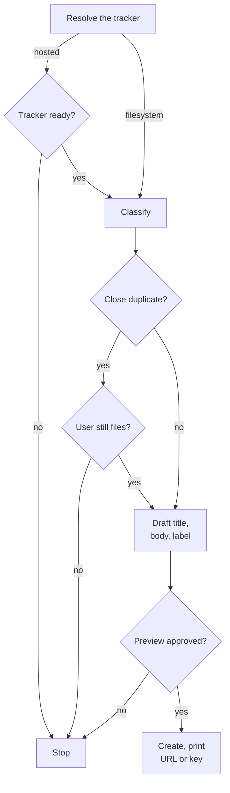

## Steps

<workflow>

An issue is created only after the tracker is ready, no duplicate stops it, and the user approves the rendered preview.



- **Resolve the tracker**: {{ template "resolved-provider" "issue-tracker" }}
- **Tracker ready?**: skipped for `issue-tracker: filesystem`, since the local ledger has no sign-in and no project. For a hosted tracker, the `auth-check` the reference names passes, and its `project-identifier` row resolves to one project. On failure, print the reference's install or sign-in guidance and stop. When several projects are reachable and `issue-tracker-project` is unset, ask the user which one.
- **Classify**: read the user's description: **bug** vs **feature/enhancement** vs **question**. If ambiguous, ask once.
- **Close duplicate?**: the `issue-search` operation with the key terms. On a close match, surface its URL or key and ask before opening a new one.
- **Draft title, body, label**:
    - Templates: when the `template-location` row names templates that exist in this repository, start the body from the matching one; otherwise build it inline.
    - Title: imperative for features (`Add X`), declarative for bugs (`X crashes when Y`). ≤70 chars. No "Bug:" / "Feature:" prefix unless repo convention demands.
    - Body: per the shape below. Atomic tone: drop filler, exact symbols in backticks, no hedging, no AI bylines. Redact per the **Privacy** section as you draft; never write raw PII, secrets, or third-party identifiers into the body.
    - Label: `bug` → `bug`, `feature/enhancement` → `enhancement`, `question` → `question`. Keep it only when the `label-list` operation reports it; never create one. User-specified labels stack on top, under the same rule. The `filesystem` ledger has no labels: a bug takes `--severity risk`, a question `--severity question`, and a feature or enhancement `--kind plan`, with a kebab-case `--id` derived from the title and `--origin "/report-issue"`.
- **Preview approved?**: print the full rendered issue (title, body, target project, labels) and get an explicit go-ahead before creating. See **Privacy**.
- **Create, print URL or key**: the `issue-create` operation with the title, body, and kept labels, then print the URL or key it returns. When the reference applies labels in a separate step, follow with `label-apply`.

</workflow>

## Privacy: redact before posting

{{ template "report-issue-privacy" . }}

## Body shapes

### Bug

```markdown
## Summary

<one-line statement of what's broken>

## Repro

1. <step>
2. <step>
3. <step>

## Expected

<what should happen>

## Actual

<what happens, including exact error message in a code block>

## Environment

- Version / commit: <x>
- OS: <x>
- Runtime: <x>
```

### Feature / enhancement

```markdown
## Problem

<the user-facing pain, not the proposed solution>

## Proposal

<what to add or change>

## Why now

<context — skip if obvious>

## Out of scope

- <thing this issue is not>
```

### Question

```markdown
## Question

<the question, specific>

## Context

<what was tried, what was read, where stuck>
```

## Skill invocation

Atomic-review skill not invoked — issue bodies are not finding lists. Tone comes from the active output style.

## Rules

<constraints>

No AI bylines. No "I think" / "maybe" / "perhaps". State facts. Code blocks for exact errors and commands. One issue per invocation — if user describes multiple unrelated problems, ask which to file or split.

</constraints>
