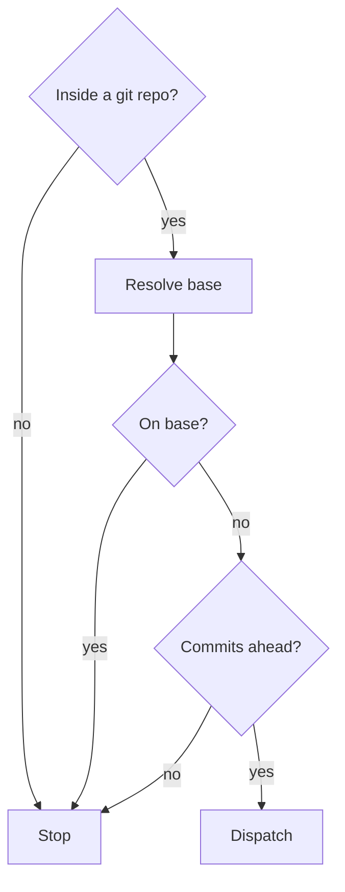

Thin wrapper. Runs `atomic-reviewer` once on `<base>..HEAD`, returns its standard `## Spec compliance` + `## Code quality` + signals block + `VERDICT:` output.


<workflow>

## Pre-flight


Only a feature branch with commits ahead of its base reaches the reviewer.





- **Inside a git repo?**: `git rev-parse --is-inside-work-tree`. No: `not a git repo. /review-branch needs a versioned project.`
- **Resolve base**:

    ```bash
    gh repo view --json defaultBranchRef -q .defaultBranchRef.name 2>/dev/null \
      || git config init.defaultBranch \
      || echo main
    ```

- **On base?**: compare `git branch --show-current` with the base. Yes: `refused: already on <base>. /review-branch reviews a feature branch against its base.`
- **Commits ahead?**: `git rev-list --count <base>..HEAD`. `0`: `refused: no commits on this branch ahead of <base>. nothing to review.`


## Dispatch


Capture the SHAs:


```bash
BASE_SHA=$(git merge-base <base> HEAD)
HEAD_SHA=$(git rev-parse HEAD)
FEATURE=$(git branch --show-current)
```


Dispatch `atomic-reviewer`, fresh context. Prompt:


    ```
    Review the diff <base>..HEAD on the current branch. No spec is provided — this is
    a pre-PR / pre-merge branch review, not a spec-compliance check.

    Branch: <feature>
    Base: <base>
    Base SHA: <BASE_SHA>
    HEAD SHA: <HEAD_SHA>
    Repo: <pwd>

    Skip the spec-compliance pass — emit `## Spec compliance\n\n(no spec — branch review only)`.

    Run the code-quality pass thoroughly. Verify TDD signals as usual:
      - typecheck (project-detected command from docs/wiki/index.md if present)
      - tests
      - build
      - lint

    Emit the standard output format ending with VERDICT: PASS or VERDICT: CHANGES_REQUESTED.
    ```


## Report


Pass the reviewer's output through to the user verbatim. Do not summarize, do not add commentary — the reviewer's findings are the deliverable.


Append one line at the end:


```
suggested next step (on PASS):
  /commit pr    → open PR for review
  /commit merge → merge into <base>
```

</workflow>

<constraints>

## Rules


- One reviewer dispatch per invocation. No loop, no fix-and-retry. The user picks what to do with the findings. **Why:** auto-retrying hides the true diff state and conflates review with implementation — the user must own the fix decision.
- Never invoke the implementer or write code. Reviewer reports; user (or `/subagent-implementation`) fixes. **Why:** mixing reviewer and implementer roles in one command collapses the review signal — findings lose their independent authority.
- Do not commit, push, or merge. This command is pure read-only inspection. **Why:** a review command that mutates state is a footgun; the user must explicitly choose the next ship verb after seeing the verdict.
- If the reviewer returns `CHANGES_REQUESTED`, do not advise the user to "address them" — the findings speak for themselves. **Why:** adding a nag comment after the reviewer output is redundant noise and implies the command is narrating rather than the reviewer speaking directly.
- Spec-compliance pass is skipped intentionally. Use `/subagent-implementation` for the orchestrated implement→review loop with a spec. **Why:** without a spec there is no contract to measure against; emitting a compliance section would be fabricated and misleading.

</constraints>
