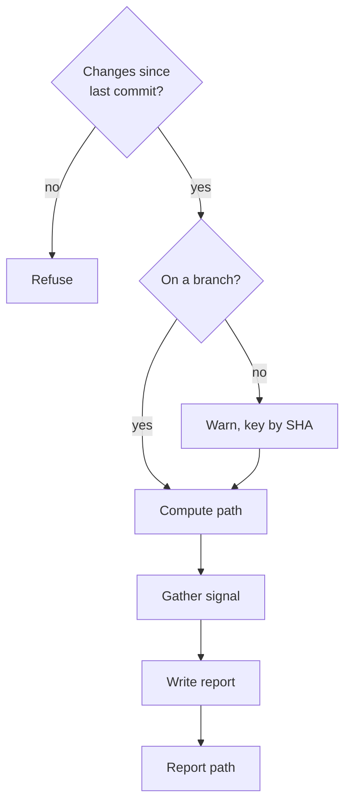

## When to use

Long-running branch spanning multiple Claude Code sessions. The eventual commit (or squash) needs the *why* behind the work, but `git diff` alone loses that. Run `/session-report` at the end of a session to capture intent for the future commit-message synthesis.

Opt-in only. Does not auto-fire.

<workflow>

## Flow

A report is written only when the tree has changes, and a detached HEAD scopes it to the commit SHA instead of a branch.

- **Changes since last commit?**: `git status --porcelain` prints anything. No: `refused: no changes since last commit — nothing to report.`
- **On a branch?**: `git branch --show-current` prints a name.
- **Warn, key by SHA**: use `git rev-parse --short HEAD` and warn `detached HEAD — report scoped to <sha> not a branch.`
- **Compute path**: dir is `atomic where --json`'s `reports` field — already branch-scoped, with the legacy fallback folded in. Never construct it by hand. Filename `<YYYY-MM-DD-HHMM>-<slug>.md`; slug from `$ARGUMENTS` if provided, otherwise inferred from the most prominent change in the working tree (one or two kebab-case words). On a collision (same minute + same slug) append `-2`, `-3`, etc.
- **Gather signal**: `git status --porcelain` (touched files, staged + unstaged), `git diff --stat` and `git diff --cached --stat` (magnitude per file), and recent conversation context — what was tried, what was rejected, what the user clarified mid-flight.
- **Write report**: seed the path from the embedded template — `atomic template session-report > <path>` — then fill every `<angle-bracket>` placeholder (frontmatter + `## What changed` + `## Why` + optional `## Open threads`) and delete the guidance comment.
- **Report path**: print `wrote <reports-dir>/<file>.md`, using the `reports` path from `atomic where --json`.

</workflow>

<output_format>

## Voice

`atomic-writing` voice at the length budget it gives a short-lived state file: bullets and short paragraphs, no narrative. Not atomic output style, which governs Claude's replies rather than file contents. Internal context that the commit-message synthesis will read.

## Lifecycle

Reports persist on disk until consumed by a successful commit on the same branch. Each report is consumed and deleted by the next successful ship-verb commit (see "Ship-verb integration" in `docs/spec/session-report.md`). Failed or aborted commits leave reports in place for the next attempt.

If a branch is abandoned without a commit, `/git-cleanup` reaps its reports immediately — no grace window — as soon as the branch is gone from `git branch -a`, since a gone branch has no future commit left to consume them. Paths come from `atomic scratchpad` / `atomic where --json`; if what you find on disk does not match, run `atomic migrate --show-log` for the change history.

## Cross-references

- **`atomic-git-discipline` skill** — receives the concatenated reports for the current branch as supplemental context when synthesizing the commit message.
- **Ship verb that consumes reports:** `/commit` (all escalation paths). Reads all reports for the current branch before message synthesis and deletes the branch's reports dir after a successful commit.
- **Exempt paths** (no commit-message generation): `/commit push` / `/commit pr` / `/commit merge` when run with commits already ahead of base and nothing to commit, and `/commit squash merge` on a single-commit branch with nothing to commit — these ship existing commits unchanged.
- **Full spec:** `docs/spec/session-report.md`.

</output_format>

<constraints>

## Rules

- Never stage the report file. It lives outside the repository, under `~/.atomic/<project-key>/reports/<branch>/` — there is nothing to stage.
- One report per invocation. If the user wants two slices of the same session captured separately, they call `/session-report` twice with different slug arguments.
- No follow-up commits. The session report is consumed by the next commit on the branch; do not generate one of your own.

</constraints>
