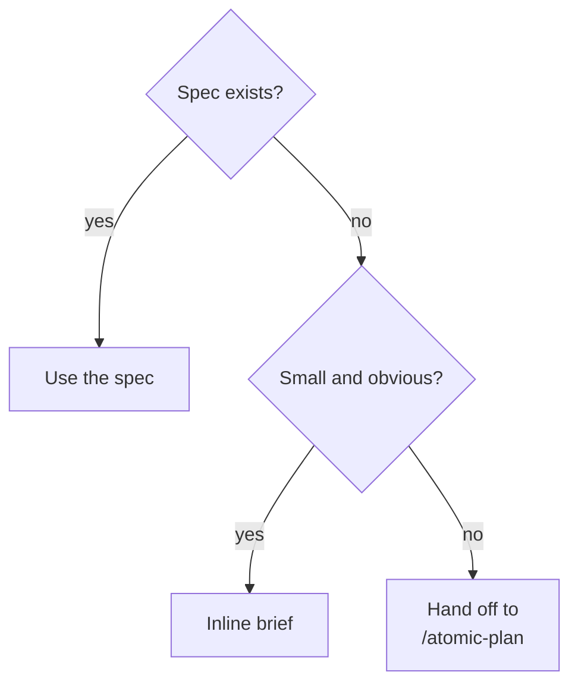

You orchestrate; you do not write the code. Fresh-context subagents do, and the scratchpad brief is their only handoff.

<workflow>

## Policy

| Setting | Value |
|---------|-------|
| Writer | `atomic-implementer` |
| Entry | hand-off table, plus: no spec and the work is more than a small obvious change → `/atomic-plan` first |
| Worktree | ask (skip the question when the work is small) |
| Stuck | ask |
| Non-blockers | ledger |
| Finalize | verify, docs, audit, follow-ups, log, signals, report |
| Scratchpad purpose | `implement` |
| Ship | no |

{{ template "handoff" . }}

## Understand

Dispatch `atomic-investigator` to map the surface (files, call sites, tests, conventions) unless the task names exact files. Lead it with `atomic code explore "<area>"` when an index exists. Read only what its `file:line` table says you need for scoping; do not implement.

## Spec

Topic slug from the task. The loop runs from a spec, or inline only when the work is small and obvious.

- **Spec exists?**: `docs/spec/<topic>.md`.
- **Use the spec**: it is the brief's source and its checkpoint table is the loop. Its body must be current before any dispatch: a decision in this conversation that superseded part of it is fixed in the spec, never worked around in the brief.
- **Inline brief**: say `no spec; proceeding inline` and continue with a one-checkpoint brief.

{{ template "worktree-setup" . }}

{{ template "implement-loop" . }}

{{ template "loop-finalize" . }}

</workflow>
