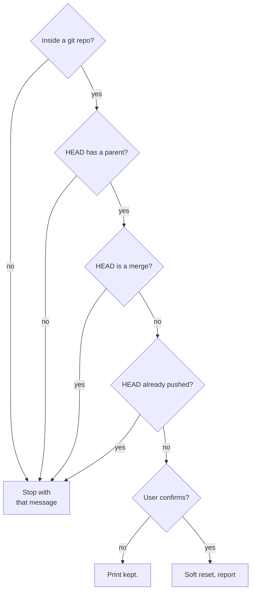

Reverses one commit without losing the work. Equivalent to `git reset --soft HEAD~1` with safety guards.


<workflow>

## Flow


Only a local, non-merge commit with a parent is undone, and only after the user confirms it.





- **Inside a git repo?**: `git rev-parse --is-inside-work-tree`. No: `not a git repo. /undo-commit requires a git repository.`
- **HEAD has a parent?**: `git rev-parse HEAD^ 2>/dev/null` succeeds. No: `refused: HEAD is the initial commit. nothing to undo.`
- **HEAD is a merge?**: `git rev-list --parents -n 1 HEAD | awk '{print NF-1}'` prints `2` or more. Undoing a merge is destructive in a non-obvious way, so it goes back to the user. Yes: `refused: HEAD is a merge commit. use git reset --hard ORIG_HEAD manually if you understand the consequences.`
- **HEAD already pushed?**: a soft undo of a published commit would rewrite public history. `git rev-parse --abbrev-ref --symbolic-full-name @{u} 2>/dev/null` finds the tracking branch; with none, HEAD is not pushed. With one, `git merge-base --is-ancestor HEAD @{u}` exiting 0 means pushed. Yes: `refused: HEAD is already pushed to <upstream>. /undo-commit only undoes local commits. use git revert <sha> for a published commit.`
- **User confirms?**: show what is about to be undone with `git log -n 1 --format='  %h %s%n  %an, %ar%n%n  Files:%n' HEAD` and `git diff --stat HEAD^..HEAD`, then ask the user:

    ```
    Undo this commit? Changes will be moved back to the staging area.
    - Yes, undo
    - No, keep it
    ```

- **Print kept.**: print `kept.` and take no action.
- **Soft reset, report**: `git reset --soft HEAD~1`, then print:

    ```
    undone. HEAD now at <new-sha-short>.
    prior commit's changes are staged. inspect with: git status, git diff --cached
    to re-commit: /commit
    to discard: git restore --staged <paths> then git restore <paths>
    ```

</workflow>

<constraints>

## Rules


- `--soft` only. Never `--mixed`, never `--hard`. The user's work stays in the index where it's visible and recoverable.
- Refuse on initial commit, merge commit, or pushed HEAD. These cases need human judgment.
- One commit per invocation. To undo multiple, run again — the per-invocation confirm forces deliberate steps.
- Print every git command before running it.
- Do not stage, do not commit, do not push. After `git reset --soft`, control returns to the user.
- This is the only command that mutates history. Treat it as destructive (axiom 3) — never act without the per-item Yes.

</constraints>
