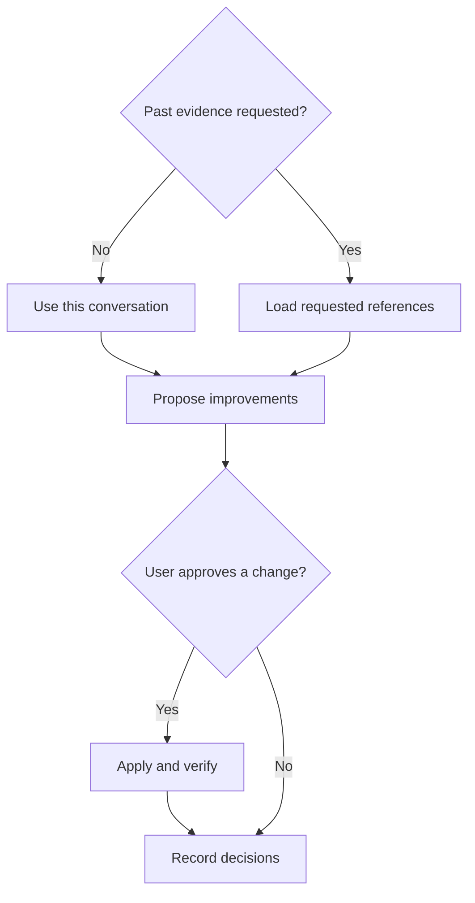

Use `/retro [focus]` to find changes worth making. By default, read only the current conversation and the artifacts relevant to its findings. Honor a focus that narrows the review. Ask one scope question only if the request is ambiguous and the answer changes which evidence you need.

## How a retro leads to changes

The user approves each change before it is applied.

- **Load requested references:** For past sessions, read [history.md](references/history.md). To check whether earlier accepted changes still hold, read [drift.md](references/drift.md). Load both only when both are requested. A request for history alone does not authorize drift checking.
- **Propose improvements:** Tie each finding to a correction, repeated request, or observed failure. Read the relevant rule, skill, or project instructions before proposing an edit. Name the evidence, target, and exact change. Combine duplicates and omit speculative findings. If nothing warrants a change, say so. Leave general health checks to `atomic doctor` and `atomic validate`.
- **Apply and verify:** Let the user accept, revise, or skip each proposal. Preview the exact patch and scope for hooks or settings before asking for approval. Preserve unrelated settings and existing hooks. Report failed writes separately. Never restore a prior rule, publish an issue, or commit as a side effect. For a problem in Atomic itself, offer `/report-issue-with-atomic`.
- **Record decisions:** When decisions are made, write a run record using [run-records.md](references/run-records.md). Recording this run does not require reading prior records. Report what changed and how it was verified.

Check `~/.atomic/profile.md` only when the reviewed evidence points to a conflicting personal fact. Propose a correction for approval and leave machine-derived facts to the profile tools.
