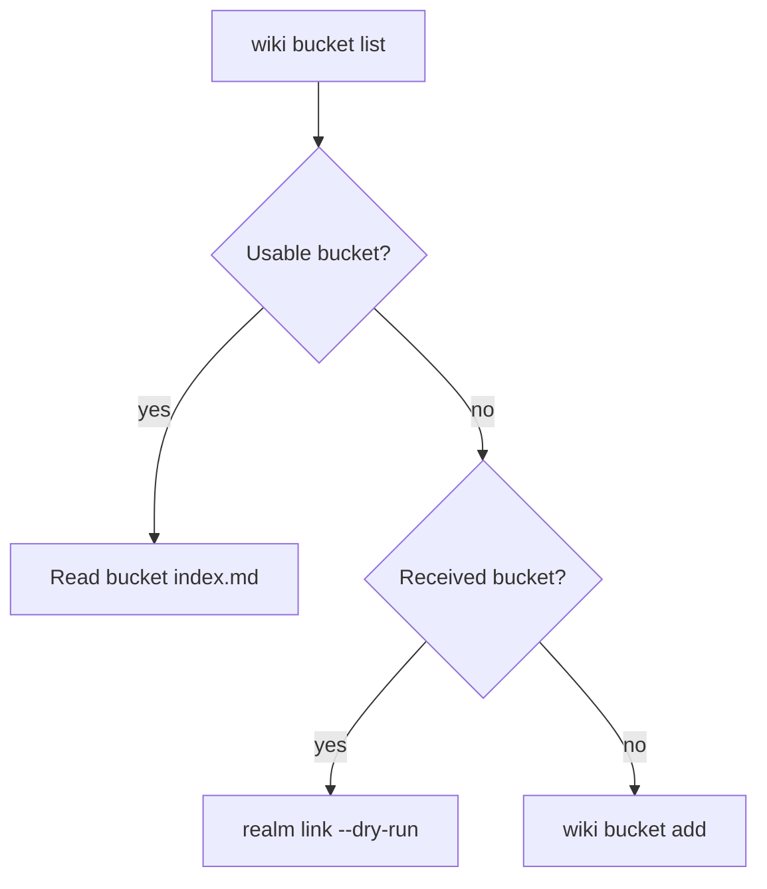

<trigger>

Auto-fires on:

- "I want a place for my notes / research / tickets / raw dumps"
- "create a space for [notes|tickets|research]" — any capture-intent phrase
- "add a bucket", "add this to my wiki", "wiki this"
- "set up a karpathy wiki", "karpathy realm", "set up a wiki for my projects"
- "what does my wiki know about X"
- "is my wiki stale"

</trigger>

Conversational entry point for wiki and capture-bucket operations. Code writes structure; the model writes meaning.

## Realm resolution

Run `atomic where --json` to locate the realm. The global `<wikis>` block projects `~/.atomic/wikis.md`; each realm entry points to `<realm-root>/wiki/index.md`. Target the logical realm root, not the managed checkout.

- **Inside a realm**: run bucket commands with `--root <realm-root>`. Check `atomic --repo <realm-root> realm status --json` for a binding and received paths. A status error other than an unbound realm needs diagnosis, not a fallback to unbound writes.
- **No registered realm + setup intent**: run `atomic wiki scan --root <realm-root>`. Ask which folder to use only if the intended root is ambiguous.

## Pipeline routing

Use the `<wiki-type>` tag to pick the inference pipeline. `<wiki-type>repo</wiki-type>` in `docs/wiki/index.md` routes `/refresh-wiki` to `references/repo.md`. `<wiki-type>realm</wiki-type>` in an independent `wiki/index.md` routes `/refresh-wiki [root]` to `references/realm.md`. Both dispatch `atomic-wiki-inferrer`. For a linked `wiki/`, edit the selected files directly and use `atomic realm sync` only when the user requests publication. `/refresh-wiki` assumes the wiki has its own Git repository.

The pipeline text lives **only** in the reference files registered as this skill's `references/` — not here, and not duplicated in the agent's system prompt. `atomic-wiki-inferrer` preloads this skill through its `skills:` frontmatter, reads the reference file under the base directory the runtime reports for it, then executes it.

## Bucket creation route

List usable buckets before registering or writing. A received bucket is a separate link decision, even when its name matches the request.

- **`wiki bucket list`**: `atomic wiki bucket list --root <realm-root>` reads the wiki registry when unbound. In a bound realm it lists usable private registrations and verified linked shared buckets. It omits received but unlinked buckets; check `atomic realm status` for the declared path and any collision.
- **`realm link --dry-run`**: If the user wants the received bucket, preview the selected realm-relative path. Link only after the user reviews and trusts the selection. Stop on a private collision; do not replace or re-register the local bucket.
- **`wiki bucket add`**: Before indexing an existing folder, tell the user that eligible subfolders will gain `index.md` files. Run `atomic wiki bucket add <name> --root <realm-root>`. It creates missing stubs and rebuilds `<bucket-docs>`. `wiki` is reserved.

Ask the user for the bucket's purpose and fill in its root `index.md` purpose and `## Conventions`.

| Realm | Where to record the purpose and registration |
|-------|----------------------------------------------|
| Unbound | `bucket add` registers the path in `wiki/index.md` and creates a `## Capture surfaces` bullet in `AGENTS.md` or `CLAUDE.md`. Fill the bullet's description placeholder. The command clears `declined="true"` when it registers a bucket. |
| Bound | `bucket add` registers the new bucket privately in `<state-root>/realm-share.toml`. Add a purpose hint only to existing local private notes, if appropriate. Do not add the private path or purpose to the shared wiki, team instructions, or a loader. |

Registering a bucket does not publish it. Promote only on explicit request: preview `atomic realm share --dry-run <bucket>/` and review the folder and registration before approval. A first share needs `--remote <git-url>` for an existing empty remote. To apply `share` or `link` without a prompt, repeat the explicit inputs with `--yes --review <digest>` from the approved preview. Receiving another developer's bucket with `sync` does not link it. Do not `sync` as a side effect of capture.

## Bucket doc authoring route

When the user wants a new item inside a registered bucket, or asks about a bucket's own conventions:

- `atomic wiki bucket doc <bucket> <slug>` scaffolds an item folder: `<bucket>/<slug>/index.md` (six-key frontmatter, `created` pre-stamped) and `<bucket>/<slug>/01_raw/index.md`, the stage that collects source material. Later stages are numbered folders the user adds (`02_findings/`, `10_publish/`). Refuses a slug that names a folder the index skips (`build`, `dist`, `target`, `tmp`, `vendor`). Refuses when `<bucket>/<slug>` already exists; never overwrites.
- `atomic wiki bucket skill <bucket>` scaffolds `<realm-root>/.claude/skills/<bucket>-management/SKILL.md`, pre-filled with the bucket's purpose line. No-op if the file exists.
- `atomic wiki bucket index [<bucket>]` rebuilds `<bucket-docs>` for a bucket, or for all usable registrations when omitted. It rebuilds `<wiki-bucket-list>` from those registrations only in an unbound realm. `atomic wiki scan` already rebuilds eligible bucket indexes; run the verb directly to force a rebuild.

To read a bucket, start at its root `index.md` and descend one `index.md` at a time.

See `references/realm.md` for the full frontmatter contract.

## Karpathy-wiki setup route

When the user asks to set up a wiki for a folder of projects:

1. Run `atomic wiki scan --root <realm-root>` to scaffold `wiki/` and classify member repos.
2. Offer bucket names: `research` (raw material lives in each item's `01_raw/` stage), `notes`, and `tickets` are examples; user defines the actual names.
3. Register the chosen buckets and fill their purpose using the route above.
4. Point at `/refresh-wiki` for an independent wiki's `wiki/repos/` summaries and `wiki/concerns/`.

Commit an independent wiki inside its own `wiki/` repository. A linked wiki belongs to the managed clone; publish approved shared edits with `atomic realm sync`, not a wiki-local commit. Scope any repo signals scan to the member repository, not the realm root or the backing clone.

## Query and staleness route

- **"what does my wiki know about X"** → read `wiki/index.md`, `wiki/repos/`, `wiki/concerns/`, and the bucket indexes returned by `atomic wiki bucket list`. Summarize what is present; say explicitly if nothing matches.
- **"is my wiki stale"** → run `atomic wiki stale --root <realm-root>`. It compares local membership with the recorded `<wiki-scan>` block. Exit 0 = no drift. Exit 1 = stdout lists `DRIFT added|removed|status` lines. Exit 2 = hard error. A local scan does not replace the block in a linked wiki.

## Conventions that prevent foot-guns

- `<wiki-scan>` and `<wiki-buckets>` blocks in `wiki/index.md` are code-owned — never hand-edit them.
- Edit one summary or concern directly for a small change. Use `/refresh-wiki [root]` for several only when the wiki is independent.

<constraints>

## Boundaries

- **Complements /refresh-wiki**: `/refresh-wiki` is the synthesis engine (repo signals refresh, realm repo summaries, concern re-auth, linkify). This skill is the conversational entry point — it registers and describes; `/refresh-wiki` synthesizes.
- **Not invoked by other commands.**
- **Never bare mkdir** for capture intent in a registered realm. `atomic wiki bucket add` is the only correct path — it writes the index stub and the registry entry.

</constraints>
