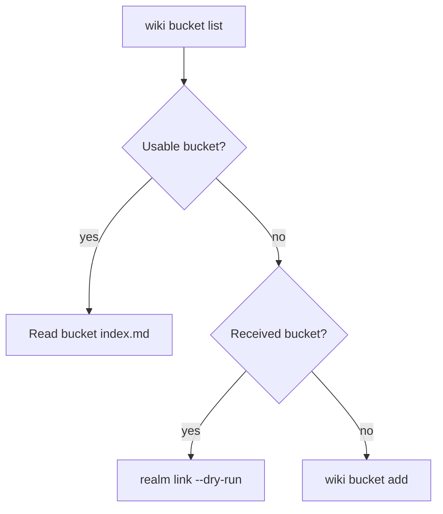

<trigger>

Auto-fires on:

- "I want a place for my notes / research / tickets / raw dumps"
- "create a space for [notes|tickets|research]" — any capture-intent phrase
- "add a bucket", "add this to my wiki", "wiki this"
- "set up a karpathy wiki", "karpathy realm", "set up a wiki for my projects"
- "what does my wiki know about X"
- "is my wiki stale"

</trigger>

Conversational entry point for wiki and capture-bucket operations.

## Realm resolution

Run `atomic where --json` to locate the realm. The global `<wikis>` block projects `~/.atomic/wikis.md`; each realm entry points to `<realm-root>/wiki/index.md`. Target the logical realm root, not the managed checkout.

- **Inside a realm**: run bucket commands with `--root <realm-root>`. Check `atomic --repo <realm-root> realm status --json` for a binding and received paths. Diagnose status errors other than an unbound realm.
- **No registered realm + setup intent**: run `atomic wiki scan --root <realm-root>`. Ask which folder to use only if the intended root is ambiguous.

Repo wiki refresh is manual: `/refresh-wiki` dispatches `atomic-wiki-inferrer` using `references/repo.md`. Realm capture uses the bucket routes below, not a synthesis pipeline.

## Bucket creation route

List usable buckets before registering or writing. A received bucket requires a separate link decision, even if its name matches the request.

The selected bucket must be usable before capture.

- **`wiki bucket list`**: Run `atomic wiki bucket list --root <realm-root>`. In a bound realm, check `atomic realm status` for received but unlinked paths and collisions.
- **`realm link --dry-run`**: Preview the selected realm-relative path. Link only after the user reviews and trusts it. Stop on a private collision; do not replace or re-register the local bucket.
- **`wiki bucket add`**: Before indexing an existing folder, tell the user that eligible subfolders will gain `index.md` files. Run `atomic wiki bucket add <name> --root <realm-root>`. It creates missing stubs and rebuilds `<bucket-docs>`. `wiki` is reserved.

Ask for the bucket's purpose and fill its root `index.md` purpose and `## Conventions`.

| Realm | Purpose and registration |
|---|---|
| Unbound | `bucket add` registers the path in `wiki/index.md` and creates a `## Capture surfaces` bullet in `AGENTS.md` or `CLAUDE.md`. Fill its description placeholder. |
| Bound | `bucket add` registers the bucket privately in `<state-root>/realm-share.toml`. Add a purpose hint only to existing local private notes, if appropriate. Do not expose the private path or purpose in shared wiki, team instructions, or a loader. |

Registering a bucket does not publish it. Promote only on explicit request: preview `atomic realm share --dry-run <bucket>/` and review the folder and registration before approval. A first share needs `--remote <git-url>` for an existing empty remote. To apply `share` or `link` without a prompt, repeat the explicit inputs with `--yes --review <digest>` from the approved preview. Receiving a bucket with `sync` does not link it. Do not `sync` as a side effect of capture.

## Bucket doc authoring route

When the user wants a new item inside a registered bucket, or asks about a bucket's conventions:

- `atomic wiki bucket doc <bucket> <slug>` scaffolds `<bucket>/<slug>/index.md` and `<bucket>/<slug>/01_raw/index.md`. Later stages are numbered folders the user adds. It refuses existing targets and skipped folder names.
- `atomic wiki bucket skill <bucket>` scaffolds `<realm-root>/.claude/skills/<bucket>-management/SKILL.md`, pre-filled with the bucket's purpose. It does nothing if the file exists.
- `atomic wiki bucket index [<bucket>]` rebuilds `<bucket-docs>` for one bucket, or all usable registrations when omitted. It rebuilds `<wiki-bucket-list>` only in an unbound realm. `atomic wiki scan` also rebuilds eligible bucket indexes.

Start at the bucket's root `index.md` and descend one index at a time. See `references/realm.md` for frontmatter and managed regions.

## Karpathy-wiki setup route

When the user asks to set up a wiki for a folder of projects:

1. Run `atomic wiki scan --root <realm-root>` to scaffold `wiki/` and classify member repos.
2. Offer bucket names such as `research`, `notes`, and `tickets`; the user chooses.
3. Register chosen buckets and fill their purpose using the route above.

## Query and staleness

- **"what does my wiki know about X"**: Read `wiki/index.md` and the indexes returned by `atomic wiki bucket list`. Read relevant existing pages and summarize what is present; say if nothing matches.
- **"is my wiki stale"**: Run `atomic wiki stale --root <realm-root>` and report its output and exit status. This is an explicit check, not a request to refresh or synthesize prose.

`<wiki-scan>` and `<wiki-buckets>` in `wiki/index.md` are code-owned. Do not hand-edit them.

<constraints>

## Boundaries

- **Repo refresh**: `/refresh-wiki` synthesizes repo wiki pages only.
- **Capture**: use `atomic wiki bucket add` for a registered realm, not bare `mkdir`.
- **Safety**: do not publish or link private or received content without explicit review and approval.

</constraints>
