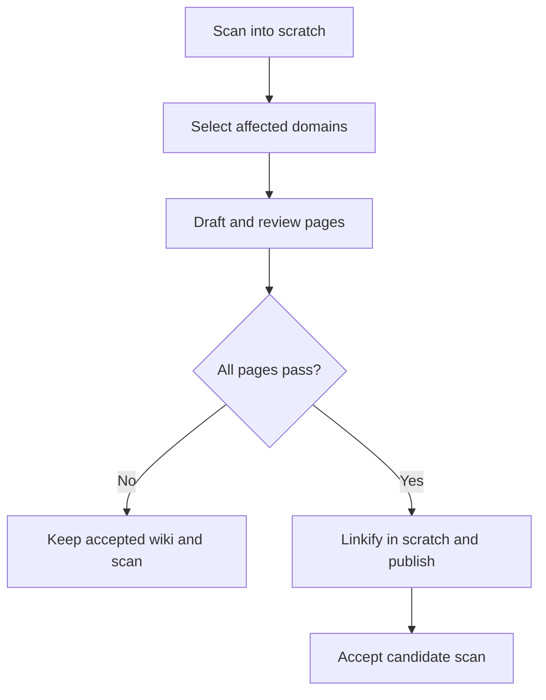

# Refresh a repository wiki

The accepted scan changes only when the corresponding wiki is ready. Draft and review changes away from the live wiki.

## Find what changed

- Read the active wiki steering file using `repo-output.md`. Keep the live scan and its index fingerprint unchanged. Run `atomic signals scan --out <scratch-dir>`; the candidate is `<scratch-dir>/docs/wiki/scan.md`. Stop on error and report it verbatim.
- Use full refresh on first run, when the accepted scan or index is missing, when an existing wiki has no canonical cards, when `<scan-sha>` differs from the accepted scan's `git hash-object`, or when added plus removed scan lines exceed roughly 20% of the accepted scan. Honor an explicit full request. Only use incremental when the baseline and cards are present and valid.
- For incremental refresh, compare accepted and candidate scans. Include changed paths from any supplied Git range and relevant uncommitted changes. Map additions, changes, and removals to their domains, including coupled pages affected by renamed or removed paths. Ignore `[generated]` paths for prose and change detection. Keep unaffected pages byte-identical.
- Partition by functional concern, not directories alone. Keep existing domain names when ownership still matches. Assign disjoint source paths and applicable `docs/design/` files to each domain; use the design's `domain:` or the source paths it describes.

## Draft and review

Load [repo-output.md](repo-output.md) for the output contracts. Dispatch `atomic-wiki-writer` per affected domain with its source paths, assigned designs, steering, existing page if any, and a scratch output path. Require source-backed facts and the domain page format. Keep judgments outside the page.

Send `atomic-reviewer` the draft, source and design paths, writer concerns, and the domain page checklist from the output contract. Verify claims and diagrams against source, including stale diagrams reported separately. Send corrections back to the writer; stop after three review attempts per domain. If any required page remains unresolved, report it and leave the live wiki and baseline unchanged. Collect source-only concerns separately for the caller.

## Publish accepted outputs

- Reconcile cross-domain links; recheck any substantive edits made after page review. Prepare the router and pointer cards using the output contract. Emit all cards on bootstrap or full refresh, otherwise only affected cards. Delete orphaned generated pages and cards only when their domain has been removed or renamed. Preserve manual files and unrelated edits.
- Linkify in an isolated scratch checkout with current source paths and approved drafts placed at their final paths. Run `atomic --repo <scratch-checkout> signals linkify` there, never against the live wiki. Check that live outputs and scan inputs have not changed since review before publishing only approved pages and the router.
- Wire the router and publish canonical cards. If a repo-local ignore rule hides the cards, add path-relative negations for `rules/wiki/` and its contents to that ignore file and verify both. On a harness-aware CLI, run `atomic wiki init --scope repo` after writing cards. Quote errors verbatim and block if expected projections are unresolved. Include repo-owned links and removals in the handoff, never generated OMP copies for external state roots.
- Keep the old fingerprint live through publication. If wiring, ignores, or projection changed scan inputs, rerun the scratch scan and review the new impact before accepting it. Do not absorb unrelated source edits. Accept the final scan and matching index fingerprint last; keep the prior pair in scratch and restore it if either acceptance write fails. Report any partial publication.
- Report `refreshed` only on acceptance. Otherwise report `blocked`, the reason, and whether any files changed. Include scan and index paths, wiring, cards emitted or removed, ignore edits, and any `## Concerns`. Do not stage or commit.

Write only task scratch files, repo wiki outputs, canonical cards, their repo ignore rule, router steering, and the harness projections made by wiki init. Leave realm wikis and capture buckets alone.
