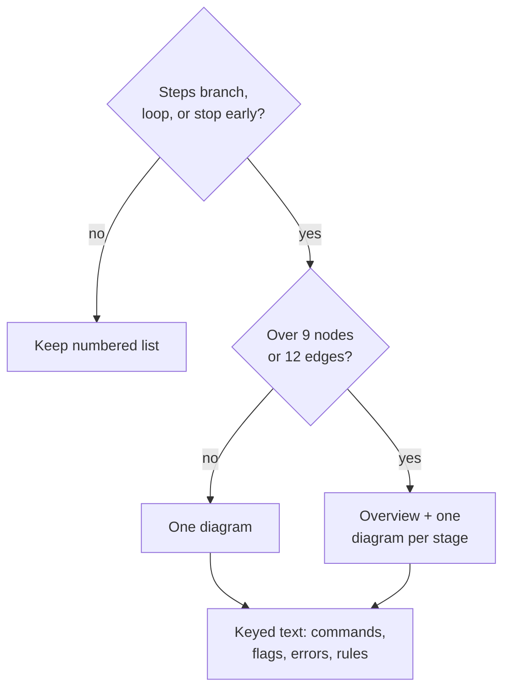

# Artifacts: draw branching flows as Mermaid

## Problem

Command, agent, skill, and partial bodies describe flows that branch or loop as numbered prose. A reviewer has to rebuild the branching in their head: the push, PR, merge, and squash partials, the signals gate, and the implement loop are the worst cases. Models read Mermaid flowcharts and state diagrams without trouble, so one drawn flow serves the person reviewing the artifact and the model executing it. The user evaluated converted artifacts against the prose versions and got identical results (issue #298).

A second source of noise is guard prose for atomic's own pieces: "skip silently if `atomic` is not on PATH", "degrade when the binary is unavailable", "if `atomic template` fails, stop". Every artifact ships inside the `atomic` binary and is installed by it, so the binary is always present when the artifact runs. The guards add branches that never fire.

## Goals / Non-goals

- Goals: every numbered sequence under `context/` that encodes a decision tree becomes a Mermaid flowchart or state diagram that replaces it; guards on atomic's own binary, skills, commands, and agents are removed; the writing skill states the rule so future artifacts follow it.
- Non-goals: the Atomic output style (stays token-compressed); TUI replies; straight sequences with no branch (stay numbered lists); checks on third-party tools (`gh`, `git`, `bun`, Claude Code tools such as `CronCreate`) and on data state (an index DB file present or not, a file that may not exist); any renamed command, changed verb, or new artifact; Go code.

## Approaches

| # | Approach | Pros | Cons |
|---|----------|------|------|
| A | Diagram above the existing steps | No information lost | Two sources of truth that drift; more tokens; the issue rejects it |
| B | Diagram replaces the steps; a short "Commands" list under it carries the exact commands, flags, and error strings keyed by node label | One source; the branching is visible; exact text survives where a label cannot hold it | Some flows exceed the 9-node budget and need splitting into an overview plus per-stage diagrams |
| C | Everything into the diagram, labels carry full commands | Fewest sections | Labels break the 24-character width limit and the parser (parens, colons, pipes in commands) |

## Recommendation

B. The diagram carries the decisions; node labels are short names (`Dirty tree?`, `Push -u`); the text right under the diagram carries what a label cannot: the exact command, the flag, the error string to print, and the rules ("never force-push the base branch"). Each text entry starts with the node label in bold so the two are joined by name.

Type choice follows `context/skills/atomic-writing/references/mermaid.md`: `flowchart TD` for a decision tree, `stateDiagram-v2` where the claim is which transitions are legal (the implement loop's Implement → Review → Triage → Commit cycle, the stuck check). Layout limits are the reference's table: at most 9 nodes, 12 edges, 2 back edges, labels at most 24 characters per line, quoted labels, no color.

**Partials.** A partial is expanded into a numbered list in its host (`commit-flow` step 4 is the `review-gate` template directive). The diagram lives inside the partial body, so it expands wherever the partial does. The host list stays numbered when the host itself is a straight sequence.

**Guards.** Removed: any branch on `command -v atomic`, "skip silently when `atomic` is absent", "degrade when the binary is unavailable", "if `atomic template`/`atomic prompt` fails, stop", and fallbacks written for a missing binary (`setup-wiki`'s binary-absent rows, `follow-up`/`remind-me` "binary present" branches, `agent-where` graceful degradation). Kept: `gh` missing or unauthed, `git` checks, Claude Code tool availability (`CronCreate`, Routines), index-DB present or absent (data state, not the binary), `atomic signals stale` exit 2 (an error code the binary itself returns).

**Writing rule.** `atomic-writing`'s diagram floor currently tells prompt artifacts to prefer ASCII unless Mermaid saves lines. That conflicts with this decision, so it changes to: prompt artifacts draw branching flows as Mermaid and keep straight sequences as numbered lists. `references/mermaid.md` widens its scope from `docs/` files to every artifact source under `context/`.

**Rendering check.** `context/` is not part of the VitePress build, so the site build does not parse these blocks. Each block is parsed with the real Mermaid parser in headless Chromium (the repo's `mermaid` and `playwright` devDependencies) and linted against the layout table.

## Open questions

- None. A conflict between a validation rule and a diagram or a removed guard is recorded in the task state, never resolved by weakening the rule.
