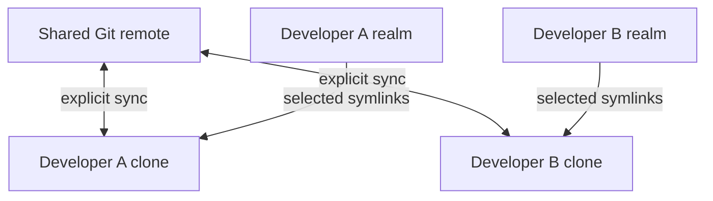
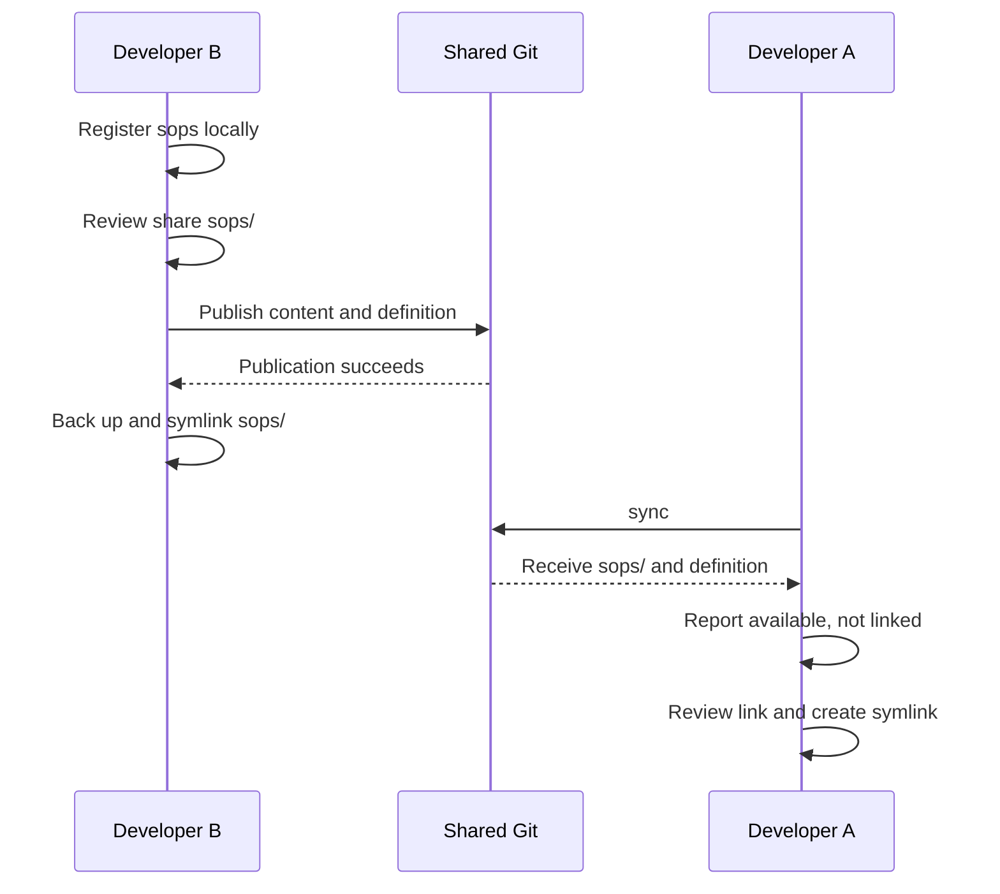
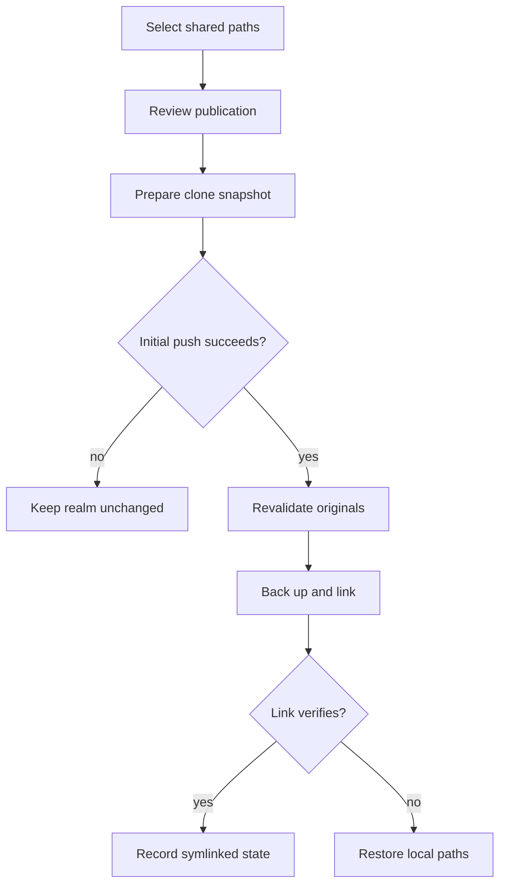
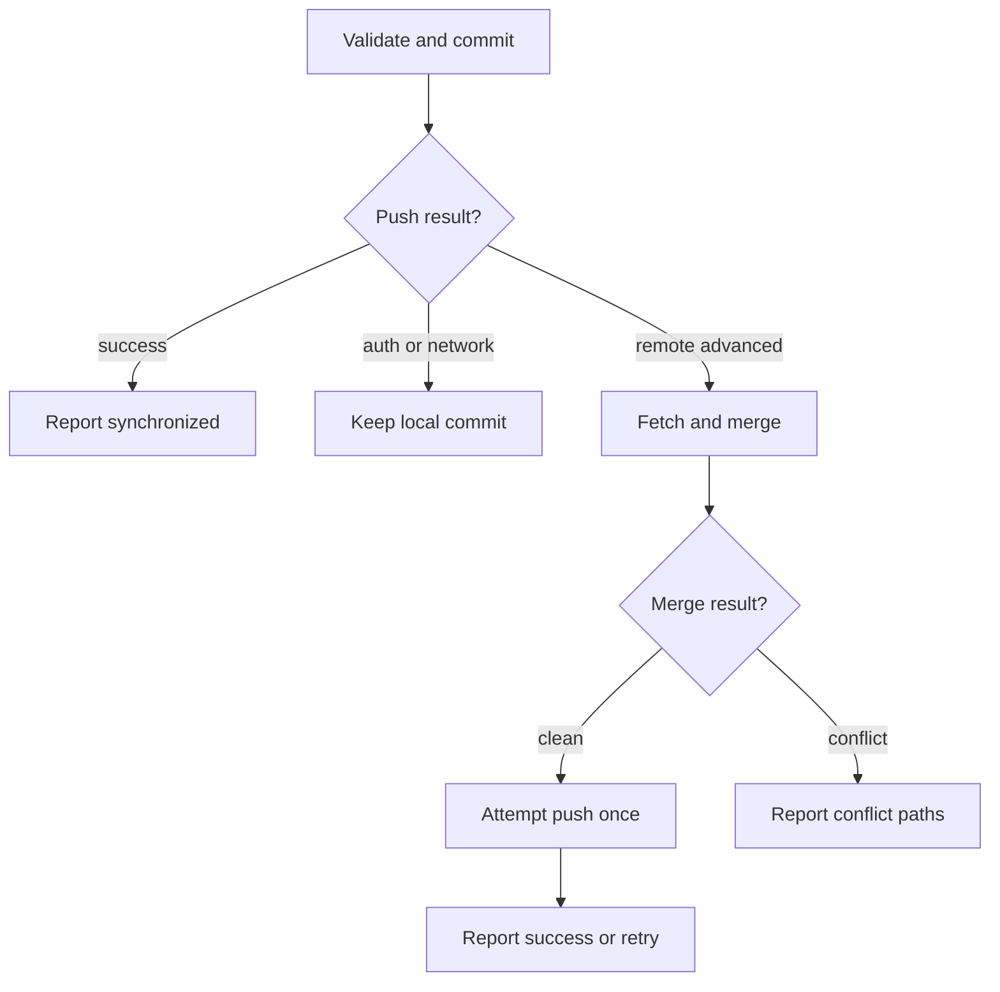

# Realm sharing

## Problem

A developer can assemble a realm with instructions, a wiki, capture folders, and member repositories, but colleagues cannot reproduce that arrangement from one portable definition. Sharing the wiki alone leaves configuration and source material behind.

Realm sharing gives each developer a local workspace backed by a separate Git clone. Use it to exchange selected realm content without sharing credentials or managing colleagues' code branches.

The shared clone stores content; each developer works through paths in their own realm.

`atomic realm link` creates native filesystem symbolic links from local realm paths to the clone. `atomic realm unlink` removes only recorded symlinks and restores retained originals. No filesystem driver or background process is involved.

Developer A runs these commands from an existing local realm:

    atomic realm share
    atomic realm sync

Developer B runs these commands from their own local realm directory:

    atomic realm join <git-url>
    atomic realm link
    atomic realm sync

Either developer can inspect or disconnect the arrangement:

    atomic realm status
    atomic realm unlink

## Goals / Non-goals

| Kind | Boundary |
|---|---|
| Goal | Publish selected configuration, team instructions, wiki content, capture folders, skills, commands, and agent definitions through an ordinary Git remote. |
| Goal | Preserve a developer's local realm identity while reads and writes reach shared content through symlinks. |
| Goal | Convert an extensive existing realm with a preview, retained originals, and recoverable symlinking. |
| Goal | Make synchronization explicit and suitable for an agent or an explicitly configured hook. |
| Non-goal | Background watchers, automatic synchronization hooks, hosted collaboration services, and real-time editing. |
| Non-goal | Pulling, committing, cloning, or switching branches inside member code repositories. |
| Non-goal | Sharing personal realm instructions, credentials, session state, caches, machine-local paths, hooks, MCP connections, or harness permission settings. |
| Non-goal | Consolidating historical repositories, multiple shared remotes per local realm, or providing a security sandbox. |

## Approaches

| # | Approach | Sketch | Cost | Risk |
|---|---|---|---|---|
| A | Document ordinary Git and manual symlinks. | Reuse native tools without adding a lifecycle command. | Low. | Developers must handle selection, recovery, portability, and agent orientation themselves. |
| B | Version the whole local realm. | Make the realm root a Git repository and exclude member repositories. | Medium. | Changes realm ownership and risks publishing private material and machine state. |
| C | Link content from a separate shared clone. | Reuse Git and native symlinks while keeping local identity and shared storage separate. | Medium. | Requires symlink ownership, bounded traversal, and protection against file-link replacement. |
| D | Copy selected files in both directions. | Keep independent local and shared working copies. | High. | Adds a second conflict mechanism outside Git. |

## Recommendation

Choose C. The [symlink experiment](../research/realm-sharing-symlinks.md) supports agent reads, edits, creation, and local follow-on work through symlinked paths. It also identifies discovery and file-replacement limits that the implementation must handle.

Reuse the Git executable, native symlinks, the existing configuration directory resolver, and realm markers. The checkout already registers CLI families in `atomic/cmd/atomic/main.go:123`, provides the global state root in `atomic/internal/config/paths.go:9`, and preserves logical wiki paths in `atomic/internal/wiki/registry.go:44`.

### Evidence and limits

| Evidence | Finding | Consequence |
|---|---|---|
| OMP 18.20.2 with `openai-codex/gpt-6.1-sol`, experiment trace. | The agent loaded a symlinked instruction token, edited a symlinked wiki note, created a symlinked research file, and returned to a local-only file. | Realm-local paths are a viable working surface with explicit local-root guidance. |
| Root glob/search versus explicit symlinked roots, experiment outputs. | Recursive searches from the realm root omitted symlinked directories; explicit roots found their contents. | Supply a local symlink index and route discovery through declared roots. Do not promise transparent behavior from third-party search tools. |
| `atomic/internal/wiki/bucket.go:41`. | The bucket fingerprint walker uses non-following `WalkDir`. | Registered symlinked bucket roots need bounded resolution before traversal. |
| `atomic/internal/wiki/bucket_registry.go:43`; `action.go:359`. | Bucket paths are written and consumed as absolute strings. | Shared registries need relative paths resolved against the consuming local realm. |
| `atomic/internal/wiki/registry.go:168`; atomic-rename probe. | Renaming a replacement onto a file symlink removes the link and leaves its target unchanged. | Atomic-owned writers must preserve declared file symlinks and write their validated targets. |
| Claude Code headless startup fixture. | The external symlink import did not load team guidance. A local Python `SessionStart` hook loaded the shared marker alongside a private marker with tools disabled and without `--add-dir`. | Load team text from its current source at startup instead of copying it or relying on the external import. |
| Installed Atomic `7.0.0-next.6 (6f16205)` versus checkout `b4ca195c`. | Runtime scaffolding and command behavior differ from this checkout. | Ground implementation paths in source and use resolved state paths rather than copying the fixture's `.atomic` spelling. |
| `pwd`, `pwd -P`, and installed `atomic where --json` from the symlinked `wiki` directory. | Logical cwd stayed under the local realm, but the report used symlinked-directory state and a backing-clone-derived reports key. | Symlinked descendants must reuse the local root's binding and state; shared content must not accumulate local state. |

### Shared and local ownership

| Surface | Ownership and rule |
|---|---|
| Shared `realm.toml` in the clone. | Contains a stable non-time-based identity, format version, selected source-to-destination mappings, artifact kinds, relative bucket locations, and member repository definitions. It contains no absolute developer paths, private loader content, or credentials. |
| `~/.atomic/realms/<name>/`. | Holds one developer's managed clone, with a configured remote and branch. Name collisions never reuse an unrelated repository. |
| `<state-root>/realm-share.toml`. | Holds the local binding, trust acceptance, private bucket registrations, pending sharing operations, loader and native-artifact ownership receipts, symlink receipts, and backup locations. The existing state-root resolver chooses its parent directory. It is never shared or symlinked. |
| Local realm root. | Remains the workspace and the base for relative paths, scope detection, wiki registration, agent instructions, and member repository discovery. |
| Selected shared sources. | Team guidance, wiki content, capture paths, skills, commands, and agents use explicit file or directory symlinks. Root instruction loaders and native artifact parent directories remain local; only declared sources and owned per-artifact entries are shared or projected. |
| Local symlink index. | Lists logical symlinked paths and tells the agent to use those roots for discovery. It names the local realm as the workspace; clone paths appear only in storage diagnostics and Git recovery instructions. |

A local realm binds to one managed clone. A clone binds to one local realm. A shared remote can have many independent developer clones.

Sharing configuration means selecting portable definitions, not copying an entire harness settings directory. Joining downloads content without activating prompt artifacts, executing hooks or scripts, connecting MCP servers, or granting permissions. Linking team instructions and artifacts requires explicit trust acceptance; the preview distinguishes copied source content from native activation.

Nested repositories are not recursively imported. The wiki is the supported content-import exception: copy its current content without `.git`, preserve the original wiki repository and history in the local backup, and explain that the new shared repository starts with a content snapshot. Other nested repositories require exclusion rather than implicit flattening.

Realm `/refresh-wiki` requires an independent wiki repository. A linked `wiki/` is content in the managed checkout and has no independent Git history. Edits through the link reach the checkout; `atomic realm sync` exchanges them explicitly.

### End-result realm usage

The team shares authored guidance and selected reusable artifacts. Each developer keeps private instructions and generated harness loaders in their own realm.

    realm/
      AGENTS.md                    local loader, never published
      CLAUDE.md                    local Claude loader when required
      AGENTS.local.md              private realm instructions, never published
      .agents/
        realm.md                   shared team instructions
        skills/review/SKILL.md      optionally shared skill and supporting files
        commands/triage.md          optionally shared command
        agents/reviewer.md         optionally shared agent definition
      .claude/                     local native entries, not a shared directory
      .omp/                        local native entries, not a shared directory
      wiki/                        optionally shared wiki
      research/                    optionally shared bucket

Atomic creates `AGENTS.local.md` locally when absent and keeps it out of the managed clone. Claude's local loader imports that file directly. The optional Atomic-owned `SessionStart` hook supplies validated team text separately.

The enrolled adapter composes team and private guidance for supported fresh primary OMP sessions with persisted enrollment and for supported fresh primary Codex sessions with local project trust and native startup hook approval. This startup evidence does not establish general slash invocation, resumed sessions, child agents, or inheritance into nested repositories.

Atomic previews hook installation only when Claude is enrolled, `claude` is on `PATH`, and the developer selects and trusts `.agents/realm.md`. A wiki-only link preserves Claude settings, loaders, and hooks; Atomic still records link ownership in its resolved state directory. Repeating the trusted instruction link after installing Claude adds one hook without replacing existing symlinks.

The local script reads only the validated instruction file in the bound clone and returns its text as context. Atomic never executes clone-supplied scripts. It reports missing prerequisites or content beyond Claude's documented hook context limit instead of claiming activation. Unlink removes the owned hook and registration without modifying user hooks or private instructions.

Clone write access is independent of startup loading. The `link` preview names the resolved checkout path for selections that need external write access, including wiki-only links. Atomic does not grant access. See the [realm sharing guide](../guides/realm-sharing.md#save-permission-to-write-through-a-link) for setup and links to the native tests.

| macOS native probe | Saved local access | Result through linked `wiki/` |
|---|---|---|
| Claude Code 2.1.328 in `acceptEdits` mode (`TestClaudeRealmWikiSavedWrite`) | `permissions.additionalDirectories` | Denied without the checkout root; wrote with it. |
| Codex 0.147.0 in `workspace-write` mode (`TestCodexRealmWikiSavedWrite`) | `sandbox_workspace_write.writable_roots` | Denied without the checkout root; wrote with it. |

Both deterministic loopback probes used a regular file under the linked directory, without `--add-dir`, an Atomic startup hook, or a hosted model. Claude's native Edit and Write tools refuse a standalone symlink at the final file path even with the directory grant. An editor that replaces the final path by rename can also detach a standalone file link. The separate [original OMP macOS study](../research/realm-sharing-symlinks.md) observed local reads, edits, file creation, and follow-on work without an extra directory grant. It did not exercise the current startup adapters. These results establish no Windows behavior.

| Instruction rule | Contract |
|---|---|
| Team guidance. | Edit `.agents/realm.md` through the realm path and run `sync` to exchange it. Selecting team instructions in the wizard selects this source, not the generated root loaders. |
| Personal guidance. | Edit `AGENTS.local.md`; it stays on this machine and is excluded from initial publication, additions, and every synchronization, including explicit attempts to select it. “Private” means not shared through Git; the local harness still reads it. |
| Existing instruction files. | Preserve authored content and backups. Separate team text from personal text before opting it in; do not silently classify prose or publish a mixed instruction file. Update only owned loader blocks, and refuse ambiguous replacement of existing files. |
| Imports and compatibility. | Resolve Claude's private import from its local loader, not from a shared file in the checkout. Use adapter-composed context where supported and report unsupported delivery separately from source availability. An unexpanded `@` token does not deliver guidance. |
| Loading order. | Load team guidance before personal realm guidance where the harness supports that order. Personal notes do not grant permissions or provide an enforceable override of conflicting policies. |
| Unlink and relink. | Preserve the private file and authored local text. Remove only owned shared references and projections, restore retained originals, and keep personal instructions loadable without dangling shared imports. Record the restored loader identity for safe relinking. |

### Opt-in skills, commands, and agents

Use `.agents/skills/`, `.agents/commands/`, and `.agents/agents/` as the realm's authored locations. `commands` is the canonical name for reusable slash workflows; do not introduce a synonymous `prompts` directory. Standalone prompt documents can still be shared as ordinary files without claiming native command registration.

| Selection | Sharing and activation |
|---|---|
| One skill directory. | Share its `SKILL.md` and reviewed supporting files together. Dependencies outside that directory must be selected explicitly or reported missing; do not pull private dependencies into the publication. |
| One command or agent file. | Share that authored file and its declared shared dependencies. Validate the receiver's native schema and capabilities before making it available to the harness. |
| An artifact collection. | A wizard's “select all” expands to the currently selected artifact units, not a symlink for the whole parent directory. Direct selection of `.agents/`, `.agents/skills/`, `.agents/commands/`, or `.agents/agents/` asks for explicit units or fails in noninteractive mode. New sibling artifacts remain local until opted in. |
| Personal or installed artifacts. | Keep unselected artifacts and existing harness-owned files untouched. Project individual shared entries only; never replace `.claude/`, `.omp/`, or their whole artifact directories with shared symlinks. |
| Native discovery. | Reuse the enrolled harness's supported project surface and adapters. Do not duplicate an entry already natively discovered from the canonical path. Report unsupported activation separately from content availability, and do not drop unsupported behavior fields while claiming successful activation. |
| Scope. | Activate only within the local realm's supported launch scope. Do not write global profile directories or member repositories to make realm artifacts appear elsewhere. Report repository-boundary and restart limitations instead of promising inheritance. |
| Trust. | Show instructions, scripts, dynamic command expansion, and agent options in the activation review. An artifact can cause later tool execution; Markdown is not a safety boundary. Linking authorizes the reviewed artifact and subsequent content updates from the trusted remote, not automatic permission grants. New artifact units require their own selection. |

The [realm sharing guide](../guides/realm-sharing.md#choose-what-a-fresh-agent-session-loads) owns the artifact sharing procedure. The link preview lists native destinations, collisions, support status, and restart or external-import approval requirements. `status` distinguishes available content, linked sources, active native entries, and unsupported activation.

### Native instruction and artifact evidence

| Primary source | Constraint on this design |
|---|---|
| [Claude memory documentation](https://code.claude.com/docs/en/memory#import-additional-files). | `@` imports are supported and relative to the importing file. `CLAUDE.local.md` is native personal context, but its presence can disable default `AGENTS.md` discovery; an explicit loader avoids that fallback. `AGENTS.local.md` and `.agents/` instructions are not automatically read by Claude. |
| [Claude skill documentation](https://code.claude.com/docs/en/skills#choose-where-skills-load) and [subagent documentation](https://code.claude.com/docs/en/sub-agents#choose-the-subagent-scope). | Claude uses `.claude/skills/`, `.claude/commands/`, and `.claude/agents/`. Skills support symlinked unit directories. Parent discovery stops at repository boundaries, so realm-wide inheritance cannot be assumed. |
| Installed OMP `src/discovery/agents.ts:157–300` and `src/task/discovery.ts:79–91`. | OMP has `.agents` discovery for some resource kinds, but task agents explicitly use `.omp/agents` and skip direct cross-harness agent roots. One directory spelling does not prove every kind is active. |
| Installed OMP `src/discovery/at-imports.ts:59–68`. | Context import expansion is file-relative. This is source evidence for a candidate loader, not a completed shared/private runtime probe. |
| Existing 7.0 harness adapter and capability research in `omp-rebase`. | The implementation base must include that existing adapter layer and its versioned capability gates before this feature starts. Reuse native rendering; do not implement a second discovery system or treat the installed prerelease as proof for this checkout. Claude model access and full realm-artifact runtime delivery still require their own acceptance runs. |

### Command behavior

| Command | User-visible contract |
|---|---|
| `share [<path>...]` | On an unbound realm, select an existing empty remote and the initial paths. On a bound realm, reuse its remote and add selected paths or bucket registrations. Preview and approve each publication, publish before replacing originals, and create owned symlinks after success. |
| `join <git-url>` | Download and validate an existing shared realm, record a local binding, and preview its symlinks. Do not link, overwrite local content, or clone member repositories. |
| `link [<path>...]` | Review and trust selected paths, validate mappings and collisions, then install owned symlinks and local orientation. Restored originals must match the recorded restoration identity; retain a recoverable backup before replacement. Repeating a trusted instruction link preserves correct symlinks and can install a newly eligible Claude hook. |
| `sync` | Operate on the bound clone without changing the caller's workspace. Commit selected changes, attempt a push, integrate remote commits when required, and report whether publication and receipt succeeded. Work while unlinked remains possible. |
| `status` | Inspect the binding, symlink ownership, local changes, cached ahead/behind counts, conflicts, and last successful synchronization. Mark remote knowledge as cached rather than claiming current remote state. Do not fetch or modify files. |
| `unlink` | Remove only unchanged owned links and restore retained originals. Preserve clone content, unpublished edits, the binding, and backups. Refuse to overwrite replacement files. Repeating a successful unlink is a no-op. |

All six commands provide help. `status --json` provides the same facts for agents and hooks. Mutations return a nonzero exit when they fail, require trust, or stop for conflict resolution; diagnostics identify preserved work and the next safe action. No command silently force-pushes, deletes a clone, discards edits, or restores files over user changes.

The remote is created through the developer's Git host before the first `share`; provider-specific repository creation is not part of these commands. A new binding requires an empty remote. An existing shared realm is joined, while a bound realm adds content to its recorded remote without selecting another repository.

### Remote selection and prompts

Humans use a terminal wizard. An agent uses the same operation with explicit arguments after presenting the preview through its harness's normal approval UI. Atomic does not require a separate browser application.

| Prompt | First `share` | Later `share` |
|---|---|---|
| Remote URL. | Paste the SSH or HTTPS clone URL of the empty repository. Check reachability and emptiness, and use Git's configured authentication. Do not infer a destination from a member repository's `origin` or request tokens in this form. | Display the recorded URL; reuse it. A conflicting `--remote` is an error, not a remote change. |
| Branch. | Offer `main` and accept an explicit branch name. Show the choice before publication. | Display and reuse the recorded branch. A conflicting `--branch` is an error. |
| Paths. | Select files, folders, team guidance, and individual artifact units from a checklist or enter realm-relative paths. Mark registered buckets and artifact kinds explicitly. New selections start unchecked; required shared metadata accompanies selected content. Private instructions and generated loaders are not selectable. | Show existing shared paths as already shared, and select additions. Ordinary folders include descendants subject to exclusions and Git ignore rules; artifact collections require explicit units. |
| Publication. | Show selected paths, bucket registrations, counts, bytes, exclusions, remote, branch, snapshot semantics, and local symlink changes. Require confirmation before publishing. | Show the added paths and metadata changes with the same confirmation. Do not silently include unrelated pending work. |

The command surface is:

    atomic realm share [<path>...] [--remote <git-url>] [--branch <name>] [--dry-run | --yes --review <digest>]
    atomic realm link [<path>...] [--dry-run | --yes --review <digest>]

| Input | Contract |
|---|---|
| Interactive invocation. | Missing choices open the terminal prompts. Path arguments preselect those paths but do not skip publication confirmation. |
| `--remote` and `--branch`. | Supply initial choices for noninteractive use. An omitted initial branch uses the displayed default `main`; a bound realm uses its binding. Credentials remain with Git, not the shared definition. |
| `--dry-run`. | Print the proposed effects and exactly one `Review digest: sha256:<hex>` line without persisting approval, changing files, or publishing. Mutually exclusive with `--yes` and `--review`. |
| `--yes --review <digest>`. | Pass the `sha256:<hex>` token unchanged. Apply only when it matches the current review, with or without a terminal. Reject missing paths or digest, a stale digest, and `--review` without `--yes` before mutation. Initial `share` also needs the remote; bound `share` uses the recorded destination. |
| No terminal. | Without sufficient explicit inputs and approval, return an actionable nonzero exit before mutation. Authentication failures must return an error rather than waiting for terminal input. |

The digest binds the operation, local realm, destination, selected paths, and reviewed effects. For `share`, it covers selected snapshot bytes and metadata, the Git base, and whether work remains to publish or only to link. For `link`, it covers the shared definition, selected instructions and other selected behavior artifacts, and local collision and restoration evidence. Unchanged previews produce the same digest across processes. Interactive confirmation approves the plan in memory; both modes revalidate under the mutation lock.

An agent can inspect a plan, ask the user through its native form, and then apply the approved selection:

    atomic realm share wiki/ raw/ research/ --remote git@github.com:acme/team-realm.git --branch main --dry-run
    atomic realm share wiki/ raw/ research/ --remote git@github.com:acme/team-realm.git --branch main --yes --review <digest>

These are proposed invocations, not commands executed by the symlink experiment. They assume `raw` and `research` are registered buckets in the local realm.

### Opting in files, folders, and buckets

Creating a local directory or registering a local bucket does not publish it. Registering a bucket gives it wiki semantics; sharing selects its content and portable registration for publication.

| Change | Required action |
|---|---|
| New file or subfolder inside an already-shared ordinary directory or skill unit. | The selection covers it unless excluded or ignored. The next `sync` publishes it; no new symlink is needed. A new sibling skill, command, or agent is a separate artifact unit and requires opt-in. |
| New sibling directory outside the selected paths. | Keep it local until `share <path>` explicitly adds it. |
| New individually shared file. | Use `share <file>`. Only that file is selected; adjacent files remain local. |
| New realm bucket `sops/`. | Run `atomic wiki bucket add sops`, then `atomic realm share sops/`. The first operation registers it locally; the second previews and publishes the bucket's content and portable registration together. |
| Existing selection. | Repeating `share` for an unchanged path and bucket role is a no-op. A directory already covered by a shared parent needs no additional mapping. |
| Private bucket metadata. | Keep unselected bucket registrations and discovery hints in local state. Do not add them to the shared wiki's generated registry or shared instructions. Shared generated registries contain only selected entries with realm-relative paths. |

In a shared realm, `atomic wiki bucket add` must preserve that local-only boundary even when the wiki and team instruction source are symlinks. Publishing a selected bucket promotes its registration to shared ownership after success; a failed publication leaves the local registration and original content intact.

Adding content reuses the initial publication safety rules: a reviewed snapshot, an approved commit, a successful push, source revalidation, retained originals, and then owned symlinks. Ordinary edits use `sync`; `share` publishes a new selection.

| Existing clone state | Addition behavior |
|---|---|
| Clean and synchronized. | Publish the selected addition and its required metadata as one reviewed change. |
| Unrelated edits, staged changes, or unpublished commits. | Refuse the addition before mutation and report that the existing work must be handled first. Do not include drafts in a folder-sharing confirmation. |
| Recorded incomplete sharing operation. | Repeating the same `share` resumes only that recorded selection after revalidation. Do not treat unrelated dirty state as permission to resume. A later `sync` may publish the retained commit but never silently replaces original local paths; report pending symlink creation until `share` completes it. |

### A colleague adds a shared bucket

Developer B can add a bucket without changing the realm's remote:

    atomic wiki bucket add sops
    atomic realm share sops/

For noninteractive operation, the second command has preview and approval forms:

    atomic realm share sops/ --dry-run
    atomic realm share sops/ --yes --review <digest>

Developer A receives the addition separately from linking it into their workspace:

    atomic realm sync
    atomic realm link

Receiving a new shared bucket does not automatically create a new local symlink.

`link` shows the newly available paths, lets the developer select additions, and checks for collisions before creating their symlinks. Existing owned links remain intact. If A already has a private `sops/`, Atomic reports the conflict and preserves it; it does not adopt that folder or change its private registration. `status` reports shared paths as linked, available but unlinked, conflicting, or pending completion.

### Converting an extensive realm

Publication must succeed before Atomic replaces original paths with symlinks.

| Condition | Required behavior |
|---|---|
| Large realm. | Preview each selected path, file count, total bytes, exclusions, remote, and branch before publication. Reject an unsupported file rather than silently omitting selected content. |
| Confidential material. | Use an allowlist. Exclude credential files, Git metadata, harness execution settings, caches, and session state. Explain that review is still required because arbitrary documents can contain secrets. |
| Edits during preparation. | Revalidate selected originals before cutover. If they differ from the prepared snapshot, stop without replacing them and report that preparation must be repeated. |
| Filesystem collision. | Accept an already-correct owned link. Occupied destinations are eligible only when receipts identify them as unchanged originals restored by `unlink`. Reject other occupied paths, unowned links, missing targets, overlapping mappings, and paths outside the allowed roots. |
| Existing originals in `share`. | Retain a recoverable local backup with symlink ownership receipts. Check available space and copy failures before cutover. |
| Restored originals on relink. | Compare the complete restored file or tree, including retained wiki Git state, against its restoration receipt rather than the current shared clone or timestamps. Revalidate all eligible originals before replacement and retain or re-establish recoverable backups. Changed originals or ambiguous ownership stop relink without replacing local paths. |
| Interrupted cutover. | Record enough progress to restore or finish the operation without guessing which files Atomic owns. |
| Failure after publication. | Restore local paths and report that the remote snapshot exists. Do not claim that a failed local link undid the remote push. |
| No symlink capability. | Fail before mutation with an actionable diagnostic. Do not silently switch to copying. |

### Synchronization and conflicts

Only non-fast-forward rejection calls for integrating remote commits; authentication and network failures preserve the local commit and report the actual failure.

| Rule | Contract |
|---|---|
| Ownership. | Synchronize only manifest-declared content and the shared definition. Reject unexpected staged paths, nested Git repositories, unsafe links, and an unfinished merge or rebase before creating a new commit. |
| Empty local changes. | Do not create an empty commit. Still receive remote work through the push/rejection integration path. |
| Remote changes. | Receive shared content and portable definitions without automatically creating new symlinks or registering private local paths as shared. Report newly available paths for explicit review through `link`; ordinary content changes appear through existing links after successful integration. |
| Merge conflicts. | Preserve standard Git conflict state, list both clone-relative and realm-local affected paths, and stop. A human or agent resolves and stages those paths and completes the merge using explicit `git -C <clone>` commands. A later `sync` publishes the result. |
| Concurrent pushes. | After one clean integration, attempt one further push. Another remote advance returns a retryable error with local commits preserved, not an unbounded retry loop. |
| Concurrent local operations. | Serialize Atomic mutations of the same clone. Preserve edits made after staging and do not report a clean realm while unpublished work remains. |
| Synchronization hooks. | Atomic installs no synchronization hook. An explicitly configured hook that invokes `sync` follows the same trust, conflict, and failure rules as direct invocation. |

### Existing realm consumers

Logical identity and physical I/O need separate treatment. Validate physical containment for declared symlinks, but retain local realm paths in scope decisions, output, links, and registrations.

| Consumer | Required compatibility |
|---|---|
| Wiki and bucket commands. | Resolve shared relative locations from the local realm and keep private registrations in local state. `bucket add` must not leak private paths into a shared wiki registry or shared instructions. Index and fingerprint declared symlinked roots without following arbitrary nested links, and do not initialize a second Git repository inside symlinked wiki content. |
| Atomic-owned instruction writers. | Distinguish shared `.agents/realm.md` content from local loaders and `AGENTS.local.md`. Preserve declared instruction-source symlinks, never publish loader/private bytes, and report an externally replaced symlink as drift. |
| `where` and realm resolution. | Return the local realm when invoked there or through a logical symlinked path. Reuse that root's binding, state, and reports identity without writing state into symlinked content. Do not identify the backing clone as the active realm. |
| Browser navigation and search. | Include declared symlinked content with realm-local URLs and existing authorization checks. Do not expose the remainder of the backing clone or home directory. |
| Harness orientation. | Deliver shared and personal guidance through the enrolled harness, using the local startup hook for Claude. Name symlinked discovery roots explicitly and show per-kind activation status. Keep recovery commands scoped with `git -C`. |

## Open questions

| Question | Evidence needed |
|---|---|
| Can Claude writes be scoped more narrowly than the backing clone? | The fixture verified clone-level access, not a narrower policy. Verify any narrower configuration before documenting it. |
| Do Windows symlink permissions and supported filesystems satisfy the same symlinking and rollback contract? | Run capability and lifecycle checks on Windows before claiming Windows support. The current experiment covers macOS only. |
| Which realm artifact kinds are natively discoverable for each enrolled harness and launch scope? | Record runtime discovery and invocation for the linked units, including sessions started inside member repositories. Do not infer those scopes from source paths or apply global/member configuration as a workaround. |
