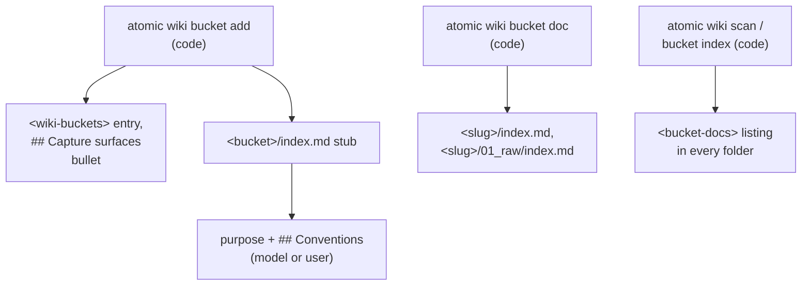

# Wiki capture buckets

## Problem

Realms accumulate working knowledge outside their member repos: research notes, raw dumps (exports, transcripts, PDFs), business-facing work items. Without tooling this is hand-managed per realm: ad-hoc folders, conventions re-explained in a prompt document every time a new realm adopts the pattern, and no listing an agent can read to find out what a folder holds.

The wiki already gives repos a code-owned registry and listing (`<wiki-scan>`, `## Members`). Buckets apply the same split to non-repo content: code registers the folder and builds its indexes, and the model or the user writes what the folder is for.

Code writes every structural file and listing; the model writes only the bucket's meaning:

## Goals / Non-goals

- Goals:
  - Zero-dependency bucket tooling: `atomic wiki bucket add | list | doc | index | skill`, all Go.
  - Buckets carry **no semantics in code**: a bucket is a registered folder; its meaning lives in its own `index.md`.
  - An `index.md` in every folder of a bucket, rebuilt by code, so an agent descends one index at a time.
  - `/refresh-wiki` offers bucket creation once per realm and prompts for the purpose lines the stubs leave blank.
- Non-goals:
  - Per-bucket slash commands (`/wiki-from-research` etc.).
  - Hardcoded bucket names or per-name behavior (`research`/`notes`/`tickets` are prompt examples only).
  - Any relationship to `atomic followups` — buckets are arbitrary user folders; no shared tooling or taxonomy.
  - Versioning capture content itself — buckets are working material; only the wiki repo is versioned.
  - Any model pass over bucket content, and any fingerprint, manifest, or freshness state for a bucket.

## Concepts

| Concept | Definition |
|---------|-----------|
| Bucket | User-named folder at the **realm root** (sibling of `wiki/`). Registered and indexed. Never nested inside `wiki/`. |
| Registry | Machine: managed `<wiki-buckets>` block in `wiki/index.md` (code-owned, spliced like `<wiki-scan>`). Narrative: `## Capture surfaces` section in the realm root's `CLAUDE.md`, created with the file if absent, appended (existing content preserved) if present, written on first `bucket add`. The upward CLAUDE.md walk makes it visible to member-repo sessions too. |
| Bucket index | `<bucket>/index.md`: purpose line plus a `## Conventions` block the user or model fills, and a code-generated `<bucket-docs>` listing. The only place a bucket's meaning exists. |
| Folder index | Every folder below the bucket root also carries an `index.md` whose `<bucket-docs>` region lists its direct children: markdown files and subfolders, with title and description from frontmatter or the fallback ladder. Numbered folders list in numeric order. |
| Item | A slug folder scaffolded by `bucket doc`: `<slug>/index.md` describes it, and its work lives in numbered stage folders starting at `01_raw/`. Raw material and the research built on it share one bucket. |

The folder and listing contract: `docs/spec/bucket-icm-structure.md` and `docs/design/bucket-doc-management.md`.

## Business rules

- Bucket names are user-defined; the only reserved name collision is `wiki` itself.
- The bucket-creation offer fires once: `/refresh-wiki` on a realm with no `<wiki-buckets>` block prompts (with `research`/`notes`/`tickets` as examples); a decline is recorded in the block so the offer never re-nags. `atomic wiki bucket add` works any time after.
- Code writes structure, the model writes meaning: `bucket add` stubs the `CLAUDE.md` section and bucket `index.md` with purpose placeholders; the `/refresh-wiki` offer flow prompts the model (asking the user where needed) to describe what each bucket is for in both places. Unfilled placeholders surface in the disposition output.
- Code writes only the `<bucket-docs>` region of an existing `index.md`; text outside it survives every rebuild byte-for-byte.
- `atomic wiki scan` rebuilds every bucket's indexes on each run, writing a file only when its content changes.

## Approaches

| # | Approach | Pros | Cons |
|---|----------|------|------|
| A | Status quo: per-workspace script + prompt doc | No atomic changes | Runtime dependency per realm; manual setup; conventions drift; script copies fork |
| B | Go verbs (`atomic wiki bucket …`) with code-built folder indexes | Zero deps; reuses the registry splice pattern; semantics stay user-side | New verb family to maintain |
| C | Per-bucket slash commands (`/wiki-from-research` …) | Mirrors original setup | Hardcodes bucket semantics into artifacts; N commands for N buckets; contradicts "no semantics in code" |
| D | B plus model synthesis into a topic-keyed `wiki/knowledge/` layer, tracked by content manifests | Distilled pages beside the raw capture | Built and removed: per-folder indexes give progressive disclosure at no model cost and never drift, so synthesis was unneeded, and it carried a manifest store, a two-phase promote, and fingerprint stamping |

## Recommendation

**B.** The registry splice is the `<wiki-scan>` / `## Members` pattern in `atomic/internal/wiki/wiki.go`, and the listing reuses the frontmatter description ladder `DeriveMemberDescription` already applies to member summaries. Buckets stay plain folders: no state under `wiki/` beyond the registry entry, and nothing a rebuild cannot reproduce.

## Open questions

- Binary files in buckets (PDFs, images): not listed, since the index lists only markdown. Today the user describes them in the item's `index.md` or its `01_raw/index.md`. A `bucket describe` helper or OCR pass is out of scope.

## Change log

### 2026-10-19 — Buckets without synthesis, indexed at every level

**What changed:** Rewrote the Problem, diagram, Goals, Concepts, Business rules, Approaches, Recommendation, and Open questions to the current design: buckets are registered folders with a code-built `index.md` in every folder, items are slug folders with numbered stage folders starting at `01_raw/`, and raw material and research share one bucket. The verb family is `add | list | doc | index | skill`.

**Why:** Bucket synthesis and its manifests were deleted with the realm wiki refresh tracking (`docs/spec/realm-wiki-drop-refresh.md`), and per-folder indexes replaced the one-level bucket index (`docs/spec/bucket-icm-structure.md`).

**Removed:** SHA-256 manifests under `wiki/.buckets/`, the two-phase `bucket diff` / `bucket promote` contract, `wiki/knowledge/` pages with `sources:` frontmatter, the capture → knowledge → concerns citation DAG, bucket staleness in `atomic wiki stale`, the bucket-synthesis inferrer mode, and the `/refresh-wiki` synthesis phase order.
