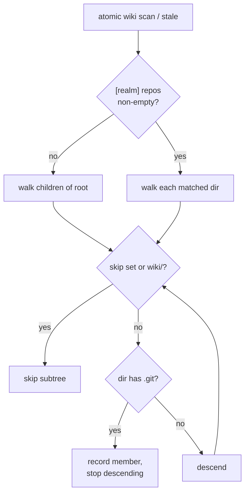
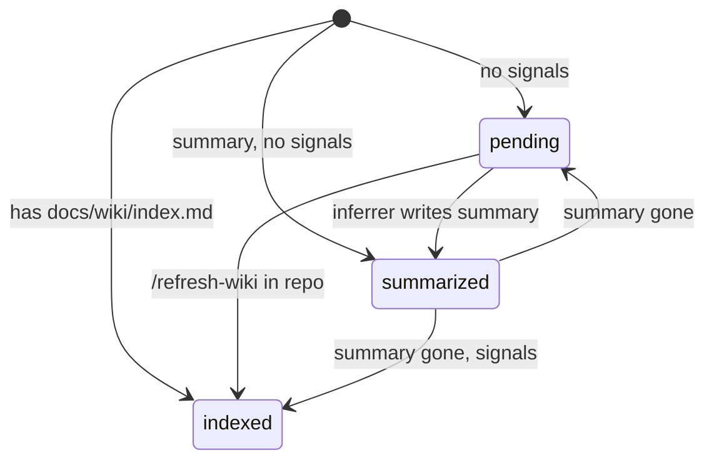
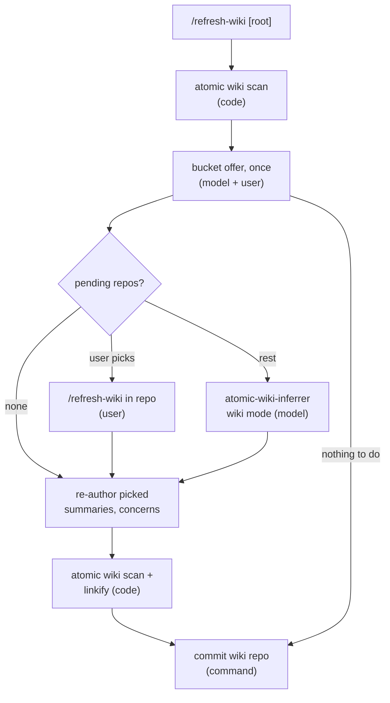

# Project wikis


## Problem


Atomic signals describe **one repo's internals**. Nothing describes **how repos relate** within a realm of work. A developer with a folder of microservices (or a set of OSS libs, or client projects) has no durable, machine-and-human-readable map of the cross-cutting concerns between them: shared libraries, dependency edges, duplicated patterns, contracts one repo owns and another consumes.

The knowledge exists only in the developer's head. A fresh Claude session rediscovers it every time, repo by repo, with no orientation to the realm as a whole.


## Goal / Non-goals


**Goal.** A `wiki` is a portable, git-initialized knowledge base for one **realm** of cross-repo concerns. Deterministic CLI verbs scaffold it, find its member repos, record which have signals, register the wiki globally, index its capture buckets, and report membership drift. `/refresh-wiki` runs the model pass on request. It summarizes no-signals repos with the signals explorer, whose output is **redirected** into the wiki so the source repo is never touched. It also re-authors the summaries and concerns the user picks. Nothing schedules, nudges, or tracks the freshness of that pass.

**Non-goals.**

- Not a replacement for signals. Signals stay repo-local and authoritative; the wiki points at them, never copies them.
- Not a dependency graph generator. Cross-cutting concerns are LLM-curated prose with cited evidence, not a parsed import graph.
- Not a CLI "membership" system for out-of-tree repos. Cross-realm links are LLM-curated via the `<wikis>` registry.
- Not a new agent. The no-signals explorer is the existing `atomic-wiki-inferrer` in a wiki-output mode.
- No freshness tracking: no session-start nudge, no ship-time marker, no fingerprints in artifact frontmatter.
- No model pass over bucket content. A bucket's only derived output is its folder indexes.
- Out of scope: monorepo sub-packages (a repo is a `.git` boundary) and `--full` self-containment (summarizing `indexed` repos too).


## Concept


| Term | Meaning |
|------|---------|
| **wiki** | A knowledge base for one realm. Lives at `<root>/wiki/`. Its own git repo. |
| **root** | A folder that *contains* repositories. The wiki's scan scope. The root is never itself a member. |
| **repo** | A member: a directory with a `.git` entry, found by walking the root or the roots declared in `[realm] repos`. The walk stops at the repo boundary. |
| **realm** | The scope a wiki covers (client / OSS / personal). One wiki per realm; 3-5 per machine is typical. Marked by `scope = "realm"` in `<root>/.claude/atomic.toml`. |
| **bucket** | A user-named capture folder at the realm root, beside `wiki/`, for material that is not a repo: research, notes, tickets. |

Mental model: **signals = one repo's internals; a wiki = how a realm's repos relate.** Code finds and records; the model reads and writes prose.


### How a repo is found


Discovery is the same walk for `atomic wiki scan` and `atomic wiki stale`. By default it walks every child of the root. A realm whose root also holds buckets, notes, or unrelated checkouts declares where its repos live with `[realm] repos` in `<root>/.claude/atomic.toml`: a list of root-relative paths and doublestar globs. When that list is non-empty, the walk starts only from the directories it matches.

Declared roots narrow where the walk starts; the member rule inside each walk is unchanged:



A bad entry (no match, absolute path, leaves the root, a symbolic link) is a stderr warning, never a failure, and the walk continues with the remaining entries. A member that falls outside the declared roots after the list changes shows up in `atomic wiki stale` as removed. The entry rules and warning texts live in `docs/reference/atomic-toml.md`.


### Repo knowledge states


"No signals" is not a defect. It is a fork between repo-owned and wiki-owned knowledge. Some repos (OSS especially) should never carry committed signals; the wiki summarizes them instead, never touching the repo.

A recorded summary holds a repo at `summarized` until its summary file is deleted; after that, signals win over any summary still on disk:



| State | Knowledge source |
|-------|------------------|
| `indexed` | repo has `docs/wiki/index.md` (or the legacy `.claude/project/signals.md`): read live, cite the path, never copied |
| `summarized` | no in-repo signals: `wiki/repos/<repo>.md`, or `wiki/repos/<repo>/` for a domain-split summary, written by the inferrer in wiki mode |
| `pending` | no signals and no summary on disk: `/refresh-wiki` offers to resolve it |


### Buckets


A bucket holds working material the wiki can point at: raw dumps, research notes, tickets. Code writes its structure and the model writes its meaning. `atomic wiki bucket add` creates the folder and registers it in two places: a `<wiki-buckets>` block in `wiki/index.md` for code, and a `## Capture surfaces` section in the realm root's `CLAUDE.md` for sessions in member repos. The bucket's purpose and conventions live in its own `index.md`, written by the model or the user.

Every folder in a bucket carries an `index.md` with a code-generated `<bucket-docs>` listing of its direct children, so an agent descends one index at a time and loads only the layer it needs. An item scaffolded by `atomic wiki bucket doc` is a slug folder with numbered stage folders, starting at `01_raw/`, so raw material and the research built from it share one bucket. `atomic wiki scan` rebuilds every bucket index on each run. Detail: `docs/design/wiki-buckets.md`; current contract: `docs/spec/wiki-buckets.md` and `docs/spec/bucket-icm-structure.md`.

```
<root>/research/
├── index.md            # purpose, ## Conventions, <bucket-docs> listing
└── seo-audit/
    ├── index.md        # lists 01_raw/
    └── 01_raw/
        └── index.md
```


## Code / model split


Code owns every step that writes a block, an index, or a link; the model writes only summaries, concerns, bucket meaning, and the commit message. A run with nothing pending, created, or offerable goes straight to the commit:



The inferrer in wiki mode reads its substrate from `atomic signals scan --out <tmp>` and writes only under `wiki/repos/`, so the member repo is never touched. The closing scan records the repos the run just summarized before `linkify` rewrites path citations into links.

| Verb | Owner | Job |
|------|-------|-----|
| `atomic wiki scan` | code | Scaffold `wiki/`, discover members, classify, splice the `index.md` blocks, rebuild bucket indexes, mark realm scope, register in `<wikis>` |
| `atomic wiki stale` | code | Read-only membership drift: added, removed, or changed-status members against the recorded scan |
| `atomic wiki linkify` | code | Turn path citations in summaries, concerns, and the index narrative into relative links |
| `atomic wiki init --scope realm` | code | Write the realm `wiki/CLAUDE.md` scaffold and the scope marker |
| `atomic wiki bucket add / list / doc / index / skill` | code | Register, list, scaffold items in, re-index, and scaffold a management skill for buckets |
| `atomic signals scan --out` | code | Write a repo's scan substrate outside the repo |
| `/refresh-wiki` | model | Summaries, re-authored concerns, bucket purpose lines |

Contract for each verb: `docs/spec/wiki.md` and `docs/spec/wiki-buckets.md`.


## Wiki layout


```
<root>/
├── CLAUDE.md               # ## Capture surfaces (one bullet per bucket)
├── .claude/atomic.toml     # scope = "realm", optional [realm] repos
├── research/               # a bucket, beside wiki/
└── wiki/
    ├── index.md            # code-owned blocks + model-owned narrative
    ├── README.md           # CLI-written
    ├── CLAUDE.md           # realm steering scaffold
    ├── repos/              # summaries, ONLY for no-signals repos
    │   ├── billing.md
    │   └── gateway/<domain>.md   # large repo: domain-split
    └── concerns/           # cross-cutting docs
        └── shared-auth.md
```

`index.md` is one file in two zones. Code splices its managed regions in place: the `<wiki-scan>` membership block, the linked `## Members` list (`<wiki-member-list>`), the `<wiki-buckets>` registry, and the `## Buckets` list (`<wiki-bucket-list>`). The model owns everything outside them. No in-file change log: the wiki repo's git history is the change log.


## Refresh


`/refresh-wiki` is the single idempotent entry point (init == refresh). A run writes what is missing (summaries for pending repos) and re-authors only the existing summaries and concerns the user selects from a numbered list. New concerns are written by hand. The run ends by committing the wiki repo automatically, since an additive commit to the wiki's own history loses nothing.

Freshness is the user's call. `atomic wiki stale` answers whether the set of members changed; the user decides whether a summary or concern still matches its repos by reading it.


## Approaches


| # | Decision | Chosen | Rejected + why |
|---|----------|--------|----------------|
| 1 | Registry location | `<wikis>` block in `~/.claude/CLAUDE.md` | `config.toml` (LLM can't see it in-session); a new `@-ref`'d file (context bloat). |
| 2 | No-signals explorer | reuse `atomic-wiki-inferrer` in wiki mode, fed by `atomic signals scan --out` (substrate redirected outside the repo), output written into the wiki, @-ref wiring skipped | New agent: an extra artifact that drifts from the explorer it duplicates. Write into the repo, then move and clean: leaks on crash, risks deleting pre-existing `.claude/`, must revert a CLAUDE.md edit. Redirecting the output removes the whole class of risk. |
| 3 | index.md structure | two-zone single file (code-owned regions + narrative) | split sidecar: the user wants the block inside `index.md`. |
| 4 | Concern synthesis | `/refresh-wiki` orchestrator; per-repo summaries by the inferrer | in-agent synthesis: needs all repos together. |
| 5 | Cross-realm refs | LLM-curated, evidence-cited, linked via the registry | CLI membership mechanism: the registry is the only mechanism needed. |
| 6 | Knowledge routing | pointer to in-repo signals; summarize only when absent | copy signals into the wiki: breaks single-source-of-truth. |
| 7 | Registry write | CLI splices `<wikis>` directly into CLAUDE.md | proposed/ + merger: content outside `<atomic>` is auto-preserved. |
| 8 | Freshness | none tracked; the user picks what to re-author | Code-stamped fingerprints, a session-start neglect nudge, and a ship-time `.dirty` marker were built and removed: the nudge repeated every session without producing refreshes, and the fingerprints fed per-artifact drift reports for refreshes nobody ran. |
| 9 | Repo discovery scope | walk the whole root by default; `[realm] repos` declares the roots when set | whole-root walk only: a repo inside a bucket or notes folder became a member, and a realm split into folders per company could not be described. |
| 10 | Bucket output | per-folder `index.md` listings written by code; items as slug folders with numbered stages | model synthesis into a `knowledge/` layer with content manifests: built and removed, because per-folder indexes give progressive disclosure at no model cost and never drift. Separate `raw` and `research` buckets: an item's raw material is its first stage, so it lives in that item's `01_raw/`. A one-level index per bucket: an agent entering a deep bucket had no map of each folder. |


## Recommendation


`atomic/internal/wiki/` mirrors `internal/signals/`: Options plus an injectable clock, idempotent body-compare writes, one repo-discovery walk shared by `scan` and `stale` (worktree-aware `os.Lstat` `.git` detection, `[realm] repos` read from the realm's `atomic.toml`), and managed-region splices in the style of the profile `## Environment` block. Bucket indexing is code in the same package. `atomic signals scan` carries `--out <dir>`. `/refresh-wiki` and the inferrer's wiki mode are rendered artifacts; both auto-bundle.


## Open questions


- **Large-repo domain-split threshold.** Agent judgment, with a rough signal in the prompt, and no hard numeric gate.


## Change log


### 2026-10-19 — Current design after the refresh removal

**What changed:** Rewrote the Goal, Concept, code/model split, layout, refresh, Approaches, Recommendation, and Open questions to the current design. Concept gains how a repo is found (`[realm] repos` declared roots) and buckets (per-folder indexes, slug items with numbered stages). Repo states now read `docs/wiki/index.md` as signals. The code/model diagram covers the current verbs.

**Why:** The doc still described machinery removed in `docs/spec/realm-wiki-drop-refresh.md`, and predated `[realm] repos` and the per-folder bucket indexes (`docs/spec/bucket-icm-structure.md`).

**Superseded:** `/refresh-wiki` offered the wiki commit instead of committing automatically, and auto-committing was a non-goal.

**Removed:** the Staleness and Forcing function sections, `reflects_*` fingerprints and `atomic wiki stamp`, the `.dirty` marker and `atomic wiki mark-dirty`, `wiki.CheckStaleness` and the session-start nudge, the open questions on neglect threshold, concern `reflects` granularity, and repos with no commits.
