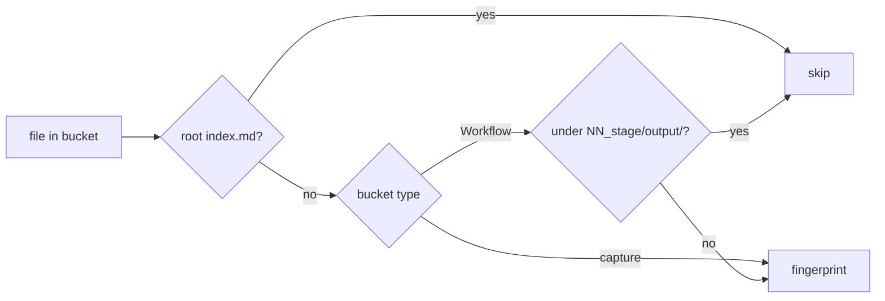
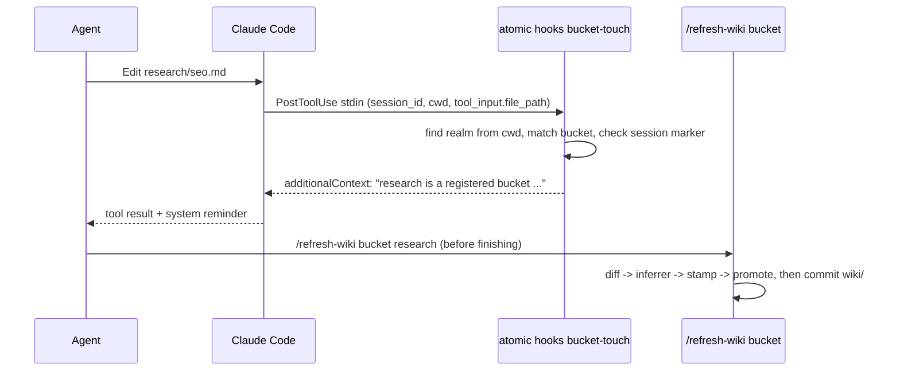

# Workflow buckets and touch-driven bucket refresh


## Problem


A realm bucket today is a capture surface: loose notes go in, `/refresh-wiki` synthesizes them into `wiki/knowledge/`. Two gaps follow from that single shape.

**No home for staged work.** The Interpretable Context Methodology (ICM, Van Clief and McDermott, arXiv:2603.16021) runs a workflow as numbered stage folders, each with a stage contract and an `output/` folder that a human edits before the next stage reads it. A realm is the natural place for these workflows, but a capture bucket has no stages, and the manifest walk in `WalkBucket` (`atomic/internal/wiki/bucket.go:38`) fingerprints every file except the root `index.md`. Every run of a workflow would rewrite `output/` files, so the bucket would report `STALE bucket <name>` forever, and synthesis would fold drafts into knowledge pages.

**Drift accumulates between refreshes.** Bucket synthesis runs only inside a full `/refresh-wiki` (Step 8, `context/commands/refresh-wiki.md:384`). An agent that edits a bucket during ordinary work leaves a non-empty diff behind, and nothing tells it the bucket now needs synthesis. The session-start nudge reports staleness after the fact, one session late.

A third gap surfaced while checking the first two: the per-bucket authoring skill exists (`ScaffoldBucketSkill`, `atomic/internal/wiki/bucketdoc.go:104`) but only behind the separate `atomic wiki bucket skill` verb. `bucket add` never calls it, so most buckets have no skill.


## Goals / Non-goals


- Goals:
    - A bucket declares its kind in its `index.md` frontmatter: `type: Workflow` or anything else (capture).
    - A workflow bucket has an ICM layout that atomic scaffolds: numbered stage folders, each with a `CLAUDE.md` stage contract and an `output/` folder, plus a `references/` folder.
    - A workflow bucket's runs never make it stale: `output/` under a stage folder is outside the manifest, so diff, stale, serve, and synthesis see only the workflow definition.
    - Every bucket has its authoring skill, with a workflow variant for workflow buckets: `bucket add` scaffolds it for new buckets, `atomic wiki scan` scaffolds it for registered buckets that lack one.
    - An agent that edits a bucket learns it during the work, in the same session, and has a one-bucket refresh to run.
- Non-goals:
    - Running a workflow. Stage execution stays with the agent and the human; atomic scaffolds and indexes, it does not orchestrate.
    - Synthesizing run deliverables into the wiki.
    - Blocking a turn until a bucket is refreshed.
    - A global (user-scope) hook. The hook lives in the realm's project settings only.
    - Converting an existing capture bucket into a workflow bucket. Editing `type:` by hand works; no migration verb.


## Concepts


A workflow bucket maps the ICM context layers onto files atomic already knows how to load.

```
<realm-root>/
├── .claude/
│   ├── settings.json                     PostToolUse bucket-touch hook (realm scope)
│   └── skills/<bucket>-management/       per-bucket skill (workflow variant)
└── <bucket>/
    ├── index.md                          L1  type: Workflow, purpose, <bucket-stages> region
    ├── references/                       L3  stable across runs (voice, conventions)
    ├── 01_research/
    │   ├── CLAUDE.md                     L2  stage contract: Inputs / Process / Outputs
    │   └── output/                       L4  run artifacts, outside the manifest
    └── 02_script/
        ├── CLAUDE.md
        └── output/
```

ICM's layer 0 is the realm's own `CLAUDE.md`, which already exists. ICM names the stage contract `CONTEXT.md`; atomic names it `CLAUDE.md` because Claude Code loads a nested `CLAUDE.md` on its own when the agent reads a file in that folder, so the stage contract reaches the agent without an instruction to read it. The router stub from `bucket doc --router` (`atomic/internal/wiki/templates/bucket-router-claude.md`) relies on the same loading behavior.

The manifest covers the factory, not the product. Which files feed the manifest depends on the bucket's type.



A stage folder is a top-level directory of the bucket whose name is two digits, an underscore, and a slug (`01_research`). Only `output/` directly inside a stage folder is excluded. An `output/` elsewhere, for example under `references/`, is factory content and stays in the manifest.


## Business rules


- The bucket type is read from the `type` key of the bucket root `index.md` frontmatter. `Workflow` (case-insensitive) is a workflow bucket. Any other value, a missing key, a missing frontmatter block, or a missing `index.md` is a capture bucket. The `bucket add` stub already writes `type: Bucket` (`atomic/internal/wiki/bucket_registry.go:236`), so every existing bucket stays capture.
- Diff, stale, serve, and `/refresh-wiki` all derive the file set from the same walk, so the exclusion applies everywhere at once.
- Stage numbers are assigned by code: the next stage is one more than the highest existing `NN_` folder. Numbers are never reused or renumbered.
- `bucket add` scaffolds the bucket skill for both types, and `atomic wiki scan` scaffolds it for any registered bucket missing one, so realms whose buckets predate this change get their skills on the next refresh. An existing skill file is never overwritten.
- The skill does not copy the bucket's purpose text. It points at the bucket's `index.md`, which stays the one place the purpose lives. At `bucket add` time the purpose is still the stub placeholder, and a copied placeholder would never be filled because the skill is never rewritten.
- The instruction to refresh an edited bucket before reporting work done lives in the bucket skill, and the hook's reminder names the command. The realm `CLAUDE.md` `## Capture surfaces` section is unchanged.
- The touch hook never fails or delays a tool call. Any error inside it exits 0 with no output.
- The hook reports a bucket once per refresh cycle: after it reports bucket `B` in a session, it stays quiet for `B` until `B` is promoted again.
- An edit under a workflow stage's `output/` is not reported. That file is outside the manifest, so there is nothing to refresh.


## Touch-driven refresh


Detection is deterministic and lives in a hook; synthesis is judgment and stays with the agent. The hook adds a factual line next to the tool result through `hookSpecificOutput.additionalContext`, which Claude Code inserts as a system reminder at the point the hook fired (Claude Code hooks reference, `PostToolUse`). It never blocks.



The hook's decision rule:

```
on PostToolUse(Edit | Write | NotebookEdit):
    path  = tool_input.file_path or tool_input.notebook_path
    realm = realm root found from cwd by the realm-scope marker resolver
    if no realm or no path: exit quietly
    bucket = registered bucket whose path contains `path`
    if no bucket: exit quietly
    if path is not in the bucket's manifest file set: exit quietly
    actor  = agent_id if present, else session_id
    marker = marker for (actor, bucket)
    if marker exists and is newer than the bucket's baseline: exit quietly
    touch marker
    emit additionalContext:
        "<file> is in realm bucket `<bucket>`. Its wiki knowledge is refreshed by
         `/refresh-wiki bucket <bucket>`, which synthesizes only this bucket."
```

The message is written as a statement, not an imperative, following the hooks reference guidance that instruction-shaped hook text can trip prompt-injection defenses. The bucket skill carries the instruction itself: refresh a bucket you edited before reporting the work done.

The marker is keyed per actor. A subagent's tool call arrives with the parent's `session_id` plus its own `agent_id` (Claude Code hooks reference, common input fields); keying on `session_id` alone would let a subagent's edit consume the reminder the main thread needs.

"Path is in the manifest" is one exported wiki predicate that both `WalkBucket` and the hook use, so the hook stays quiet for every path the manifest ignores: the bucket-root `index.md`, `skipDirs` subtrees, OS junk files, and workflow `output/` folders. A reminder for an ignored path would lead to a refresh that reports `SKIPPED (fresh)`.

**Scope.** Claude Code reads the shared `.claude/settings.json` only from the session's primary working directory (Claude Code settings reference), not from parent directories. The hook therefore fires only in sessions started at the realm root. A session started inside a member repo that edits a realm bucket gets no reminder; the session-start staleness nudge and `atomic wiki stale` still catch the drift later. Bucket work happens from the realm root in practice, so this is accepted.

**Coverage.** Edits made through `Bash` (`sed`, heredocs, `mv`) do not fire the hook. The manifest still records them, so `atomic wiki stale` catches them later.

**Usage.**

```
atomic wiki bucket add pipeline --type workflow     # index.md type: Workflow, references/, skill, realm hook
atomic wiki bucket stage pipeline research          # pipeline/01_research/{CLAUDE.md,output/}
atomic wiki bucket stage pipeline script            # pipeline/02_script/{CLAUDE.md,output/}
/refresh-wiki bucket pipeline                       # synthesize this bucket only
```


## Approaches


Three decisions, each with its own options.

**Type marker.**

| # | Approach | Pros | Cons |
|---|----------|------|------|
| A | `type:` in bucket `index.md` frontmatter | Key already written by the stub; travels with the folder; no registry change | `type` is also a free-form topic-doc key, so the meaning depends on which file it sits in |
| B | `type="workflow"` attribute on the `<bucket>` entry in `wiki/index.md` | Registry is the single place code already reads | Lives away from the bucket; a moved or copied bucket loses it |
| C | A sentinel file (`.workflow`) in the bucket | Trivial to detect | Hidden state; a new convention nothing else uses |

**Synthesis scope for workflow buckets.**

| # | Approach | Pros | Cons |
|---|----------|------|------|
| A | Factory only: exclude `NN_stage/output/` from the manifest | Runs never cause drift; the wiki learns what the workflow does | Run deliverables never reach the wiki |
| B | Factory plus the last stage's `output/` | Finished runs become knowledge | Stale after every run; "last stage" moves when a stage is added |
| C | Exclude workflow buckets from synthesis entirely | Simplest | The workflow's own definition never reaches the wiki |

**Touch trigger.**

| # | Approach | Pros | Cons |
|---|----------|------|------|
| A | `PostToolUse` hook with a non-blocking reminder, realm scope | Detection is code; the reminder lands at the moment of the edit | New hook command and settings registration; realm-root sessions only |
| B | Instructions only (skill and realm `CLAUDE.md`) | No new code | Relies on the model remembering, which is how the drift happens today |
| C | `Stop` hook that blocks while a touched bucket has a diff | Strongest guarantee | Blocks turns; can loop when synthesis fails; contradicts the context-over-hooks preference |


## Recommendation


Type marker A, synthesis scope A, trigger A, chosen with the user.

- **Marker A** reuses the key the stub already writes (`bucket_registry.go:236`) and keeps the declaration inside the bucket, where the `atomic-wiki-inferrer` already reads `index.md` as conventions context (`context/skills/atomic-wiki/references/realm.md`, B1). Reading frontmatter reuses `frontmatter.Parse`, already used by `readTopicMeta` (`atomic/internal/wiki/bucketindex.go:159`).
- **Scope A** puts the exclusion in `WalkBucket`, the one function every consumer calls (`BucketDiff`, `BucketDiffReadOnly` for stale and serve, `/refresh-wiki` Step 8a through `bucket diff`), so there is no second file set to keep in sync.
- **Trigger A** splits the work along the code-versus-model line: matching a path to a bucket is deterministic, deciding what knowledge to write is not. It reuses the settings writer the session-start hook already uses (`registerInSettings`, `atomic/internal/hooks/hooks_hujson.go:17`), moved into a leaf package and pointed at realm scope rather than user scope, and the scoped `/refresh-wiki bucket <name>` reuses Step 8 as is.

The hook is installed by `bucket add` and re-ensured by `atomic wiki scan` whenever the realm has at least one registered bucket; `scan` also scaffolds any missing bucket skill. Every `/refresh-wiki` runs `scan`, so realms whose buckets predate this change pick up both on their next refresh without a separate step. A failure to write the realm settings file is a warning, never a failed `add` or `scan`: a malformed `settings.json` must not stop a wiki refresh.

The settings writer in `hooks_hujson.go` is hard-wired to the `SessionStart` event, and `hooks` imports `wiki`, so `wiki` cannot call it. The writer moves into a small leaf package that registers and removes one command under any event; `hooks` and `wiki` both import it, and the existing session-start install keeps its behavior.


## Open questions


None. A doctor check for a realm with buckets but no bucket-touch hook is out of scope: `scan` repairs the hook on every refresh.
