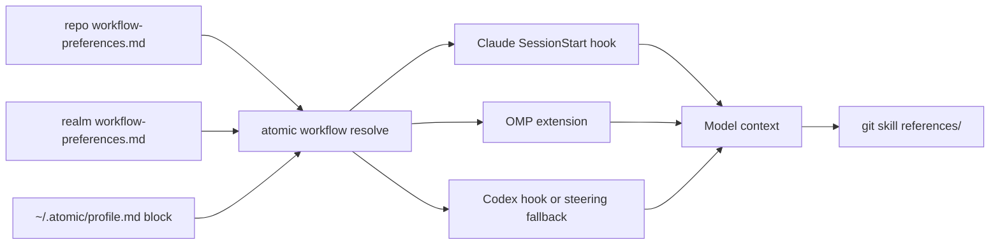

# Workflow preferences


## Problem


Atomic's workflow artifacts assume one toolchain. `/commit pr` and `/commit merge` call `gh`. `/report-issue` and the follow-up `promote` step call `gh issue create`. Worktree setup names Claude Code's `.claude/worktrees/`. Deferred work lands in a markdown ledger that the user's issue tracker never sees. A user on GitLab, Bitbucket, Codeberg, Linear, Jira, or Trello, or a user running OMP or Codex, receives instructions that name tools and paths they do not use.

Two choices are fused today that are independent in practice. Source control is where change requests are opened and merged. Issue tracking is where issues and follow-ups live. A Jira shop hosts code on GitLab; a Linear shop hosts code on GitHub.

The preference has to reach the model at session start on every harness, and the provider-specific steps have to live where a model can read them on demand rather than in every command.

Resolved preferences travel from three editable files, through one resolver, to the model, which then reads the provider reference the block names:



Reminders (`/remind-me`, `atomic reminder`, the session-start reminder section) are removed in the same change. Nothing in them depends on the tracker choice, and the follow-up sink below replaces the one workflow they overlapped.


## Goals / Non-goals


- Goals:
  - One source-control choice and one issue-tracker choice, each with a built-in default, stated in the user's profile and overridable per realm and per repository.
  - Autodetect the profile-level choice and keep the block editable without losing a user's lines.
  - Deliver the resolved choice at session start on Claude, OMP, and Codex, with a deterministic fallback where a harness cannot run a hook.
  - Keep provider mechanics in git-skill reference files, one file per provider, so adding a provider adds a file and no code.
  - Record follow-ups in the chosen issue tracker, with the local follow-up ledger as the fallback.
  - Teach worktree placement per harness from a reference file, without making Claude's path the only answer.
- Non-goals:
  - Atomic code that calls a provider API. The reference files tell the model what to run.
  - Authenticating to a provider or storing a token.
  - Shipping a provider whose reference has not been checked against vendor documentation.
  - Moving existing follow-up entries into a tracker automatically. `/follow-up review` promotes one entry on request.
  - Reminders in any form.
  - Choosing a CI provider. `/watch-ci` keeps file-tree detection.


## Approaches


Delivering provider-specific behavior:

| # | Approach | Pros | Cons |
|---|----------|------|------|
| A | Route in code: `atomic followups add` and the ship verbs shell out to `gh`, `glab`, and the rest | Deterministic; matches the repo's code-over-model rule | Linear, Jira, and Trello have no CLI Atomic can assume; each provider becomes Go to maintain |
| B | Reference files in the git skill; a resolved block tells the model which to read | Any provider is one markdown file; users and contributors can edit it; works with MCP-only trackers | Depends on the model following the reference; needs a carrier on every harness |
| C | One skill per provider | Native skill triggers | Skill sprawl; the mandatory artifact checklist runs once per skill; subagents do not auto-fire skills |

Where preferences live:

| # | Approach | Pros | Cons |
|---|----------|------|------|
| D | A block in the profile plus one `workflow-preferences.md` per realm and per repository | Matches where the owner states preferences; same block grammar at every level; no change to the TOML loader | A new hybrid block (user-edited and machine-filled) in a user-owned file |
| E | A `[workflow]` table in `atomic.toml` | Reuses the lenient TOML loader | Not injected into model context; diverges from the block the owner specified |
| F | A block inside each scope's `AGENTS.md` | Native delivery on every harness | Raw and resolved copies double-deliver; mixes into user prose; the realm `AGENTS.md` may not exist |


## Recommendation


Use B and D. Evidence: the profile rewrite is already a pure string transform with a heading-anchored span (`atomic/internal/profile/refresh.go:69-102`, `render.go:103-132`), the session-start builder already emits injected sections (`atomic/internal/hooks/hooks.go:197-212`), and the OMP extension already returns a `systemPrompt` carrier proven at runtime (`atomic/internal/harness/omp/extension.go:208-222`).

### Block grammar

One grammar at every level. The `level` attribute names where the block lives; a mismatch with the file's location warns and the location wins.

```text
<workflow-preferences level='profile'>
- source-control: github  # detected: gh authed for github.com
- issue-tracker: linear   # detected: LINEAR_API_KEY is set
- worktrees: auto
</workflow-preferences>
```

| Key | Values | When unset at every level |
|-----|--------|---------------------------|
| `source-control` | `github`, `gitlab`, `bitbucket`, `codeberg`, `none` | origin-host inference, else `github` |
| `source-control-host` | hostname, for a self-hosted instance | the `origin` host when `origin` maps to the resolved `source-control` provider, else the provider's public host |
| `issue-tracker` | `github`, `gitlab`, `codeberg`, `linear`, `jira`, `trello`, `filesystem` | follows `source-control` when that has a tracker; `filesystem` when it is `bitbucket` or `none` |
| `issue-tracker-project` | tracker-specific identifier: Jira project key, Linear team key, Trello board | unset |
| `worktrees` | `auto`, a repo-relative path, `off` | `auto` |

`none` for `source-control` means no remote. `/commit merge` and `/commit squash merge` take the local-merge path; `/commit push` and `/commit pr` refuse and tell the user to add a remote or change the preference. `filesystem` for `issue-tracker` means the local follow-up ledger.

Locations:

| Level | Location |
|-------|----------|
| profile | a `## Workflow preferences` section in `~/.atomic/profile.md`, placed before `## Environment` so the Environment rewrite never contains it |
| realm | `<realm-root>/<state-root>/workflow-preferences.md` |
| repo | `<repo-root>/<state-root>/workflow-preferences.md` |

### Resolution

Per key, an explicit value at the most specific level wins. A value Atomic wrote (marked `# detected`) is soft: for `source-control` it yields to the repository's `origin` host. The resolved block names the level that supplied each value and warns when an explicit value disagrees with the `origin` host. A provider here means a host family: GitHub Enterprise is `github`, and `source-control-host` names the instance.

```text
resolve(cwd):
    levels = [repo, realm, profile]            # realm skipped outside a registered realm
    for key in KEYS:
        explicit = first non-empty value in levels that is not marked "# detected"
        soft     = first "# detected" value in levels
        if explicit:                                  value, level = explicit
        else if key == source-control and origin host maps to a provider:
                                                      value, level = that provider, "origin"
        else if key == source-control-host and origin host maps to the resolved source-control:
                                                      value, level = origin host, "origin"
        else if key == issue-tracker and soft:        value, level = soft        # always a non-host tracker
        else if key == issue-tracker:                 value, level = tracker of resolved source-control,
                                                                     "filesystem" when it has none
        else if soft:                                 value, level = soft
        else:                                         value, level = default(key), "default"
    if explicit source-control provider != origin host provider: add warning
    if origin host maps to no provider: add warning
    emit block with levels, warnings, and the reference paths to read
```

An empty value (`- key:`) is unset; `none` and `filesystem` are values and stop the fall-through. A block without a `level` attribute is treated like a mismatch: it warns and the file's location decides. Autodetection writes only `level='profile'`, only absent or `# detected` lines. Deleting `# detected` pins a value. Atomic writes realm and repo files only when the user runs `atomic workflow set --level realm|repo`.

Autodetection runs on the existing daily profile refresh cadence. Signals are machine-level: which provider CLIs are installed and authenticated (read from each CLI's host configuration file first; environment tokens by variable name only, never value). Exactly one authenticated source-control family sets `source-control`; two or more leave it unset and remove an earlier `# detected` line. `issue-tracker` is written only when exactly one non-host tracker credential (Linear, Jira, Trello) is present; GitHub, GitLab, and Codeberg trackers are always derived from `source-control`, so a detected value never contradicts an explicit one. The `origin` host is a per-repository signal and is never written to the profile.

### Carriers

The resolved block is data. The instruction to read it is static and lives in steering, so a harness without a session hook still has a path.

| Harness | Carrier | Fallback when the carrier fails |
|---------|---------|--------------------------------|
| Claude | A `## Workflow preferences` section in the `SessionStart` hook's `additionalContext` | Steering paragraph: if no resolved block is in context, run `atomic workflow resolve` once |
| OMP | The generated extension runs `atomic hooks session-start --harness omp --cwd <cwd>` at `session_start` and appends the text to the `before_agent_start` system prompt | Same steering paragraph |
| Codex | A `SessionStart` entry in `$CODEX_HOME/hooks.json`; the user must trust it in `/hooks` | Same steering paragraph; it is the only carrier until the hook is trusted |

The steering fallback is an LLM safeguard layer over a deterministic path that can be absent (hook not installed, not trusted, binary not on the harness's PATH). The principles allow this; the spec names it where it is added.

### References

The git skill, `atomic-git-discipline`, gains a `references/` tree. Commands and partials name an operation and tell the model to read the reference the resolved block lists.

```text
atomic-git-discipline/references/
    resolution.md                          how the resolved block maps to the files below
    worktrees.md                           placement and create/enter/clean per harness
    source-control/{github,gitlab,bitbucket,codeberg,none}.md
    issue-tracking/{github,gitlab,codeberg,linear,jira,trello,filesystem}.md
```

The `base-resolution` partial resolves the default branch provider-neutrally first (`git symbolic-ref refs/remotes/origin/HEAD`, then git configuration) and reads a reference's `default-branch` row only when that fails. Every source-control file answers the same operation rows: `default-branch`, `change-request-view`, `change-request-create`, `change-request-edit-title`, `change-request-merge` (merge, squash, delete branch), `change-request-attach-images`, `push-permission-check`, `ci-target-resolve`, `auth-check`, `install-hint`, `closing-keywords`. Every issue-tracking file answers: `issue-create`, `issue-view`, `issue-search`, `issue-close`, `label-list`, `label-apply`, `template-location`, `commit-reference-syntax`, `project-identifier`. An operation with no CLI says so and gives the REST call. The three host-based trackers (GitHub, GitLab, Codeberg) point back to the matching source-control file for installation and authentication. Bitbucket Cloud offers source control only, so a Bitbucket repository pairs with Jira or another tracker. The `filesystem` reference resolves the ledger folder with `atomic followups path` rather than naming it.

Every file under a skill's folder ships with it (`atomic/internal/harness/skill.go:374-387`). A `references/...` or `./...` path that a shipped file declares is checked against the declaring file's own directory, and an unresolved one fails the OMP package and Codex plugin builds (`skill.go:393-430`). A pointer from one reference to another therefore uses a form relative to its own file (`../source-control/github.md`), never `references/source-control/github.md` from inside `references/issue-tracking/`. The skill carries a short index so a model can find the files. Three agents preload the skill (`context/agents/atomic-auditor.md:13`, `atomic-implementer.md:10`, `atomic-reviewer.md:12`), so the index stays small and references load on demand. Subagents do not auto-fire skills, so each consuming partial carries one explicit sentence: read the listed reference.

### Follow-up sink

One partial, `followup-sink`, states the rule once. Commands and partials expand it; the `atomic-documentation` skill, which does not expand partials, carries a one-sentence pointer.

```text
record_followup(title, body, severity, origin):
    tracker = resolved issue-tracker
    body    = redact per report-issue-privacy(body)           # paths, hostnames, secrets
    show the rendered title and body in the same message as the user's defer choice
    if tracker != filesystem and its reference's auth-check passes:
        labels = severity and kind labels that label-list reports as existing   # never creates a label
        issue-create per issue-tracking/<tracker>.md; report any label skipped
    else:
        run the filesystem reference (it owns `atomic followups add`); report why the tracker was not used
```

The issue may be public, so the sink applies the redaction the `report-issue-privacy` partial defines and shows the rendered issue before it is created. The user's per-item `defer` or `Later` choice is the confirmation; the sink adds no second prompt. That partial carries no provider operation (redact, preview, confirm only), because `/report-issue-with-atomic` also composes it and must keep targeting `damusix/atomic-claude` on GitHub whatever the user prefers.

Seven commands and partials compose the partial: the loop finalize step, the ship-verb doc-impact "Later" option, `/documentation`, `/subagent-diagnose` defer, `/challenge-swarm` offer 3, `/refresh-wiki` concerns, and `/follow-up`. The `atomic-documentation` skill, which cannot expand a partial, carries a one-sentence pointer. `defer` and `issue` become one disposition. The `docs(followups): defer` commit happens only when the sink wrote a tracked file. The whole `atomic/internal/followups` package, its five verbs, and doctor check 6 stay for the filesystem sink; the local folder remains `<state-root>/project/followups`. The command text for the local ledger lives only in the `filesystem` reference.

A GitHub user whose `gh` is signed in now gets remote issues by default, where `defer` used to write the local ledger. Every result line the sink prints names the tracker it used, and the upgrade notes and the follow-up reference name `issue-tracker: filesystem` as the way back. The sink keeps no per-repository state.

`/follow-up <text>` records one follow-up through the sink. `/follow-up review` triages the local ledger; its `promote` step is the bridge from a ledger entry to the tracker. Bare `/follow-up` prints those two forms. The spec that owns `/follow-up` is `docs/spec/workflow-preferences.md`; the cron-workflow spec that named it is retired.

### Worktrees

| Harness | Recommended location | Create and enter |
|---------|---------------------|------------------|
| Claude Code | `.claude/worktrees/<branch>` | `EnterWorktree` or `claude --worktree`; Claude Code creates the path itself |
| OMP, Codex, an unknown harness | `<state-root>/worktrees/<branch>` | `git worktree add`, then change directory |
| any | the `worktrees` key, when set | as above |

`worktrees: auto` resolves to the row for the harness the session reports. The model knows its own harness; `atomic where --json` carries the same recommendation for scripts. Cleanup and scans enumerate with `git worktree list`, never with a path glob, so a worktree in any location is found.

Usage:

```text
$ atomic workflow resolve
<workflow-preferences level='resolved'>
- source-control: gitlab (realm)
- source-control-host: git.acme.example (realm)
- issue-tracker: jira (realm)
- issue-tracker-project: ACME-BILLING (repo)
- worktrees: .claude/worktrees (default)
warning: none
Read: references/source-control/gitlab.md, references/issue-tracking/jira.md, references/worktrees.md
</workflow-preferences>

$ atomic workflow set issue-tracker linear --level realm
wrote <realm>/.atomic/workflow-preferences.md
```


## Open questions


- The Codex `SessionStart` hook needs per-hash user trust. Until trusted it is silent, so the steering fallback is the only Codex carrier. Whether to write the rendered profile-level block into the Codex global `AGENTS.md` as a third carrier is deferred until the hook is proven at runtime.
- OMP can reach `atomic` through `pi.exec` or `child_process`; the documented `pi.exec` ignores `cwd` in the fetched source, so the extension passes the working directory on the command line. The choice is settled at build time against the runtime probe.
- Each provider reference is checked against vendor documentation before it ships. Bitbucket Cloud has no first-party CLI, so its reference is REST-first. Research read Bitbucket's retirement of its issue tracker (2026-08-20) from the current OpenAPI, which lists no `/issues` paths, and from an aggregator quote; Atlassian's own notice was not readable. Confirm it before the Bitbucket reference ships.
