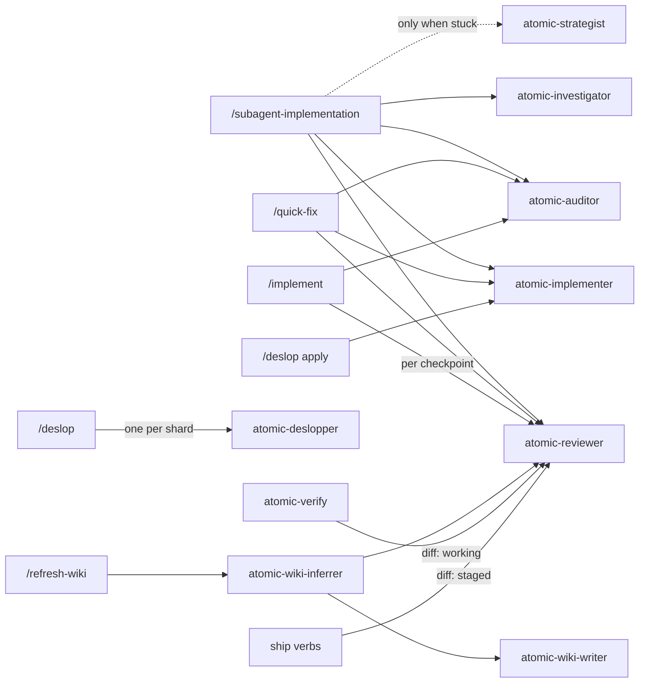
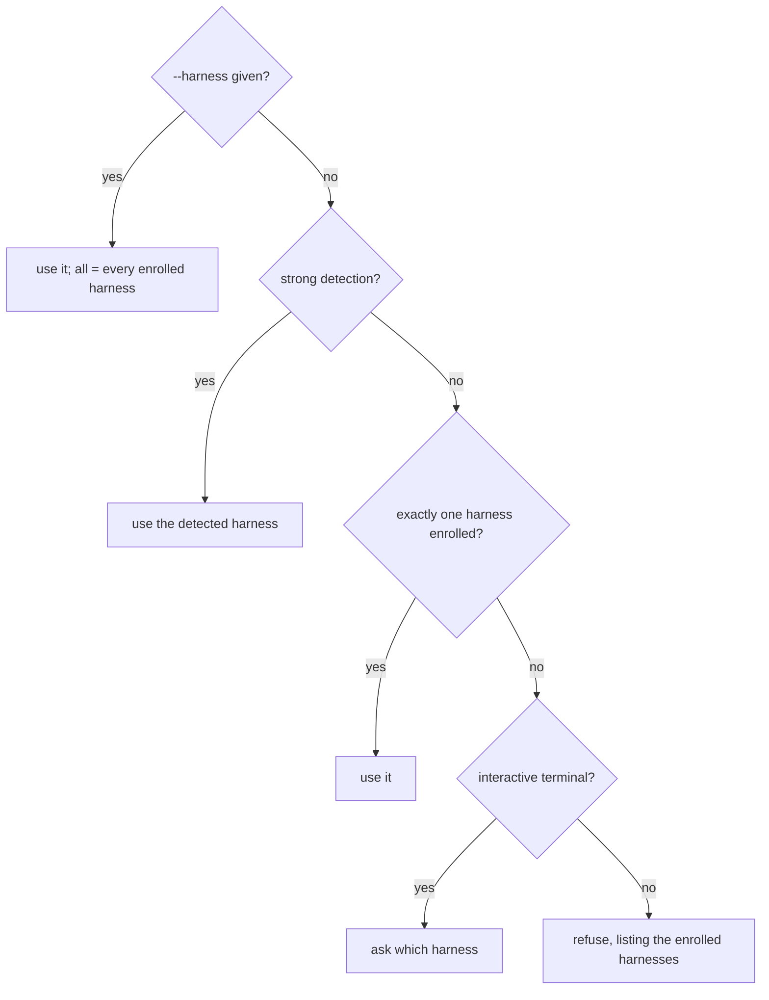

# Agents

Agents are specialized workers that run in a fresh context. The orchestrator dispatches them during `/subagent-implementation`, `/quick-fix`, and `/subagent-diagnose`, but you can also invoke them directly. Two of [Anthropic's agent patterns](https://www.anthropic.com/engineering/building-effective-agents) are built in: orchestrator-workers (a parent breaks the task down and delegates to workers) and evaluator-optimizer (the implementer writes, a separate reviewer critiques).


## Who dispatches whom

Three orchestration trees drive the implementation lifecycle, and two ad-hoc exits route into the same reviewer outside them. The implement loop fans out per checkpoint, implementer then reviewer, with the investigator scoping surfaces, the auditor gating the whole delivery once at the end, and the strategist called in only when the loop is stuck; `/quick-fix` drives the same implementer, reviewer, and auditor from a brief instead of a spec. The wiki pipeline fans out per domain, one writer per domain with the same reviewer gating each page. The deslop pass fans out per shard, one read-only auditor per wiki domain, and its second phase hands accepted findings back to the same implementer.



`/quick-fix` and `/subagent-diagnose` reuse the implement loop's tree, `/autopilot` runs it end to end, and ship verbs dispatch the wiki-inferrer silently. `/implement` is the one implementation verb with no implementer dispatch: the main agent writes the code, so the reviewer runs per checkpoint and the auditor once at the end, as in the loop. `/atomic-plan` borrows the reviewer alone, in spec-mode. `/deslop` is the only tree whose two halves are separate invocations: the audit never reaches the implementer without a human accepting findings first. Code the main agent writes ad-hoc, outside any of these trees, reaches the reviewer two ways: `atomic-verify` dispatches it against the working diff before a completion claim, and the ship verbs' review gate dispatches it against the staged diff before the commit.


## Code agents

These write, review, and gate code.

| Agent | What it does | Execution |
|-------|-------------|-------|
| `atomic-implementer` | Dual-mode implementation agent. The orchestrator declares the mode at dispatch time. **feature mode**: implements a feature checkpoint — one cohesive slice across however many files it touches (controller + service + DTO + tests, etc.); refuses cross-cutting or ambiguous scope. **surgical mode**: small targeted edits with a hard cap of 2 files, test files excluded; bounces anything larger back to the orchestrator. Both modes write a failing test first. | Fresh context, one dispatch per checkpoint |
| `atomic-reviewer` | Reviews a diff after each implementer pass. Re-runs the quality signals it verifies (tests, type checks). One line per finding, ends with PASS or CHANGES_REQUESTED. Flags suppression patterns — error-catching added to dodge a failure without investigating it. Flags over-engineering — reinvented stdlib, duplicate helpers, or one-implementation abstractions — and comment noise; both are 🟡 and drive the verdict, never nits. Runs `atomic code comments` on the diff and reports `comments: N added (M over max)` beside the other signals. Checks the implementer's proposed commit message against `atomic-git-discipline`. Also runs in spec-mode: reviews a draft spec against its design doc (coverage, voice, over-prescription) to gate the `/atomic-plan` spec loop. Also gates code the main agent wrote outside any loop, at both `atomic-verify` (`diff: working`, before a completion claim) and the ship verbs' review gate (`diff: staged`, before the commit). | Fresh context, one dispatch per gate |
| `atomic-auditor` | Final gate on a finished implementation, dispatched once after the loop goes green. Audits four things per-checkpoint review cannot see: success criteria no single checkpoint owned, iterations that each passed and do not compose, commit types that misstate user-visible impact, and documentation that is current but says nothing. Never edits the repo; findings also land in `$SCRATCH/AUDIT.md`. Fresh context, ends with PASS or CHANGES_REQUESTED. | Fresh context, once after green |


## Research agents

These read code but never write it.

| Agent | What it does | Execution |
|-------|-------------|-------|
| `atomic-investigator` | Locates code. "Where is X defined?", "What calls Y?", "List all uses of Z." When an index is present, leads with `atomic code explore` for broad scoping (one natural-language query returns the relevant symbols, files, and relationships), then uses `atomic code search/callers/callees/impact` for targeted follow-up; falls back to `sg`/`grep` otherwise. Returns a file:line table with no speculation. | Fresh context, read-only |
| `atomic-strategist` | Reasons through hard problems — plans, specs, architectural tradeoffs. Surfaces hidden assumptions and recommends approaches. Read-only; never implements. Dispatched for root-cause analysis when the implement→review loop gets stuck on the same failure. | Fresh context, on demand |
| `atomic-deslopper` | Audits one shard of a standing codebase — a wiki domain or a directory, never a diff. Sweeps eight slop categories, each bound to a rule atomic already carries, so a suspicion with no rule behind it is dropped rather than reported. Proves dead code through the symbol graph plus a literal sweep for dynamic references, and assigns every finding a safety tier that decides whether it may ever be auto-fixed. Its one write is a findings file inside the scratchpad bundle; it runs no mutating command, because siblings audit the same working tree in parallel. Dispatched one per shard by `/deslop`. | Fresh context, one per shard, parallel |


## Infrastructure agents

These handle system-level tasks.

| Agent | What it does | Execution |
|-------|-------------|-------|
| `atomic-wiki-inferrer` | Scope-sensitive wiki pipeline, and an orchestrator rather than an author. Repo scope: scans via `atomic signals scan`, infers domain structure (using real import/call edges from the code-intel index when present; filename heuristics otherwise), dispatches one `atomic-wiki-writer` per domain and `atomic-reviewer` per page, then assembles `docs/wiki/index.md` and wires the `@docs/wiki/index.md` ref (checking `claude.local.md`, `CLAUDE.local.md`, `AGENTS.md`, then the `CLAUDE.md`/`claude.md` file, and, under the default `loader` steering mode, adding the loader's `@AGENTS.md` import when the ref sits only in `AGENTS.md`). Preloads the `atomic-wiki` skill to locate its pipeline references. Realm scope: executes the cross-repo pipeline against `<root>/wiki/`. Runs in its own context so the scan, which is thousands of lines, never enters the caller's. Dispatched by `/refresh-wiki` and silently by ship verbs. | Fresh context, orchestrates per domain |
| `atomic-wiki-writer` | Authors one wiki page from source, dispatched once per domain by `atomic-wiki-inferrer` with the page contract and source paths in its prompt. Carries the `atomic-writing` skill in frontmatter, so the page's reading order, its diagrams, and its voice load as context rather than arriving as a request. Reads the files rather than inferring from filenames, draws every shape the domain has, redraws every current-architecture diagram from the domain's design docs into the page checked against source, and reports judgments separately from facts. Its prompt tells it not to dispatch other agents; its tool list does not enforce that. | Fresh context, one dispatch per page |


## Model and effort

The canonical agent definitions declare no model or effort. Each states behavioral intent, required capabilities, write scope, execution preference, dependencies, and enforcement strength; model and effort are runtime policy, chosen per harness and per user.

`atomic config agents` writes that policy per harness, as `[<harness>.agents.<name>]` tables in `~/.atomic/config.toml`. Each harness has its own table, its own native keys, and its own form.

| Harness | Table | Agent file | Model key | Effort key | Model examples | Effort levels |
|---|---|---|---|---|---|---|
| Claude Code | `[claude.agents.<name>]` | `<Claude root>/agents/<name>.md` | `model` | `effort` | `opus`, `claude-opus-4-8` | `low`, `medium`, `high`, `xhigh`, `max` |
| OMP | `[omp.agents.<name>]` | `<profile agent root>/agents/<name>.md` | `model` | `thinking` | `@slow`, `anthropic/claude-opus-4-8` | `auto`, `inherit`, `off`, `minimal`, `low`, `medium`, `high`, `xhigh`, `max` |
| Codex | `[codex.agents.<name>]` | `$CODEX_HOME/agents/<name>.toml` | `model` | `model_reasoning_effort` | `gpt-5.2-codex` | `none`, `minimal`, `low`, `medium`, `high`, `xhigh`, `max`, `ultra` |

- **model** is lenient on every harness: any value without spaces or control characters passes through, and the harness resolves it at runtime.
- **effort** is strict on Claude, where a value outside the five levels is a config error. The OMP and Codex lists are the levels known at release; a value outside them warns in `atomic doctor` and still passes through.

With no override stored, the projected agent carries no model or effort key, so it inherits the session's values. An override you store applies everywhere the agent is dispatched by name, including `atomic-verify` and the ship verbs' review gate, whose `review:` line names the model that ran.

### Choosing the harness

```
atomic config agents [--harness claude|omp|codex|all]
```



An unadopted legacy Claude install counts as an enrolled Claude harness here. Each harness opens its own form: its model placeholder, its effort choices, and its own restart note. The form is pre-filled from that harness's table. A blank model and a blank effort remove the entry. `--harness all` opens one form per enrolled harness; Ctrl+C on any form stops the run before the next one opens.

### How an override travels

1. **Config.** The form writes nested tables to `config.toml`:

    ```toml
    [claude.agents.atomic-implementer]
    model = "claude-opus-4-8"
    effort = "high"

    [omp.agents.atomic-reviewer]
    model = "@slow"
    effort = "high"

    [codex.agents.atomic-investigator]
    model = "gpt-5.2-codex"
    effort = "low"
    ```

2. **Convergence.** For each edited harness that is enrolled, the save converges that harness's targets through the same lifecycle `atomic harness repair` runs: the lifecycle lock, the journal, and the ledger. The adapter writes the agent file with your override under its native keys, and the ledger records the digest of exactly those bytes. Nothing is patched in place. An agent file you edited by hand is a conflict: it keeps its bytes, the verb exits 1, and the saved config waits for `atomic harness repair` after you resolve the edit.
3. **Not enrolled.** A harness that is not enrolled changes in config only. The verb says the change applies when that harness is enrolled, and `atomic install --harness <kind>` delivers it.
4. **Legacy Claude.** An unadopted legacy Claude install has no ledger, so the save re-patches the agent files already in its root instead. `atomic update` adopts that install once, and from then on the save converges it like any other enrolled root.
5. **Doctor.** `atomic doctor` category 9 warns for an override whose harness is not enrolled, whose agent delivery is `unsupported`, or whose value looks wrong. A value warning ends with `atomic config agents --harness <kind>`, naming the harness whose form fixes it.

`atomic config list` shows what is active, grouped by harness:

```
claude.agents.atomic-implementer.model = claude-opus-4-8
omp.agents.atomic-reviewer.effort      = high
```

### Edge cases

| Case | Behavior |
|---|---|
| scalar entry (`atomic-implementer = "opus"`) | config parse error; nested tables are the only accepted shape |
| running session on any harness | keeps the old agent file; restart to pick up the change |
| Claude root under `CLAUDE_CONFIG_DIR` | converges like `~/.claude` once enrolled |
| hand-edited agent file | conflict; the file keeps its bytes until you resolve it |
| agents added manually to an agents directory | never touched; only Atomic's own agents carry overrides |
