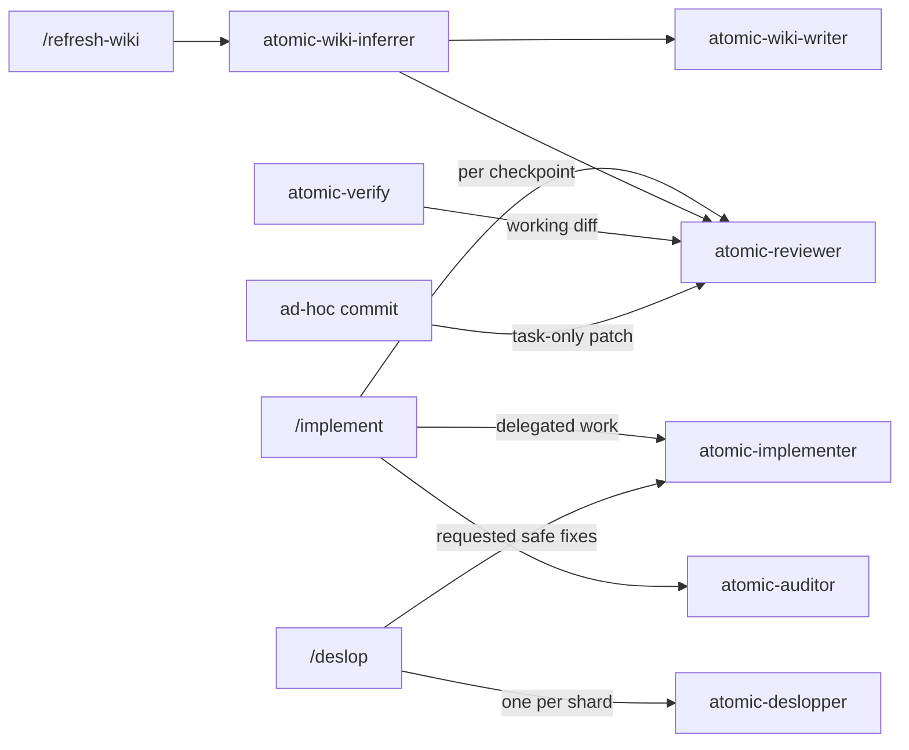
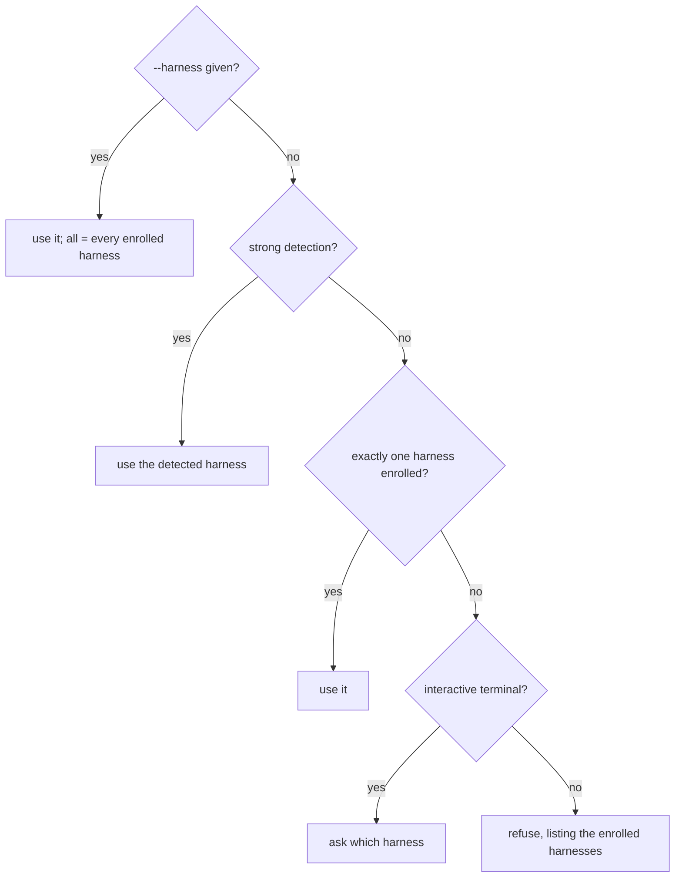

# Agents

Agents are specialized workers that run in a fresh context. Commands dispatch them, or you can invoke them directly via the Agent tool.


## Who dispatches whom

`/implement` always dispatches an independent reviewer and a final auditor. It delegates writing when the work warrants it.



`/atomic-plan` uses the reviewer in spec mode. Outside an implementation command, `atomic-verify` reviews the working diff before a completion claim. Before an ad-hoc commit, an independent reviewer must pass the exact task-only patch unless it has already passed review.


## Code agents

These write, review, and gate code.

| Agent | What it does |
|-------|-------------|
| `atomic-implementer` | Implements a cohesive feature checkpoint or a surgical edit, as declared by the orchestrator. Both modes write a failing test first. |
| `atomic-reviewer` | Reviews one scoped diff, spec draft, or requested wiki page. For diffs, verifies evidence and blocks duplicate helpers, library drift, and premature abstractions. |
| `atomic-auditor` | Audits the whole delivery once: end-to-end proof, coherence, remaining polish, commit messages, and docs. Reports fixes in `AUDIT.md` when given a scratchpad. The caller assigns and reviews fixes. |


## Research agents

These read code but never write it.

| Agent | What it does |
|-------|-------------|
| `atomic-investigator` | Optional read-only source locator. The workflow can use any inexpensive read-only scout. |
| `atomic-strategist` | Reasons through hard problems, plans, specs, and architectural tradeoffs. Read-only; never implements. |
| `atomic-deslopper` | Checks one shard for avoidable complexity and dead code. Reports evidence and whether each fix is safe. |


## Infrastructure agents

These handle system-level tasks.

| Agent | What it does |
|-------|-------------|
| `atomic-wiki-inferrer` | Selects affected repo domains, dispatches writers and reviewers, and publishes reviewed outputs before accepting the scan. Follows `atomic-wiki/references/repo.md`. |
| `atomic-wiki-writer` | Reads assigned source and designs, writes one source-backed draft in scratch, and reports concerns separately. Follows `repo-output.md` for page format. |


## Model and effort

The canonical agent definitions declare no model or effort. Each states behavioral intent, required capabilities, write scope, execution preference, dependencies, and enforcement strength; model and effort are runtime policy, chosen per harness and per user.

`atomic config agents` writes that policy per harness, as `[<harness>.agents.<name>]` tables in `~/.atomic/config.toml`. Each harness has its own table, its own native keys, and its own form.

| Harness | Table | Agent file | Model key | Effort key | Model examples | Effort levels |
|---|---|---|---|---|---|---|
| Claude Code | `[claude.agents.<name>]` | `<Claude root>/agents/<name>.md` | `model` | `effort` | `opus`, `claude-opus-4-8` | `low`, `medium`, `high`, `xhigh`, `max` |
| OMP | `[omp.agents.<name>]` | `<profile agent root>/agents/<name>.md` | `model` | `thinking` | `@slow`, `anthropic/claude-opus-4-8` | `auto`, `inherit`, `off`, `minimal`, `low`, `medium`, `high`, `xhigh`, `max` |
| Codex | `[codex.agents.<name>]` | `$CODEX_HOME/agents/<name>.toml` | `model` | `model_reasoning_effort` | `gpt-5.2-codex` | `none`, `minimal`, `low`, `medium`, `high`, `xhigh`, `max`, `ultra` |

- **model** is lenient on every harness: any value without spaces or control characters passes through, and the harness resolves it at runtime.
- **effort** is strict on Claude, where a value outside the five levels is a config error. The OMP and Codex lists are the levels known at release; a value outside them warns in `atomic doctor` and still passes through.

With no override stored, the projected agent carries no model or effort key, leaving the harness to select the session's values. Atomic projects a stored override into the named agent file; runtime support depends on the harness. A Codex 0.147.0 fresh child ran with both configured values, while OMP and Claude model-level delivery remains unproven. Atomic's static Codex agent-delivery capability still reports `unsupported`; see the [capability evidence](../research/harness-capability-matrix.md#agent-delivery).

### Choosing the harness

```
atomic config agents [--harness claude|omp|codex|all]
```



An unadopted legacy Claude install counts as an enrolled Claude harness here. Each harness opens its own form: its model placeholder, its effort choices, and its own restart note. The form is pre-filled from that harness's table. A blank model and a blank effort remove the entry. `--harness all` opens one form per enrolled harness; Ctrl+C on any form stops the run before the next one opens.

### How an override travels

1. **Config.** The form writes nested tables to `config.toml`:

    ```toml
    [claude.agents.atomic-implementer]
    model = "claude-opus-4-8"
    effort = "high"

    [omp.agents.atomic-reviewer]
    model = "@slow"
    effort = "high"

    [codex.agents.atomic-investigator]
    model = "gpt-5.2-codex"
    effort = "low"
    ```

2. **Convergence.** For each edited harness that is enrolled, the save converges that harness's targets through the same lifecycle `atomic harness repair` runs: the lifecycle lock, the journal, and the ledger. The adapter writes the agent file with your override under its native keys, and the ledger records the digest of exactly those bytes. Installed Atomic agents are managed artifacts: a manually edited copy is backed up under `~/.atomic/backups/<operation>/` before replacement. An unowned file collision still requires the explicit replace-or-leave-unowned decision.
3. **Not enrolled.** A harness that is not enrolled changes in config only. The verb says the change applies when that harness is enrolled, and `atomic install --harness <kind>` delivers it.
4. **Legacy Claude.** An unadopted legacy Claude install has no ledger, so the save re-patches the agent files already in its root instead. `atomic update` adopts that install once, and from then on the save converges it like any other enrolled root.
5. **Doctor.** `atomic doctor` category 9 warns for an override whose harness is not enrolled, whose agent delivery is `unsupported`, or whose value looks wrong. A value warning ends with `atomic config agents --harness <kind>`, naming the harness whose form fixes it.

`atomic config list` shows what is active, grouped by harness:

```
claude.agents.atomic-implementer.model = claude-opus-4-8
omp.agents.atomic-reviewer.effort      = high
```

### Edge cases

| Case | Behavior |
|---|---|
| scalar entry (`atomic-implementer = "opus"`) | config parse error; nested tables are the only accepted shape |
| running session on any harness | keeps the old agent file; restart to pick up the change |
| Claude root under `CLAUDE_CONFIG_DIR` | converges like `~/.claude` once enrolled |
| hand-edited managed Atomic agent | backed up before replacement; unowned collisions still require an explicit decision |
| agents added manually to an agents directory | never touched; only Atomic's own agents carry overrides |
