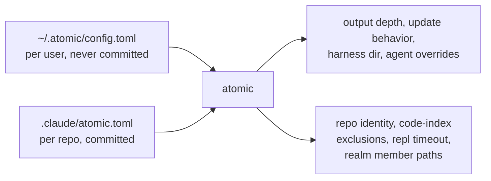

# .claude/atomic.toml

The repo-scoped config file. It is committed, so it applies to everyone working in the repository, and it holds settings that belong to the project rather than to you.

There are two config files and they do not overlap:



Your personal preferences live in `~/.atomic/config.toml` and never reach the repository. Facts about the project live here. A teammate cloning the repo should get the same code-index exclusions you have; they should not inherit your update settings.

`atomic repo init` creates the file with a `scope` marker at a repo root; `atomic wiki scan` and `atomic wiki init --scope realm` do the same at a realm root. Everything else you add by hand.

## Keys

| Key | Type | Default | What it does |
|-----|------|---------|--------------|
| `scope` | string | none | Declares this directory as `"repo"` or `"realm"` |
| `[code] ignore` | string array | empty | Glob patterns excluded from the code-intel index |
| `[scan] ignore` | string array | empty | Glob patterns dropped from the wiki scan entirely |
| `[scan] generated` | string array | empty | Globs kept in the tree but skipped for domain content |
| `[comments] max_lines` | integer | `2` | Longest comment `atomic code comments` accepts before it flags the entry |
| `[repl] idle_timeout` | string | `1h` | How long an idle `atomic repl` session survives |
| `[realm] repos` | string array | unset | Realm root only. Paths and globs where `atomic wiki scan` and `atomic wiki stale` look for member repos |

A complete repo-scope example:

```toml
scope = "repo"

[code]
ignore = ["vendor/**", "*.generated.ts", "dist/**"]

[scan]
ignore = ["fixtures/large-dataset.json", "third_party/**"]
generated = ["*.pb.go", "generated/**"]

[comments]
max_lines = 2

[repl]
idle_timeout = "30m"
```

## scope

`scope` states what a directory is, so nothing has to guess. Without it, a repo root is inferred from `git rev-parse --show-toplevel` and a realm root is found by looking up your personal `<wikis>` registry, which means the same directory can resolve differently for two people.

`atomic where` reports which one answered.

| Value | Means |
|-------|-------|
| `"repo"` | A single project. Written by `atomic repo init`. |
| `"realm"` | A root holding several member repos plus a shared wiki. Written by `atomic wiki scan` and `atomic wiki init --scope realm`. |

Discovery walks upward from the current directory to the filesystem root, taking the first marker of the kind it wants. It crosses `.git` boundaries deliberately, because a realm root sits above the repos it contains.

A marker naming the other kind is skipped, not treated as an error. `atomic doctor` warns when `scope = "repo"` contradicts a realm registered at the same path.

## [code] ignore

Patterns here keep files out of the code-intel index. Use it for vendored trees, generated output, and build artifacts, which add nodes and edges without telling you anything about the code you write.

Matching rules, which are not gitignore rules:

| Pattern | Matches |
|---------|---------|
| `vendor/**` | contains a slash, so it matches the full repo-relative path |
| `*.generated.ts` | no slash, so it matches the basename at any depth |
| `./dist/**` | leading `./` is stripped, then treated as a path pattern |
| `build/` | trailing slash only, matches nothing — write `build/**` |

There is no negation syntax. An invalid pattern is dropped with a warning rather than failing the run.

Newly ignored files are removed from the index on the next `atomic code index` or `atomic code sync`, through the same pruning that handles deleted files.

**If your repo gitignores `.claude/` wholesale**, add a negation so this file is actually committed:

```gitignore
.claude/*
!.claude/atomic.toml
```

Uncommitted, it only configures your own machine, which defeats the point of a repo-scoped file.

## [scan] ignore and [scan] generated

These control what the repo wiki's deterministic scan sees. They are two lists because there are two different things you might want:

| Key | Effect | Use for |
|-----|--------|---------|
| `ignore` | the path never appears in the tree at all | vendored dependencies, checked-in fixtures, large data files |
| `generated` | the path stays in the tree, marked, and the inferrer skips it for domain content | build output, protobuf output, lockfiles |

The scan already starts from tracked files plus untracked files not covered by `.gitignore`, so anything gitignored is excluded before these run. Reach for `[scan]` when a *committed* path should be dropped or flagged.

```toml
[scan]
ignore = ["fixtures/large-dataset.json", "third_party/**"]
generated = ["*.pb.go", "generated/**"]
```

Matching follows the same rules as `[code] ignore` above: a pattern with a slash matches the full repo-relative path, one without matches the basename at any depth, and `**` crosses directories.

**Migrating from `.signalsignore`.** These keys replace the repo-root `.signalsignore` file, whose bare lines are now `ignore` and whose `+`-prefixed lines are now `generated`. `atomic update` converts an existing file and deletes it; `atomic migrate --repo <path>` does the same on demand. Until that runs, a repo with no `[scan]` table still reads `.signalsignore`, so nothing breaks in the meantime. If both exist, `[scan]` wins as a whole table — a config declaring only `ignore` also suppresses the old file's `+` lines, so the effective rules never depend on a file you forgot was there.

## [comments] max_lines

Bounds how many consecutive full-line comment lines `atomic code comments` accepts in one diff entry before flagging it. Default 2 when the key is absent. A value under 1 warns and resolves to 2, the same lenient contract as the other keys.

See [code intelligence](/reference/code-intel) for the verb that reads this key.

## [repl] idle_timeout

How long a named `atomic repl` interpreter session stays alive with no activity. Accepts a Go duration string: `30m`, `2h`, `90s`.

Resolution order is repo, then user, then the `1h` built-in default. Set it here when the project's sessions are expensive to start; set it in `~/.atomic/config.toml` when it is your own preference.

## [realm] repos

Limits where a realm looks for its member repos. Without it, `atomic wiki scan` and `atomic wiki stale` walk the whole realm root. Every git repo the walk reaches becomes a member, including one inside a capture bucket or a notes folder. Set it in the realm root's `.claude/atomic.toml` to name the folders that hold the repos you want:

```toml
scope = "realm"

[realm]
repos = ["agency", "experiments", "{companya,companyb}"]
```

Each entry is a path relative to the realm root. The scan walks every directory an entry matches the same way it walks the whole root. It records the first directory holding a `.git` entry as a member and does not descend into it. It skips the realm's `wiki/`, `node_modules`, `dist`, `build`, `target`, `vendor`, `tmp`, `.worktrees`, and `.git`. An entry that is itself a repo makes that repo the member.

| Setting | Result |
|---------|--------|
| Key absent, or no `.claude/atomic.toml` | Walk the whole realm root |
| `repos = []` | Walk the whole realm root, with a warning |
| An entry matching `.`, alone or beside others | Walk the whole realm root |
| One or more entries | Walk only the matched directories; a repo outside them is not a member |
| Every entry unusable | No members. Each bad entry warns; an entry dropped silently (below) gives no warning |

Matching uses [doublestar](https://github.com/bmatcuk/doublestar) globs over the realm root:

| Pattern | Matches |
|---------|---------|
| `agency` | the `agency` folder |
| `{companya,companyb}` | both folders; warns only when no alternative matches |
| `clients/*` | every direct child of `clients`, files included |
| `clients/*/` | directories only; the trailing `/` does it |
| `teams/*/services` | the `services` folder of each team |
| `**/services` | every `services` folder at any depth. Expanding `**` reads every folder under the pattern's fixed prefix (here, the whole realm) on each `scan` and `stale`, and every 30s under `atomic serve`, member repos' `.git` and `node_modules` included, so prefer a fixed-depth `*` |

A directory matched by two entries is walked once. One nested inside another match is dropped, and the outer walk covers it only up to the first repo, so when `solo` is a repo, `["solo", "solo/inner"]` records `solo` alone. A match that no other match contains is a root even inside a member repo: `["solo/pkg"]` on its own walks `solo/pkg` and records the repos below it. A match that is the realm's `wiki/`, sits under it, or is or sits under a skipped folder is dropped without a warning. A wildcard never descends into a symbolic link; a link named before the first wildcard is followed, and every hit through it warns and is skipped.

### Warnings

A bad entry never fails the run. `atomic wiki scan` and `atomic wiki stale` print warnings on stderr, skip the bad entry or match, and continue with the rest. A glob that matches both directories and files still walks its directories. `stale`'s `DRIFT` lines and exit code are unaffected. Each entry warning names the entry, the realm root, and the file to edit:

```
atomic wiki scan: warning: [realm] repos entry "missing" matches nothing (realm root /work/acme); fix or remove it in /work/acme/.claude/atomic.toml
```

| Condition | Warning says |
|-----------|--------------|
| Entry matches nothing | `matches nothing` |
| Entry, or a glob match, is a file | `matches <path>, which is not a directory`; for a glob, also `end the pattern with "/" to match directories only` |
| Entry, or a glob match, is a symbolic link | `matches <path>, which is a symbolic link; declare the real path inside the realm root` |
| Entry passes through a symbolic link | `matches <path>, which passes through the symbolic link <link>; declare the real path inside the realm root` |
| Absolute path, or one that leaves the root (`..`, `../x`) | `must stay inside the realm root` |
| Invalid glob (`[`) | `is not a valid pattern` |
| Empty entry (`""`) | `is empty` |
| Match that cannot be read | `matches <path>, which could not be read: <error>` |
| `repos = []` | `[realm] repos is empty; scanning all of <root>` |
| Misspelled key under `[realm]` (`repo = ...`) | `config: unknown key "realm.repo" (ignored)` |
| Malformed or unreadable `.claude/atomic.toml`, or any value of the wrong type | the read, parse, or decode error, then `ignoring [realm] repos and scanning all of <root>` |

A glob that hits several files, links, or unreadable paths gives one warning per kind for the entry, with the count and the first match:

| Kind | Warning says |
|------|--------------|
| Files | `matches N files, not directories (first: <path>)` |
| Symbolic links | `matches N paths through symbolic links (first: <path>)`, or `(first: <path>, through <link>)` when the first hit sits under a link |
| Unreadable paths | `matches N paths that could not be read (first: <path>: <error>)` |

Narrowing `repos` drops members from the next scan; see [membership drift](/reference/realm-wiki#membership-drift).

## State paths

`.claude/atomic.toml` does not configure where scratchpad bundles, session reports, reminders, or archives live — those resolve per project, not per repo config, under `~/.atomic/<project-key>/`. Run `atomic where --json` to read them; see [conventions](/reference/conventions) for the layout.

## How the file is read

Loading is lenient by design, because a config problem should never stop you working:

| Condition | Result |
|-----------|--------|
| File absent | Empty config, no error |
| Unknown key | Warning; the rest of the file still loads |
| Invalid glob | Pattern dropped with a warning |
| Malformed TOML | Error, and the caller degrades rather than failing |

`atomic doctor` category 13 reports on this file. An absent file passes, since the file is opt-in. Parse errors, unknown keys, invalid globs, and an invalid `scope` value all warn. It never fails, so a bad config file cannot block the rest of the check suite.
