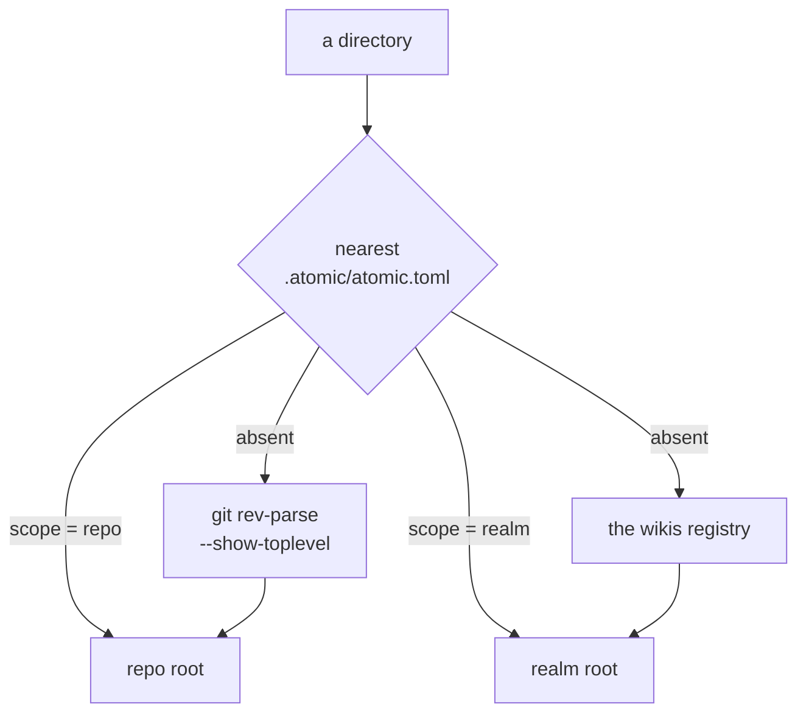
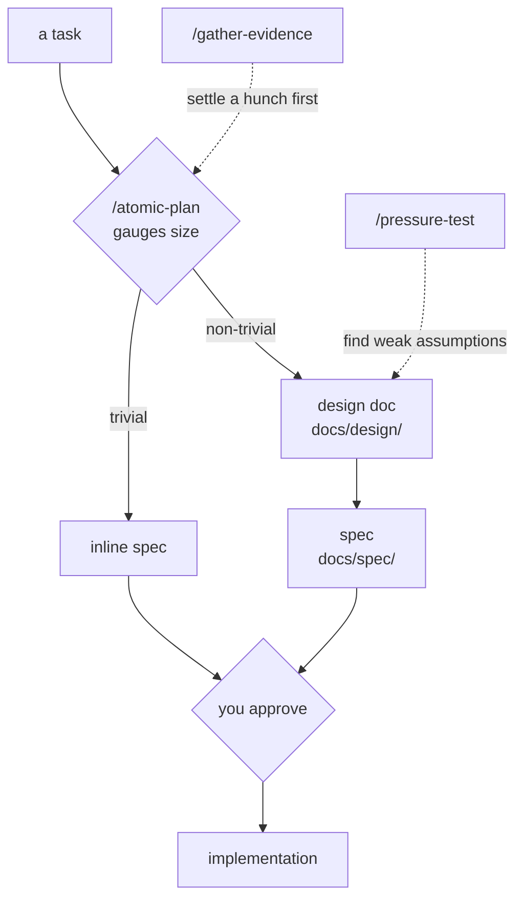
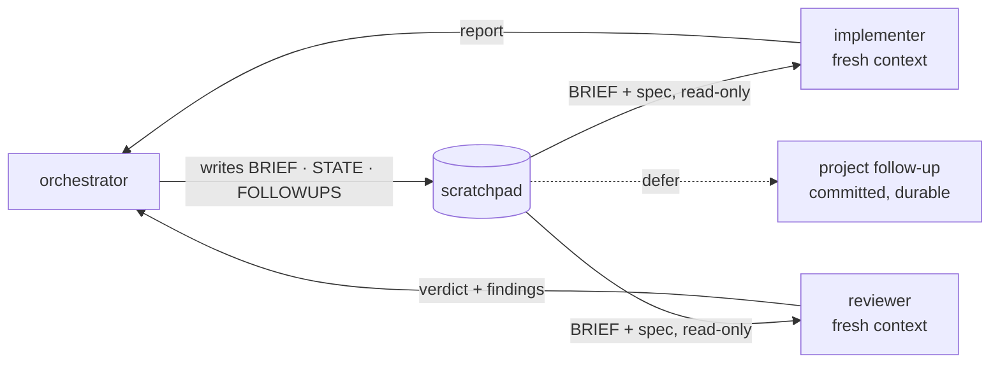
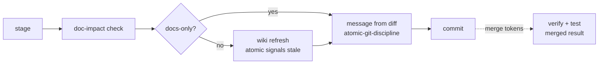

# Concepts

The ideas behind Atomic Claude and why each exists. Usage detail lives on the reference pages linked from each section.

The broader idea is *loop engineering*: build the system that finds work, hands it to the agent, checks the result, and records state, instead of prompting by hand. Each concept below is one part of that loop.

## How it flows

A real session, adding a Stripe webhook endpoint to a NestJS app. Play it, or jump between steps:

<SessionPlayer :session="FLOW" />

Each tab is one concept below.

## The atomic binary

`atomic` is a standalone Go binary and the deterministic layer under everything else. The model is good at judgment and bad at reproducibly scanning a tree, computing a checksum, or managing a scheduled job, so code does those and hands Claude facts it can trust.

| Verb family | What it does |
|-------------|--------------|
| `atomic signals scan` | Walks the filesystem (tree, manifests, languages, lockfiles) into a reproducible facts file that grounds every inference about the repo |
| `atomic code` | Builds and queries the symbol graph |
| `atomic wiki` | Scaffolds repo and realm wikis, scans realms, and checks membership drift |
| `atomic repo init`, `atomic template <name>` | Creates the harness layout once, idempotently; emits the fill-in skeleton for each workflow document so structure is copied, never reconstructed from memory |
| `atomic install`, `atomic harness` | Installs into every installed harness (`--harness` narrows) and converges its native surface; `list\|status\|enroll\|adopt\|repair\|diff\|uninstall` is the target lifecycle, `rules status\|sync` the rule surface |
| `atomic state adopt`, `atomic state migrate` | Selects this repository's state root on the harness-neutral ladder; moves Atomic's state out of legacy `.claude` into it |
| `atomic workflow resolve`, `atomic workflow set` | Prints the resolved source-control, issue-tracker, and worktree preferences; writes one preference line at the profile, realm, or repo level |
| `atomic update`, `doctor`, `validate` | Swaps the binary against a verified checksum, reconverges enrolled targets; checks the install and every target |
| `atomic config`, `followups`, `profile` | User config, per-agent model and effort overrides, follow-up entries, the user profile |

Everything below is produced by this binary or grounded by what it produces. `atomic --help` lists the full surface.

## Harnesses, steering, and state paths

Atomic ships one authored corpus: `context/AGENTS.md` as the global contract, plus commands, agents, skills, and rules. A **native adapter** projects that corpus into a harness's own surface. A bare `atomic install` installs into every harness it finds installed: Claude when its root exists, OMP when the `OMP_PROFILE` profile's agent root (else the default profile's) exists, Codex only when `CODEX_HOME` names an existing directory, and Claude when none is found. It prints a `detected:` line first. `--harness <claude|omp|codex>` narrows the install to one harness, `atomic harness enroll` enrolls one explicitly, and discovery (`atomic harness list`) never enrolls. A harness whose native root the adapter will not guess at (`CODEX_HOME` for Codex) contributes no discovered instance instead of a defaulted one. The ledger at `~/.atomic/install/ledger.json` records what each enrolled target owns; `atomic update` reconverges already-enrolled targets with the replacement binary's embedded generation and never enrolls a new harness. Its one exception is a legacy Claude install: when the Claude root is unenrolled and `~/.atomic/config.toml` carries the legacy `[install]` record without `adopted = true`, `atomic update` adopts it once and stops, naming the file, on user content it will not overwrite. The [install guide](/guides/install#updating) owns the blocker list.

| Harness | Global steering | Native artifacts | Rules |
|---------|-----------------|------------------|-------|
| **Claude Code** | Direct rendered `~/.claude/CLAUDE.md` block (no user-level `AGENTS.md`) | agents, commands, skills, output styles, unconditional rules | scoped rules `partial`: Claude Code `2.1.322` loads a `paths:` rule for an `@`-mentioned matching file |
| **OMP** | Profile `AGENTS.md` (Atomic steering with its `@` imports + output-style body) | the discovered extension module, commands, skills, and agent files at the profile agent root, with agent delivery `unsupported`; the corpus store at `~/.atomic/packages/omp/atomic` (commands, skills, rule bodies) is `unsupported` on the tested version | cards published as `.omp/rules/atomic-wiki-<domain>.md` symlinks to the state-root cards (a generated copy when the state root lies outside the repository), which OMP `18.18.3` lists with their description and globs |
| **Codex** | Managed block in `$CODEX_HOME/AGENTS.md` (Atomic steering without its `@` lines + output-style body; Codex leaves a user's own `@` lines literal) | registered plugin package whose skills Codex lists; TOML agents in `$CODEX_HOME/agents/`; commands are `unsupported` | wiki cards `partial` (edits only): a `PreToolUse` member on `apply_patch` delivers the cards matching the edited files once per session, after you trust it in `/hooks`; shipped path-scoped rules are `unsupported`; doctor reports the `hooks.json` trust states, and once trusted the session context reaches the session at startup |

Every harness receives the same session context at session start: orientation nudges and the resolved [workflow preferences](#workflow-preferences), produced by `atomic hooks session-start --harness <claude|omp|codex>`. Claude runs it as a session-start hook, OMP through the generated extension on `session_start` and `session_switch`, and Codex through a `SessionStart` member in `$CODEX_HOME/hooks.json` that runs only once you trust it. The [install guide](/guides/install#harnesses-and-targets) covers each harness's wiring and the Codex trust states `atomic doctor` reports.

Repository and nested-realm steering is a **loader pair** by default: authored guidance in `AGENTS.md` plus an adjacent thin `CLAUDE.md` whose managed block is `@AGENTS.md`. The `[steering] claude` key ([`atomic-toml`](/reference/atomic-toml)) changes the shape: `agents-md` writes `AGENTS.md` alone, and `claude-md` writes `CLAUDE.md` alone with no `AGENTS.md`. The wiki pipeline, doctor, and guidance migration all follow it. Under another harness the same `AGENTS.md` guidance is delivered natively. The capability record behind each projection is versioned in [`docs/research/harness-capability-matrix.md`](../research/harness-capability-matrix.md); a missing capability row is reported `unsupported`, never assumed.

Per-user state (config, profile, wikis registry, install ledger, backups) lives at `~/.atomic/`. Repo-local state lives in the repository's **state root**, `.atomic/` by default. The state root holds the code index (`.atomic-index/atomic.db`), `atomic.toml`, the scratchpad bundles (`.scratchpad/`), `project/` (follow-ups and `doc-surfaces.md`), the wiki pointer cards (`rules/wiki/`), the repo's [workflow preferences](#workflow-preferences) (`workflow-preferences.md`), and its own `.gitignore`. `atomic where --json` prints the resolved root as `state_root`.

### State-root resolution order

The state root resolves through a **harness-neutral ladder**, so one repo resolves the same root whatever harness runs it. The first rung that answers wins:

| Rung | Source | Notes |
|------|--------|-------|
| 1 | `ATOMIC_STATE_DIR` | process-only override, never persisted |
| 2 | `~/.atomic/<project-key>/state-location.json` | the per-clone selection `atomic state adopt --dir <path>` persists, shared by every worktree; `--clear` removes it |
| 3 | a populated state folder | see the list below |
| 4 | `state.dir` in `~/.atomic/config.toml` | a repository-relative path of one or more safe segments, such as `.config/atomic`, set once for the user |
| 5 | `.atomic` | the default |

Rung 3 looks at the folders that already hold state:

- When the destination (`state.dir`, else `.atomic`) holds state, it wins, and a one-time warning names any other populated folder as leftover.
- Otherwise a single other populated folder, such as legacy `.claude`, answers in place with no warning.
- Two or more such folders stop with an ambiguity error that asks for `atomic state adopt`.

`atomic state migrate` moves Atomic's state out of legacy `.claude` and stages the tracked renames. Its destination is the selection record, else `state.dir`, else `.atomic`; it never uses `ATOMIC_STATE_DIR`. It does not move the code index: it deletes the legacy one, and the next `atomic code index` builds a fresh one ([where the index lives](/reference/code-intel#where-the-index-lives)). `atomic repo init` and `atomic update` run that migration once on their own. No rung reads a harness variable, and `atomic where` reports cwd's four orientation axes (repo root, repo-scope wiki, realm scope, and code-index scope), not which rung answered. Where worktrees go depends on the harness; see [worktrees](#worktrees).

## Code intelligence

`atomic code index` parses source with tree-sitter into a symbol graph at `.atomic/.atomic-index/atomic.db`: what calls what, what imports what, where each symbol is defined, across 31 languages with no compiler or language server. Claude queries the graph instead of grepping for structure, and the implementation agents check blast radius before editing. The index is optional; every consumer falls back to `sg` and `grep` without it.

| Verb | Answers |
|------|---------|
| `atomic code explore "<question>"` | Start here: a one-shot digest of the relevant symbols, files, and how they relate |
| `atomic code callers <symbol>` / `callees <symbol>` | What calls it, what it calls |
| `atomic code impact <symbol>` | The blast radius of changing it |
| `atomic code sync` | Refresh the index (ship verbs and `/refresh-wiki` run it when the index is warm) |
| `atomic code mcp` | Expose the graph to an interactive session as MCP tools |

Full verb list and lifecycle: [code-intel reference](/reference/code-intel), [MCP guide](/guides/code-intel-mcp).

## Wikis

A wiki is a generated knowledge graph for a tree of code: context curated once and kept as an artifact, instead of re-derived every session. Two scopes, one system: the same command, inferrer, and page shape, with a `<wiki-type>` marker telling `/refresh-wiki` which it is looking at.

| Scope | Root | Maps | Steered by |
|-------|------|------|------------|
| **repo** | `docs/wiki/` inside the repository | one project: framework, commands, domain map | `docs/wiki/AGENTS.md` (+ `CLAUDE.md` loader) |
| **realm** | `<root>/wiki/`, its own git repo | a folder of repositories: what each is, what cuts across them | `<root>/AGENTS.md` (+ `CLAUDE.md` loader) |

They compose. A realm summarizes the repos under it without writing into them, and a member repo with its own wiki is linked rather than re-summarized.

### Repo scope

A hand-written `CLAUDE.md` drifts: you swap Jest for Vitest and forget. A repo wiki is regenerated instead, by `/refresh-wiki` and by ship verbs on every real-code commit, grounded in the code-intel graph and the actual diff. It ends invented `npm run` scripts, wrong guesses about the stack, and re-explaining the layout every session.

| File | Content | Loaded |
|------|---------|--------|
| `docs/wiki/scan.md` | deterministic facts: tree, manifests, languages (written by `atomic signals scan`, a name kept from before the two scopes were unified) | on demand by the inferrer, never `@`-ref'd |
| `docs/wiki/index.md` | inferred meaning: framework, commands, domain map, links to per-domain pages | every session, before Claude reads your code |

On a monorepo or unconventional layout inference guesses wrong. `docs/wiki/AGENTS.md` is the correction (a thin `CLAUDE.md` beside it carries the `@AGENTS.md` import for Claude Code): the harness loads a directory's steering whenever it reads a file there, which is exactly when the inferrer is working. Write "treat `src/billing/` and `src/payments/` as one domain" and it wins over the scan. See [repo wiki](/reference/repo-wiki).

### Realm scope

A realm wiki maps how a folder of repos relate: shared libraries, contracts one repo owns and another consumes, patterns duplicated across services. It is a git-initialized knowledge base at `<root>/wiki/`, registered in the authoritative `~/.atomic/wikis.md`, which is projected into the harness global file's `<wikis>` block so every session in any repo knows it exists.

| Verb | Does |
|------|------|
| `/refresh-wiki` | Scan the realm; refresh repo summaries and cross-cutting concerns with cited evidence |
| `atomic wiki bucket add <name>` | Register a folder of loose material (research items with their raw material, notes, ticket exports); the scan keeps an index in every folder |
| `atomic wiki stale` | Report repos added, removed, or reclassified since the last scan |
| `atomic serve` | Browse the realm as a navigable graph in the browser |

An `AGENTS.md` at the realm root steers all of it (with a thin `CLAUDE.md` loader beside it for Claude Code), again through the harness: Claude Code walks up the directory tree loading every `CLAUDE.md` it finds, and the walk crosses repo boundaries. Rules that span repos go there once and reach every session inside the realm.

### Scope resolution

A directory declares itself with `scope = "repo"` or `scope = "realm"` at the top of `.atomic/atomic.toml` (`atomic repo init` writes the former, `atomic wiki scan` the latter, `atomic wiki init --scope <s>` either). A marker answers discovery on its own; without one, atomic falls back to git for a repo root and to the wiki registry (`~/.atomic/wikis.md`) for a realm root:

The registry keeps one job a marker does not touch: locating a realm's `wiki/index.md` for member data. `atomic where` reports which mechanism answered each axis.

See the [knowledge base guide](/guides/knowledge-base) and [realm wiki](/reference/realm-wiki).

## Output style

Claude's default voice opens with "Sure! I'd be happy to help," hedges, and narrates what it is about to do; across a session that filler buries the answer. Atomic's output style strips it and uses tables, trees, and ASCII flows where structure carries meaning. Security warnings and irreversible-action confirmations revert to full prose. The most optional part of Atomic Claude; see [output style](/reference/output-style).

## Planning

`/atomic-plan` gauges a task's size. Only non-trivial work gets a design doc, and nothing reaches implementation without your approval:

| Piece | Job |
|-------|-----|
| `/gather-evidence` | Chase a hunch ("does this library support that") against primary sources and return a verdict before a session is designed around it |
| `/pressure-test` | Attack a design's assumptions to find the weak ones before they reach a spec |
| design doc, `docs/design/` | The thinking space: concepts, rules, approaches weighed, the why. Trivial tasks skip it |
| spec, `docs/spec/` | The contract subagents build from: checkpoints, success criteria, the plan |

A spec body states what is true now; a subagent reads it as ground truth. Its change log records how it got there: when a decision changes, rewrite the affected body and add a dated entry saying what changed and why. History survives without the body going stale.

## Implementation

`/subagent-implementation` runs the implement-then-review loop against a spec, committing each green checkpoint. Every subagent starts with no memory of the last run, so the orchestrator alone writes the scratchpad and subagents only read it and report back:

The scratchpad is the only thing that crosses from one subagent run to the next; everything else the loop produces lands in a commit or is thrown away.

### Scratchpad

`.atomic/.scratchpad/<slug>/` is the loop's working memory: gitignored, written for the next subagent, one bundle per slug. `atomic scratchpad` owns it (`new`/`path`/`list`/`archive`). Three files, three write disciplines:

| File | Written | Holds | Why that discipline |
|------|---------|-------|---------------------|
| `BRIEF.md` | overwritten every iteration | what to build now | a stale brief is worse than none; the subagent treats it as current instructions |
| `STATE.md` | append-only | one entry per iteration, plus the loop's base SHA | the audit trail, and the SHA scopes the finalize wiki refresh to this task's commits |
| `FOLLOWUPS.md` | appended after any reviewer pass with findings | risks, nits, questions, numbered `F-1`, `F-2`, … | closed entries stay, marked with the iteration and commit that closed them |

There is no `GOAL.md` or `PLAN.md`; the spec already is those. At the end you triage the ledger, and a deferred finding becomes `.atomic/project/followups/<id>.md`, committed and auto-loaded into later sessions. Full layout: [conventions](/reference/conventions).

### Worktrees

A worktree is a second checkout on its own branch in a different directory. Under Claude Code it goes in `.claude/worktrees/<branch>/`, Claude Code's own worktree home, and its `EnterWorktree` tool moves the session there, so edits and shell commands land inside it with no `cd` discipline. Under OMP, Codex, or an unknown harness it goes in `<state-root>/worktrees/<branch>/` (`.atomic/worktrees/` by default). The `worktrees` preference can name another repository-relative path or `off`, and the `worktrees` field of `atomic where --json` prints the resolved directory. `/subagent-implementation` offers one before significant work, `/autopilot` creates one without asking, and on merge or squash `/commit` offers to clean it up. Atomic runs `git worktree add -b <branch>` itself so the branch is based on the current `HEAD` and a spec you just committed follows it; if a sandbox blocks that, the loop says so and works in place.

### Subagents

Atomic defines a roster of fresh-context agents, each scoped to one job, built on the [evaluator-optimizer pattern](https://www.anthropic.com/engineering/building-effective-agents): one agent writes, a separate one critiques and re-runs the tests. Scope is constrained too; the implementer's surgical mode refuses more than two files, and the strategist is read-only. Roster: [agents](/reference/agents).

### Ship verbs

One `/commit` verb, escalated by token: bare `/commit` stages, commits, then asks how far to go; `/commit push`, `pr`, `merge`, `squash`, `squash merge` skip the prompt. It exists instead of a plain "commit and push" because of what runs around the git operation:

Docs are checked before the wiki refresh so a newly staged doc file lands in the scan. Full token set: [commands](/reference/commands).

### Session reports

Long or scattered work loses its why: you come back tomorrow, or three terminals share one branch, and no session has the whole picture. `/session-report` writes a branch-scoped snapshot of what changed and why; the next commit on that branch folds it into the message, then deletes it. It is for Claude to read when it writes your commit, not for you.

## Workflow preferences

Workflow preferences decide where change requests, issues, follow-ups, and worktrees go. Five keys exist:

| Key | Values |
|-----|--------|
| `source-control` | `github`, `gitlab`, `bitbucket`, `codeberg`, `none` |
| `source-control-host` | the instance host, such as a GitHub Enterprise or self-hosted GitLab domain |
| `issue-tracker` | `github`, `gitlab`, `codeberg`, `linear`, `jira`, `trello`, `filesystem` |
| `issue-tracker-project` | the team, project, or board to file in |
| `worktrees` | a path, `auto`, or `off` |

Each key resolves per directory from three levels, read in this order:

| Level | Where it lives |
|-------|----------------|
| repo | `<state-root>/workflow-preferences.md` in the repository |
| realm | `<state-root>/workflow-preferences.md` at the realm root |
| profile | the `## Workflow preferences` block in `~/.atomic/profile.md` |

The first explicit line wins. Without one, the `origin` remote decides `source-control`, and `issue-tracker` takes a detected Linear, Jira, or Trello login, else the source-control host's tracker, else `filesystem` when that host has none (`bitbucket`, `none`). Profile refresh writes what it detects into the profile block as soft lines ending `# detected`, and only when exactly one provider is signed in; a line without that marker is never touched.

`atomic workflow set <key> <value> [--level profile|realm|repo]` writes one explicit line, `profile` by default. `atomic workflow resolve [--json]` prints the resolved block, each value tagged with the level it came from, plus any warnings and the `atomic-git-discipline` references to read. The session-start hook puts the same block into context, and the global steering tells the agent to run `atomic workflow resolve` when it is missing. Ship verbs, `/report-issue`, and the follow-up flows act on it.

## Parking things for later

A follow-up is a decision you defer, such as a non-blocking risk a reviewer flags at triage. `/follow-up <text>` records it in the resolved issue tracker, or in the local ledger when the tracker is `filesystem` or cannot take it. A deferred finding at the end of the implement loop, `defer` in `/subagent-diagnose`, and "Later" in a documentation prompt record the same way, and each result line names the tracker used. Set `issue-tracker` to `filesystem` to keep every follow-up local. `/follow-up review` triages stale ledger entries.

## Skills vs commands

| | Fires on | Role | Example |
|---|----------|------|---------|
| **Skill** | matching language, automatically | the how: always-on discipline | "let's implement the auth module" activates `atomic-tdd` |
| **Command** | the slash you type | the when: workflows you start on purpose | `/atomic-plan`, `/commit` |

A command can invoke a skill (every ship verb uses `atomic-git-discipline`); a skill never invokes a command. See [skills](/reference/skills) and [commands](/reference/commands).

## Documentation

Code changes break docs silently: an endpoint renamed, a config field gone, a diagram showing a component that no longer exists. `/documentation` treats docs the way the wiki treats project context: scan, track, and prompt on drift.

| Mode | When | Does |
|------|------|------|
| Bootstrap | first run | Scans for markdown; you pick which surfaces to track into a `## Documentation surfaces` table in the project's instructions |
| Authoring | `/documentation` | Compares recent changes against tracked surfaces and walks the stale ones with you |
| Maintenance | every ship verb | Same check on the staged diff, silent unless something is stale |

## Your work profile

Claude reads `~/.atomic/profile.md` every session: facts that hold across repos, such as name, role, active projects, and the people you work with. Install seeds the `## Environment` section from your machine, and the `## Workflow preferences` block holds your profile-level [workflow preferences](#workflow-preferences); the rest fills in as facts surface in conversation. Volatility tags (`<stable>`, `<volatile>`, `<deterministic>`) tell Claude how eagerly to flag a contradiction, and `/retrospective-learning` resolves drift with your sign-off.

Routing rule: anything still true in a different repo belongs in the profile; repo-specific conventions go to that project's wiki.
