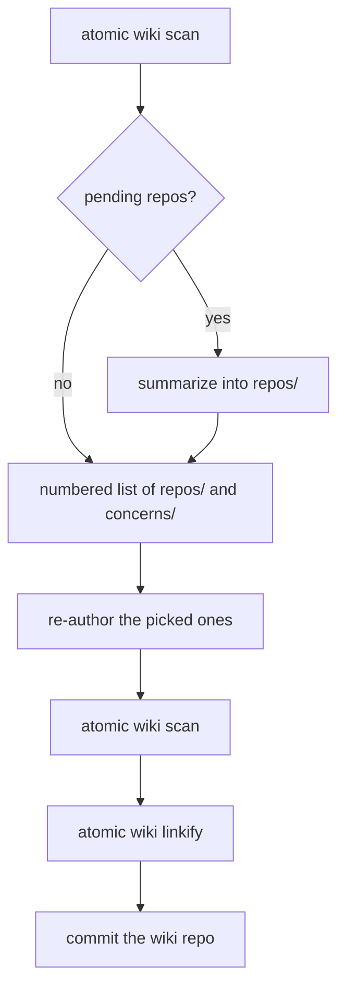

# Realm wiki

A wiki is a generated knowledge graph for a tree of code, and it comes at two scopes. This page is the **realm** scope: a folder of repositories, mapped into a `wiki/` beside them. The [repo wiki](/reference/repo-wiki) is the other scope, one level down, mapping a single repository into its own `docs/wiki/`. Same command, same inferrer; `/refresh-wiki` reads a `<wiki-type>` marker to tell which one it is looking at.

You work out of a folder. Call it a realm: a client engagement, a team's set of services, an open-source org you contribute to. It accumulates two kinds of things. Repositories, some yours and some vendored. And the loose material that collects around real work: a ticket you are halfway through, an email thread with the one detail that explains a bug, a PDF someone sent you, the notes you took chasing a problem across three systems. You keep that loose material by hand, in a `research/` folder.

```
~/work/acme/                the realm
├─ CLAUDE.md           realm rules · ## Capture surfaces written by bucket add
├─ billing-api/        repo · has its own wiki → indexed
├─ gateway/            repo · has its own wiki → indexed
├─ vendor-sdk/         repo · no wiki → summarized
├─ legacy-cron/        repo · no wiki → offered for promotion on refresh
├─ research/           capture bucket · registered via `atomic wiki bucket add research`
│  ├─ index.md         lists the bucket's items
│  └─ seo-audit/       one item · scaffolded by `atomic wiki bucket doc research seo-audit`
│     ├─ index.md      lists the item's stages
│     └─ 01_raw/       collected source material, with its own index.md
├─ experiments/        code spikes and prototypes · user-maintained (not a bucket)
└─ wiki/               the map atomic compiles over it
   ├─ index.md         member registry + <wiki-buckets> block + your narrative
   ├─ repos/           summaries of the opt-in repos
   └─ concerns/        what cuts across them
```

Holding all of that in your head is what makes a context-switch expensive. A wiki removes that cost. It is a knowledge base for one realm, compiled by `/refresh-wiki`, so the next time the realm needs explaining, the work is already done. A repo wiki describes one repo; this one describes the realm above it. See [concepts](/reference/concepts#wikis) for the idea; this page is the mechanism.

Two layers fill a wiki, and they differ by who drives them.

**Atomic drives the repo layer.** `/refresh-wiki` walks the realm, finds the repositories, and documents them. A repo that already has its own wiki is documented in place; the realm references it and cites the path, never copying them. A repo without one is opt-in, the kind that needs a deeper dive: you pick which ones get promoted to their own wiki, and the rest Claude summarizes into `repos/` from a read-only pass that never writes back to the source. `concerns/` holds what cuts across them.

**You drive the capture layer through buckets.** Atomic never touches `research/` or any other user-maintained folder until you register it as a capture bucket. The realm `CLAUDE.md` lists each bucket folder, and every folder in a bucket has an `index.md` listing what it holds.

**You manage the realm from a `CLAUDE.md`.** Keep one at the realm root, holding your rules for the realm and a pointer to the wiki. Claude Code walks up the directory tree when it loads `CLAUDE.md`, and the walk crosses repo boundaries, so a realm-root file stays in context from anywhere inside the realm, including a session you start in a member repo. The realm level is where that earns its place: cross-cutting concerns, or a feature or bug you are tracing across several services, work that spans repos instead of sitting in one. Start there to organize `research/`, manage `experiments/`, or reason across the repos at once.

This draws the boundary. Atomic stays on the code side: it documents repos, keeps their wikis current, runs the plan-implement-ship lifecycle, and indexes the capture folders you register. The non-code work is yours to direct from the realm `CLAUDE.md`, and the wiki is the assistant layer for it, a Karpathy-style knowledge base you build with Claude instead of by hand.

Deterministic CLI verbs and one command do the work:

- **`atomic wiki scan [--root=<path>]`** — scaffolds the wiki, scans the root for member repos, classifies each, declares `scope = "realm"` in the root's `.claude/atomic.toml`, and registers the wiki globally. A marker file that names another scope or fails to parse is warned about and left unchanged. Deterministic, no model.
- **`atomic wiki init --scope repo|realm [--root=<path>]`** — writes the fixed-content `CLAUDE.md` scaffold for the given scope, and declares that root's identity: it writes `scope = "repo"` or `scope = "realm"` into `.claude/atomic.toml`, the same marker `atomic repo init` writes on the repo side. `atomic where`'s realm axis prefers this marker over the `<wikis>` registry below; `repoctx` prefers the repo marker over git detection. Idempotent; a root whose marker already names a different scope is left untouched and reported as a conflict.
- **`atomic wiki stale [--root=<path>]`** — a read-only membership check. Reports `DRIFT added`, `DRIFT removed`, and `DRIFT status` lines for repos that differ from the last scan. Exits `0` no drift, `1` drift, `2` error. See [Membership drift](#membership-drift).
- **`atomic wiki linkify --root=<path>`** — renders the path citations in summaries, concerns, and the index into file-relative markdown links. Deterministic, idempotent, no model.
- **`atomic wiki bucket add|list|doc|skill|index`** — manage capture buckets. `add` registers a folder and splices the `<wiki-buckets>` block; `list` prints each registered bucket's name and path. See [Capture buckets](#capture-buckets) below.
- **`/refresh-wiki [root]`** — the LLM pass. Runs the scan, writes summaries for repos without their own wiki, re-authors the existing summaries and concerns you pick from a numbered list, re-runs the scan, runs `atomic wiki linkify`, and commits the wiki repo.

The split is the same one the repo scope uses. The CLI does the deterministic work: walking the tree, classifying, registering, indexing buckets. The command does the judgment: summarizing repos and re-authoring the existing concerns that cut across them.

| Deterministic CLI | called by | LLM command |
|---|---|---|
| `atomic signals scan` | → | `/refresh-wiki` |
| `atomic wiki scan` | → | `/refresh-wiki` |


## Setting one up

From a folder that contains repositories:

```
/refresh-wiki
```

It runs `atomic wiki scan` — scaffolding `./wiki/` on the first run, re-scanning if it already exists — then drives the refresh. You can also run the scan directly to scaffold without the LLM pass:

```
atomic wiki scan                      # scaffold ./wiki from the current directory
atomic wiki scan --root ~/work/acme   # scaffold <path>/wiki
```

`--root` is a flag; the positional slot is reserved for the verb (`scan`, `stale`). With no flag, the root is the current directory.

The scan is idempotent. Re-running regenerates only the managed regions — the `<wiki-scan>` block and `<wiki-member-list>` section in `index.md`, plus the bucket listing regions — every summary, concern doc, and the narrative you or the LLM wrote is left untouched. It is init and refresh in one command, exactly like `/refresh-wiki`.

### Choosing which repos are members

By default the scan walks the whole realm root and makes every git repo it finds a member. To keep out a repo sitting in a capture bucket or a notes folder, list your repos, or the folders that hold them, under `[realm] repos` in the realm root's `.claude/atomic.toml`:

```toml
[realm]
repos = ["{billing-api,gateway,vendor-sdk,legacy-cron}", "experiments"]
```

The scan and `atomic wiki stale` then walk only those paths. Entries accept globs, and a bad entry warns on stderr without stopping the scan. See [`[realm] repos`](/reference/atomic-toml#realm-repos) for the matching rules and every warning.


## What a wiki looks like

```
<root>/wiki/
├── index.md      # managed <wiki-scan> + <wiki-buckets> blocks (CLI) + narrative (LLM)
├── README.md     # written by the scan
├── CLAUDE.md     # steering, written by the scan
├── repos/        # summaries — only for repos without their own wiki
│   ├── legacy-cron.md
│   └── vendor-sdk/<domain>.md   # large repos are split by domain
└── concerns/     # cross-cutting docs, one per concern
    └── shared-auth.md
```

The scan writes `index.md`, `README.md`, `CLAUDE.md`, and the empty `repos/` and `concerns/` folders. `/refresh-wiki` writes the summaries and re-authors existing concerns. You write a new concern by hand.

The wiki is its own git repository: `atomic wiki scan` runs `git init` for you. There is no in-file change log; the wiki's git history is the change log. `/refresh-wiki` ends by committing the wiki repo without asking.

**OKF-aligned frontmatter.** The producer writes typed frontmatter on concept pages so `atomic serve` (and any OKF consumer) can color and filter by type:

- `wiki/concerns/<name>.md` — gets `type: Concern` and `description: <one-line>` when written by `/refresh-wiki`.
- `wiki/repos/<name>.md` — no `type:` frontmatter. `atomic serve` colors them by path convention, so they render as `repo`-type nodes.
- `index.md` — no frontmatter; the managed-block writer owns its content.

Cross-links between concept pages use standard bundle-relative markdown links (`[text](/wiki/concerns/shared-auth.md)`), the OKF §5.1 recommended form. `atomic serve` resolves these as in-shell navigable routes. Relative links work too; bundle-relative links are shorter for cross-directory references and survive file moves within the bundle.

The wiki is a navigable markdown graph. The scan writes a managed `## Members` section into `index.md` in OKF §6 listing form, each entry as `- [Name](target) - description`, with a one-line description drawn from the member's own wiki or a brief summary. `atomic wiki linkify` then turns the inline path citations across summaries, concerns, and the index into relative links to the files they name. Open the realm in Obsidian or any markdown server and click through it. A rendered `[text](path)` link is a plain markdown link, not an `@`-reference.


## Repo states

`atomic wiki scan` classifies each member repo by whether it has `docs/wiki/index.md`, and records the result in the `<wiki-scan>` block:

| State | Meaning | Knowledge source |
|-------|---------|------------------|
| `indexed` | has its own wiki | the realm points at that in-repo wiki and cites the path — never copies it |
| `summarized` | no wiki | a summary at `wiki/repos/<repo>.md`, written by reading the repo without touching it |
| `pending` | no wiki, fresh scan | the refresh pass resolves it to `indexed` or `summarized` |

"No wiki" is a fork, not a defect. A repo you own can carry a committed wiki; an open-source dependency should not — the wiki summarizes it instead, never writing into it.

When the refresh pass meets a `pending` repo, it presents the repos without one as a numbered list and asks which to run `/refresh-wiki` on, promoting those to `indexed`. The rest are summarized into the wiki by `atomic-wiki-inferrer` in its wiki-output mode: it scans the repo with the substrate redirected outside it (`atomic signals scan --out`), infers, and writes the summary only into the wiki. The source repo is never modified.


## The registry

Each wiki registers its `index.md` path in a `<wikis>` block inside `~/.claude/CLAUDE.md`:

```
<wikis>
- /Users/you/work/acme/wiki/index.md
- /Users/you/oss/wiki/index.md
</wikis>
```

The block sits outside the `<atomic>` block, so `atomic claude update` preserves it. It is not `@`-referenced: `atomic where`, realm code intelligence, and cross-wiki links read it on demand, so it adds no context to a session. The scan writes the entry idempotently: no duplicates on re-run, and the `<atomic>` block is never touched.


## Membership drift

`atomic wiki stale` compares the members recorded in the `<wiki-scan>` block against a live walk of the realm and prints one line per difference:

```
DRIFT added new-service
DRIFT removed old-worker
DRIFT status legacy-cron pending→indexed
```

Paths are relative to the realm root. When [`[realm] repos`](/reference/atomic-toml#realm-repos) is set to a non-empty list, the walk covers only those paths, and a recorded repo outside them prints as `DRIFT removed <path>`, the same as a deleted one. It exits `0` when the recorded members match the disk, `1` when it prints a `DRIFT` line, and `2` on a hard error such as a missing `wiki/index.md`. It reads no frontmatter, hashes no files, and runs no git.

No hook or ship verb runs it; `atomic serve` shows its result as nav badges and on `/status`. Run it between scans to see whether repos were added, removed, or reclassified since the last one. The next `atomic wiki scan` records the new membership, so `stale` run right after a scan prints nothing. `/refresh-wiki` scans at the start and again after it writes summaries.


## Keeping summaries and concerns current

Nothing records whether a summary or concern still matches the repos it describes, and nothing nudges you to refresh. A realm wiki stays as you last wrote it until you run `/refresh-wiki` on the realm. The artifact pass of that run summarizes pending repos first, then re-authors only the existing artifacts you pick:



The diagram leaves out the run's two other prompts: the one-time bucket offer and the offer to run repo-scope `/refresh-wiki` on pending repos. It also leaves out the early stop when nothing is pending or offerable.

The selection prompt accepts indices (`1 3`), ranges (`1-3`), `all`, `none`, and `all except N`. An artifact you leave out of the selection is reported as `SKIPPED (not selected)` and stays byte-for-byte as it was.


## Upgrading an existing realm

A realm wiki created by an older atomic release may still hold `wiki/.dirty`, `wiki/.buckets/`, `wiki/knowledge/`, `reflects_*` frontmatter keys, and a `.dirty` line in `wiki/.gitignore`. Nothing reads them any more. Delete them by hand if you want them gone; leaving them changes nothing.

The next `atomic wiki scan` adds an `index.md` to every non-skipped folder of each registered bucket. Older buckets also list differently: a `<slug>.md` beside a `<slug>/` folder now lists as two entries, and an old `<slug>/CLAUDE.md` stub lists as an unindexed doc.


## Capture buckets

A capture bucket is a user-named folder at the realm root that holds loose material: research notes, raw email threads, ticket exports, PDFs, meeting notes. Registering it with `atomic wiki bucket add <name>` makes the wiki index it. The only files atomic writes there are `index.md` files. The `atomic-wiki` skill is the conversational front door: tell Claude you want a place for notes, research, or tickets and it runs `bucket add` for you.

```
atomic wiki bucket add research    # register ~/work/acme/research/
atomic wiki bucket list            # research<TAB>/Users/you/work/acme/research
```

`bucket add` creates the folder if it is missing, writes an `index.md` stub inside it unless one exists, adds a `<bucket>` entry to the `<wiki-buckets>` block in `wiki/index.md`, and writes a `## Capture surfaces` bullet naming `<bucket>/index.md` into the realm `CLAUDE.md`. It then adds a `<bucket-docs>` region to each folder's `index.md`, the bucket root included, creating the file when absent. Files other than `index.md` are not touched. Skipped folders, listed under the bucket index rules below, get no `index.md`. Registering a name that is already in the `<wiki-buckets>` block exits `1`. `bucket list` prints one `<name>\t<path>` line per registered bucket and exits `0`.

**Bucket names.** `atomic wiki bucket add <name>` rejects an empty or whitespace-only name, a name that starts with `-`, a name containing `/` or `\`, the names `.` and `..`, and the reserved name `wiki`. Any other name registers: hyphenated, underscored, digits, and mixed case all work.

**Help.** `-h`, `-help`, and `--help` work on every bucket sub-verb (`add`, `list`, `doc`, `skill`, `index`). Each prints usage and exits 0 without creating or modifying anything.

**Bucket index.** Each bucket has an `index.md` at its root describing what the bucket is for and what conventions its content follows. `atomic wiki bucket add` creates a stub; you fill it in, or let the `/refresh-wiki` bucket offer ask you on first use. Below your description, the index carries a code-generated `<bucket-docs>` listing of the bucket's direct children: its markdown files and its subfolders. Every subfolder that is not skipped gets its own `index.md` with the same kind of listing, created if absent. An agent reads the root index and descends one `index.md` at a time, loading only the layers it needs. The buckets get no model pass: the per-folder indexes are the only output the wiki derives from them.

| Listing rule | Behavior |
|--------------|----------|
| Entries | each `.md` file other than `index.md`, and each subfolder, linked as `<name>/index.md` |
| Order | by name; a name with a leading number sorts first by that number, so `9_x` comes before `10_x` |
| Not listed | non-markdown files, dot-prefixed files, OS junk such as `.DS_Store` |
| Skipped folders | `node_modules`, `dist`, `build`, `target`, `vendor`, `tmp`, `.worktrees`, `.git`, and any dot-prefixed folder: neither listed nor indexed |
| Unindexed | a file, or a subfolder's `index.md`, with no recognized frontmatter key lists under `### Unindexed` |
| `<slug>.md` beside `<slug>/` | two separate entries |
| Your text | everything outside the `<bucket-docs>` region survives a rebuild byte-for-byte; an unchanged index is not rewritten |


### Authoring bucket docs

A bucket item is a folder: `<bucket>/<slug>/index.md` describes it, and its work lives in numbered stage folders. `01_raw/` collects source material, and later stages you add, such as `02_findings/` or `10_publish/`, build on the one before. Raw material and research share one bucket this way; each item keeps its sources in its own `01_raw/`.

The index recognizes six frontmatter keys on each doc, including every `index.md`, all optional at index time:

| Key | Writer | Fallback if absent |
|-----|--------|---------------------|
| `title` | you | first H1 in the body, then the filename stem |
| `type` | you | (none) |
| `description` | you | first prose line of the body |
| `tags` | you | (none rendered) |
| `status` | you | (none) |
| `created` | code, at scaffold time | (none) |

A doc with no frontmatter at all still indexes, listed under an `### Unindexed` heading with a derived title and description rather than being rejected. Capture stays frictionless either way.

Three verbs manage this layer:

```
atomic wiki bucket doc research seo-audit    # scaffold research/seo-audit/index.md + 01_raw/index.md
atomic wiki bucket skill research            # scaffold a per-bucket authoring skill
atomic wiki bucket index [research]          # rebuild every folder's listing (scan already does this)
```

`atomic wiki bucket doc <bucket> <slug>` accepts a slug of `[a-z0-9-]+` and refuses a slug that names a skipped folder (`build`, `dist`, `target`, `tmp`, `vendor`), since the index would never list it. It also refuses if `<bucket>/<slug>` already exists as a file or folder. It writes `<slug>/index.md` (six-key frontmatter, `created` pre-stamped, a comment describing the stage layout) and `<slug>/01_raw/index.md`, prints the path of `<slug>/index.md`, then rebuilds the bucket's indexes. Add later stages as numbered folders by hand; the next rebuild indexes them.

`atomic wiki bucket skill <bucket>` writes `<realm-root>/.claude/skills/<bucket>-management/SKILL.md`, pre-filled with the bucket's purpose line and the frontmatter contract above, so the bucket's own authoring conventions travel with it as a skill Claude can pick up automatically in that realm. It is a no-op if the file already exists.

`atomic wiki bucket index [<bucket>]` walks every folder of the named bucket (or every registered bucket, when no name is given) and rebuilds the `<bucket-docs>` region in each folder's `index.md`, then the `<wiki-bucket-list>` region in `wiki/index.md`, which links each bucket's root `index.md`. It prints one `<name>: N indexed, M unindexed` line per bucket, counting entries across the bucket's whole tree. An `index.md` with an unpaired `<bucket-docs>` tag is reported and left alone; the walk continues with the rest. `atomic wiki scan` runs this rebuild as part of its own pass, so you rarely need to call `bucket index` directly.


## Relationship to the repo scope

The two scopes are the same Karpathy-inspired pattern at two scales, which is why they share a command, an inferrer, and a page shape. A [repo wiki](/reference/repo-wiki) compiles one repository's filesystem into a markdown model Claude reads every session. A realm wiki compiles a folder of them into a knowledge base one level up: pointing at the members that already have their own, summarizing the ones that do not, writing up what they share, and indexing the capture folders you register.

Neither replaces the other, and the realm never copies what a member already documents — it links and cites. That is also why an open-source dependency is summarized rather than promoted: the realm can describe a repo it must not write into.


## Federated code intelligence

A wiki realm can also carry a federated symbol graph. Running `atomic code index` at the realm root indexes each non-excluded member repo into a per-repo SQLite db under `<realm>/.atomic/<key>.db` — nothing is written into any member. Members whose status is `pending` or whose path is under `trash/` are seeded with `exclude = true` and skipped. Query verbs (`search`, `callers`, `callees`, `impact`, `explore`) then fan out across indexed members and group results under `[<key>]` headers. Use `--only`/`--exclude` to filter to specific members.

This is a complement to the wiki layer, not a replacement: the wiki provides prose summaries and cross-cutting concerns; the code-intel layer provides a queryable symbol graph. Both live at the realm root; neither touches member repos.

See [Code intelligence](/reference/code-intel#wiki-realm-federation) for the full contract: position-sensing, storage layout, fan-out output format, filtering, session-awareness block, and federation boundaries.
