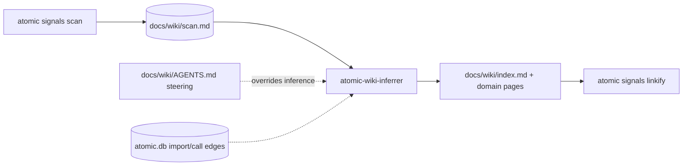

# Repo wiki

Use `/refresh-wiki` in a repository to update its `docs/wiki/` pages. For research, notes, or tickets shared across projects, use [realm capture buckets](/reference/realm-wiki).

A repo wiki is [context engineering](https://www.anthropic.com/engineering/effective-context-engineering-for-ai-agents) for one project: its working knowledge, kept as files the agent reads rather than facts you re-type each session. Instead of hallucinating build commands or inventing framework conventions, Claude reads two files that describe what is actually in the repo.

Run `/refresh-wiki` to generate or update them:

- **`docs/wiki/scan.md`** — machine-generated facts: directory tree, manifests, languages, lockfile presence.
- **`docs/wiki/index.md`** — inferred meaning: framework, build/test/lint commands, architectural style, domain index. Written by the `atomic-wiki-inferrer` agent.

Both are committed, but only `index.md` auto-loads into sessions via an `@`-ref. `scan.md` can run to thousands of lines on a large repo, so the inferrer reads it on demand instead.

`index.md` and the domain pages carry no count of things in the repo. They record structure, contracts, and coupling; counts of the current tree stay in `scan.md`, so the authored pages do not churn and parallel branches do not collide on them.


## The pipeline

Deterministic code writes the facts, the model writes the meaning, and code links the result. Steering overrides the model's inference, never the scan:



Use `docs/wiki/CLAUDE.md` to steer inference when the repo needs it.

The writer also receives the domain's `docs/design/` files and redraws every current-architecture diagram in them against source into the domain page, dropping one whose nodes no longer resolve and reporting it as a concern.

`/refresh-wiki` refreshes repo pages on request. Implementation also updates affected pages when its scan and task diff show that source changed.

::: tip The CLI verb is still called `signals`
`atomic signals scan|show|stale|diff|linkify` is the deterministic half of this pipeline, and it writes `docs/wiki/scan.md`. The verb keeps its original name from before repo-scope context and the cross-repo wiki were unified into one concept. `/refresh-wiki` calls it for you; you rarely invoke it directly.
:::

The inferrer writes backtick paths from the repo root. `atomic signals linkify` turns paths that match their exact spelling on disk into links relative to the Markdown file. Missing paths and spelling mismatches stay plain code. Re-running preserves existing links, so remove any wrong-case link from an earlier run by hand.

Implementation scans into a separate directory. It replaces `docs/wiki/scan.md` only after the required documentation passes review, so a blocked update does not erase the drift.

Open `docs/wiki/` in Obsidian, a Markdown server, or `atomic serve` to follow links from the router to domain pages and source files. A Markdown link stays inert until something reads it; `linkify` does not generate `@`-references.


## Pointer rules

`/refresh-wiki` also writes one path-scoped rule file per domain to `<state-root>/rules/wiki/<domain>.md`, which is `.atomic/rules/wiki/` under the default state root ([resolution order](/reference/concepts#state-root-resolution-order)). Claude Code reads the cards through the committed `.claude/rules/atomic -> ../../.atomic/rules` link. The harness's own `paths:` frontmatter injects a card into context the moment a session touches a file in that domain, so the domain's wiki page reaches the session without loading any wiki content by default.

```markdown
---
# generated by /refresh-wiki — do not hand-edit; regenerated every refresh
paths:
  - "atomic/internal/signals/**"
  - "context/agents/atomic-wiki-inferrer.md"
---

Domain: signals. Scan, infer, and wire the project context Claude loads each session.

Map:
  - docs/wiki/signals.md
Contracts:
  - docs/spec/signals-refresh-timing.md
  - docs/spec/signals-workflow.md
References:
  - docs/reference/repo-wiki.md

Consult the map before changing behavior here. Behavior changes stale the pages above. Renames or removals stale mentions beyond them: grep the old name across docs/ before shipping.
```

- **Frontmatter** — `paths:` globs, derived only from that domain's own source paths (never from a page's `## Where it lives` table), and a generated-marker YAML comment. The marker sits in frontmatter, not the body, because the harness strips frontmatter from injection and the body re-injects on every matching read.
- **Body** — the router's one-line domain description, then a typed pointer index: `Map:` (exactly one link, to the domain's wiki page), plus whichever of `Contracts:`, `References:`, `Guides:`, `Research:`, `Designs:`, `Related:` have a link, each checked to exist on disk and sorted by path. A fixed closing line ends every card verbatim, and the body caps at twelve links so an unchanged domain regenerates byte-identical.
- **One entry per line** — every collection is a label with its entries nested beneath it, in the frontmatter and the body alike, so adding one glob or one doc is a one-line diff. A card is rewritten whenever its domain is re-dispatched, which makes its diff the thing people actually read; a flow-style array rewraps and reports the whole line as changed.

The [output reference](../../context/skills/atomic-wiki/references/repo-output.md) defines pointer card formats. The [refresh workflow](../../context/skills/atomic-wiki/references/repo.md) defines which cards are published.

**Where they live.** `<state-root>/rules/wiki/<domain>.md`. Resolve the state root with `atomic where --json`; older CLI versions use `.claude`. After publishing cards, `atomic wiki init --scope repo` projects them to enrolled harnesses on CLI versions that support projections. Edit source or wiki pages instead of the generated cards.

**When they regenerate.** Every `/refresh-wiki` run. A repo whose wiki predates pointer cards gets a bootstrap run instead: cards for every domain, regardless of scope, once each domain has a partition-derived `<source_paths>` block to build globs from. After that first set exists, a full run rewrites every domain's card; an incremental run rewrites only the cards of the domains it re-dispatched, since only those had their source paths recomputed. Either way, a card whose domain no longer exists in the router table is deleted.

In Claude Code, use the card delivered for a matching file and open the wiki page it names. In a harness that does not inject repo cards, read the wiki index and matching page explicitly. Give delegated agents the same pointers.

Manual refresh reports which cards changed. Implementation maintenance checks affected cards when paths or ownership change.

**Ignore rules.** The workflow checks whether Git ignores the canonical cards. If a repo-local rule hides cards stored in the repo, it adds negations for the card directory and its contents. Keep repo-owned projection links; leave generated OMP copies for external state roots out of commits.

::: tip Doctor validation is deferred
Cards are fully pipeline-owned, so today the only guarantee of correctness is "was regenerated recently." A doctor check that validates card/domain parity between refreshes is tracked as a follow-up.
:::


## Steering the inferrer

The inferrer makes its best guess from the scan, but it can get things wrong — especially with monorepos, polyglot projects, or unconventional naming.

Edit `docs/wiki/AGENTS.md` in shared steering modes or `docs/wiki/CLAUDE.md` in Claude-only mode. `/refresh-wiki` reads the active file before inferring domains. The root instructions reference the wiki index, not the inference steering file.


### When to use steering

- The inferrer detected the wrong framework
- You have git submodules and want the inferrer to treat the repo as one project
- Two directories are one logical domain but got split
- A directory looks like a domain but is generated code or vendored
- The inferrer guessed the wrong build or test command
- You want to exclude paths from domain classification


### Format

Plain markdown. No required structure — the inferrer reads it as natural language. Headings help organize:

```markdown
# Signals steering

## Framework
This is a NestJS monorepo managed by Turborepo.

## Project structure
This repo uses git submodules. Treat the root as one project.
Do not recurse into submodules or create domains for them.

## Domains
- src/billing/ and src/payments/ are one domain ("payments")
- src/internal-tools/ is scratch code, not a real domain
- packages/ contains shared libraries — one domain, not one per package

## Build
- Build: pnpm turbo build
- Test: pnpm test:ci (not pnpm test — that starts watch mode)
- Lint: pnpm lint

## Ignore for domains
- vendor/
- .git/modules/
```


### How it works

The steering file is the dotted input in the pipeline above. Two rules govern it: steering beats inference — if steering says "this is NestJS", the inferrer writes NestJS regardless of what `package.json` implies — and changes take effect on the next `/refresh-wiki`, with no registration step.


### Bootstrap

`/setup-wiki` scaffolds the active steering file when it does not exist. Uncomment and edit the sections you need.

The file is committed along with the rest of `docs/wiki/`.


## Excluding files from the scan

A separate mechanism from steering. The `[scan]` table in `<state-root>/atomic.toml` (`.atomic/atomic.toml` by default) controls which files the deterministic scan sees.

The scan already starts from tracked files plus untracked files not covered by `.gitignore`, so anything gitignored is excluded before this runs. `[scan]` is for *committed* paths you still want dropped or flagged. Two lists, because there are two different outcomes:

| Key | What happens | Use for |
|-----|--------------|---------|
| `ignore` | fully excluded — the path never appears in the tree | vendored deps, checked-in fixtures, large data files |
| `generated` | stays in the tree, marked, and the inferrer skips its content | build output, protobuf output, lockfiles |

```toml
[scan]
ignore = ["fixtures/large-dataset.json", "third_party/**"]
generated = ["*.pb.go", "generated/**"]
```

A pattern containing a slash matches the full repo-relative path; one without matches the basename at any depth, so a bare `gen.go` matches wherever it sits. `**` crosses directories, which is why `third_party/**` covers the whole subtree. Same rules as `[code] ignore` — see [`.atomic/atomic.toml`](/reference/atomic-toml).

::: tip Replaces `.signalsignore`
This used to be a repo-root `.signalsignore` file, one glob per line, with `+` marking a generated path. `atomic update` converts an existing file into `[scan]` and deletes it, and `atomic migrate --repo <path>` does the same on demand. A repo that has not migrated still reads the old file, so nothing breaks in the meantime. Being TOML rather than a bespoke format also means `**` now works, where the old parser needed one pattern per directory level.
:::

**Use `[scan]`** when a committed path should be excluded from the scan or flagged as generated.

**Use the wiki steering file** to tell the inferrer something it cannot derive from the scan.
